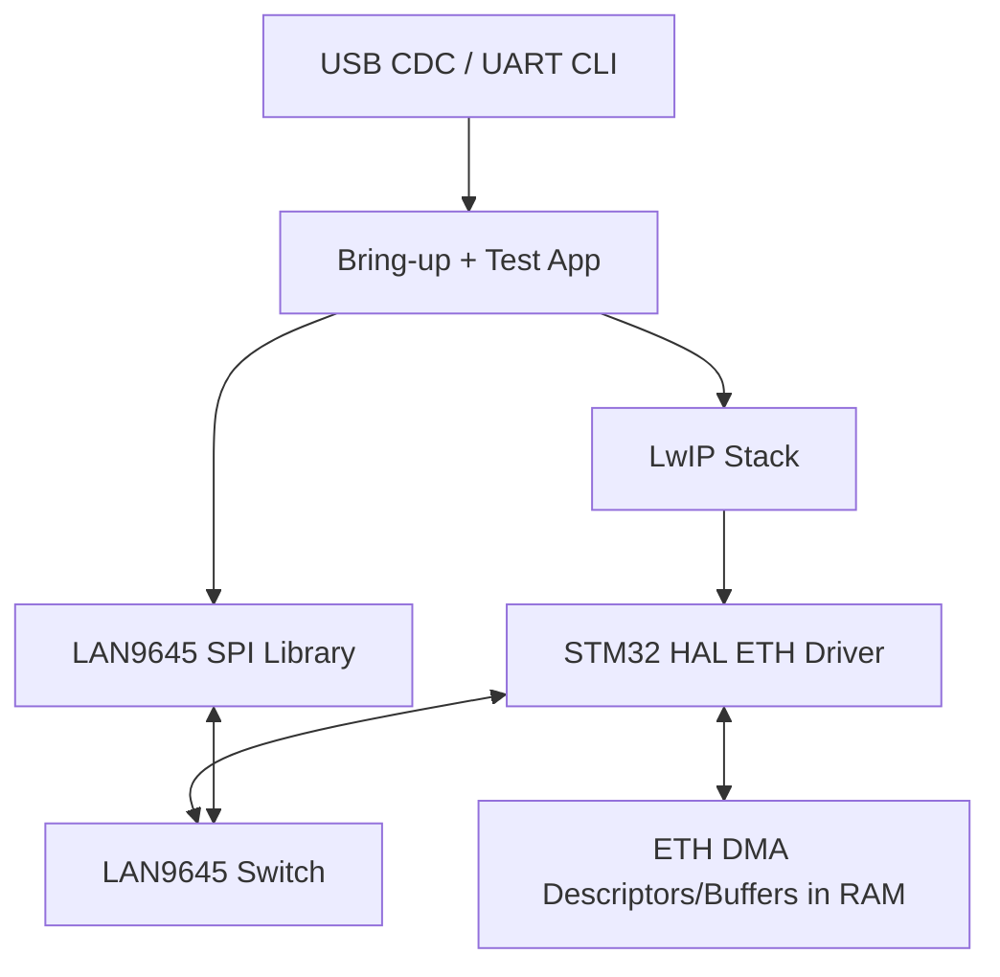

# LAN9645 + STM32 Firmware Direction (HAL ETH + LwIP)

## Decision (Locked)
For this project, firmware will use:
- `STM32Cube HAL ETH` for STM32 MAC + DMA driver
- `LwIP` for IPv4/ARP/ICMP (ping) and later TCP/UDP
- custom `LAN9645 managed library` over SPI for switch/PHY/SerDes control

`Mongoose` is not required for initial bring-up and ping validation.

---

## 1) Firmware Architecture

Responsibilities:
- `LAN9645 SPI library`: reset, straps policy checks, RMII/port config, link/status/counters.
- `HAL ETH`: moves Ethernet frames between STM32 RAM and RMII.
- `LwIP`: handles IP stack and ping replies.

---

## 2) Critical Integration Links (must exist)

These links are required so frames written in RAM are consumed by the correct library path.

1. `LwIP -> HAL ETH (TX path)`
- `netif->linkoutput` must call the HAL ETH transmit path.
- TX pbuf payload must be passed to ETH DMA safely (cache-safe / aligned policy).

2. `HAL ETH -> LwIP (RX path)`
- RX complete event must move received frames into LwIP input path.
- Driver must pass received frame to `netif->input` (`tcpip_input` in threaded mode).

3. `LAN9645 SPI library -> app init flow`
- LAN switch config must complete before enabling full ping tests.
- RMII path (`DEV8`) must be up before expecting LwIP ping success.

4. `IRQ/Status -> CLI`
- LAN IRQ0 + software health checks must feed CLI status/error output.

---

## 3) RAM/Linker Requirements for Ethernet Frames (very important)

To ensure ETH DMA and LwIP both see correct frame data:

1. Place ETH DMA descriptors in DMA-accessible RAM section.
2. Place ETH RX/TX frame buffers in DMA-accessible RAM section.
3. Add dedicated linker sections for descriptors and buffers.
4. Apply cache policy:
- either non-cacheable MPU region for ETH buffers, or
- explicit D-Cache clean/invalidate on TX/RX buffer ownership changes.

Recommended STM32H743 strategy:
- Use D2 SRAM region for ETH descriptors/buffers.
- Keep descriptor/buffer alignment suitable for DMA/cache line rules.

Typical linker section intent:
- `.eth_rx_desc`
- `.eth_tx_desc`
- `.eth_rx_buf`
- `.eth_tx_buf`

If linker/MPU/cache policy is wrong, you will see random ping failures, corrupt frames, or RX/TX stalls.

---

## 4) Bring-Up Sequence (No Code Yet)

1. Power-on checks
- verify hardware strap assumptions (`SD_125M=1`, `SGPIO_EN=0`)
- verify 125 MHz SerDes reference present

2. LAN9645 managed init (SPI)
- reset/release
- SI interface config
- RMII1 + active port config
- enable required ports only

3. STM32 ETH + LwIP init
- initialize HAL ETH
- initialize LwIP netif and IP config
- link netif callbacks to ETH driver

4. Operational checks
- confirm RMII link up (`DEV8`)
- confirm CuPHY0/CuPHY1 and SerDes links as required
- run ping matrix tests

---

## 5) Ping Test Scope

Initial goal:
- STM32 replies to ICMP ping through switched path.

Test matrix:
- Copper port 0 -> ping STM32 IP
- Copper port 1 -> ping STM32 IP
- SFP/SGMII port 0 -> ping STM32 IP
- SFP/SGMII port 1 -> ping STM32 IP

Log for each test:
- link state, speed, duplex
- ping success/loss
- LAN counters (RX/TX/drop/error)

---

## 6) CLI Minimum for Bring-Up

Required commands:
- `status all`
- `diag spi`
- `diag rmii`
- `link show`
- `stats show <dev>`
- `ping <ip> [count]`

CLI should report:
- current link map (DEV0/1/5/6/8)
- last SPI/IRQ/LINK error
- strap expectation result
- counter summary

---

## 7) Delivery Plan

Phase A:
- stable SPI register access + LAN9645 profile init

Phase B:
- HAL ETH + LwIP frame path validated (single port ping)

Phase C:
- all target ports ping matrix + CLI diagnostics

Phase D:
- add advanced controls (VLAN/QoS/ACL) to LAN library

