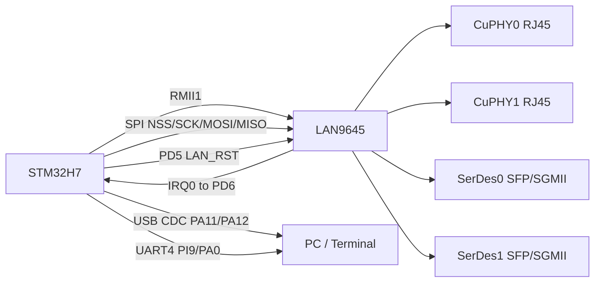
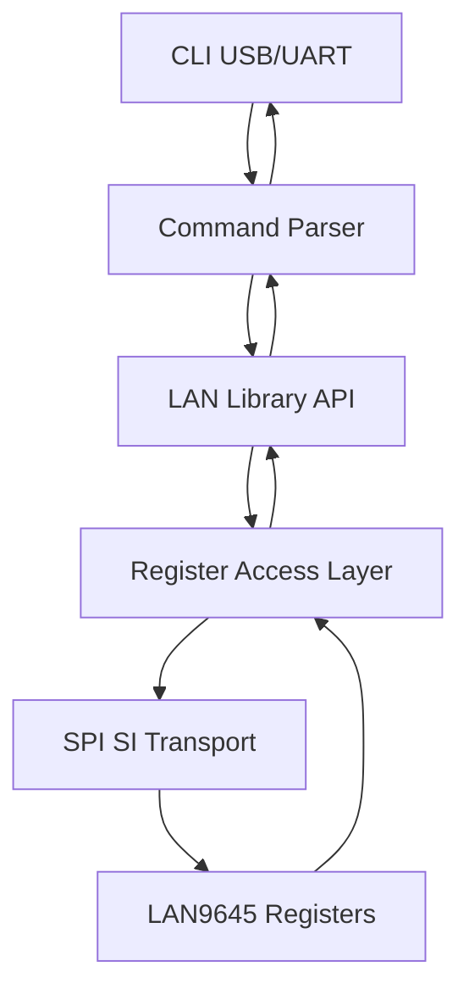
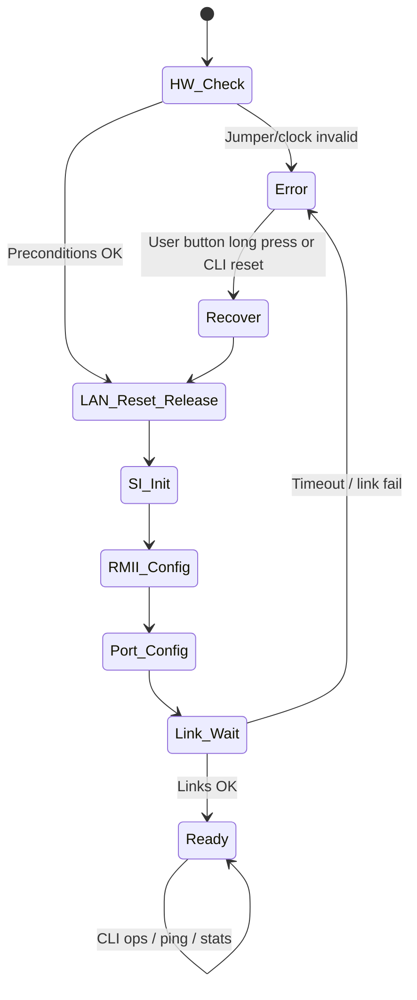

# LAN9645 <-> STM32 Physical Communication and CLI Control Plan

## Scope
This document defines the physical communication interfaces, runtime control surface, and CLI status/error workflow for your managed LAN9645 design.

Target profile:
- LAN9645 managed mode (SPI host control from STM32)
- RMII1 between LAN9645 and STM32 ETH MAC
- CuPHY0 and CuPHY1 used
- SerDes0 and SerDes1 used
- External strap/jumper selects `SD_125M` and `SGPIO_EN`

---

## 1) Physical Interface Map (STM32 side)

### 1.1 Control and data interfaces
| Interface | STM32 pin(s) | Direction | Notes |
|---|---|---|---|
| ETH RMII | `ETH_RXD0`, `ETH_RXD1`, `ETH_CRS_DV`, `ETH_TX_EN`, `ETH_TXD0`, `ETH_TXD1`, `ETH_REF_CLK` | bidirectional | RMII1 link to LAN9645 |
| SPI NSS | `PA4` | out | to LAN `SI_nCS` (pin 98) |
| SPI SCK | `PA5` | out | to LAN `SI_CLK` (pin 97) |
| SPI MOSI | `PD7` | out | to LAN `SI_DI` (pin 100) |
| SPI MISO | (not listed yet) | in | must be wired from LAN `SI_DO` (pin 99) for register reads |
| LAN reset | `PD5` | out | to LAN `nRESET` (pin 101), active low |
| LAN interrupt | `PD6` | in | from LAN `IRQ0` (GPIO_33 alt, pin 60) |

### 1.2 Debug/user interface
| Function | STM32 pin | Polarity |
|---|---|---|
| HEART LED | `PG6` | active high |
| STATUS LED | `PG7` | active high |
| ERR LED | `PG8` | active high |
| USER button | `PI10` | active low |
| UART4 RX | `PI9` | serial debug in |
| UART4 TX | `PA0` | serial debug out |
| USB FS | `PA11`, `PA12` | target: USB CDC (virtual COM port) |

### 1.3 Hardware strap/jumper controls (not MCU runtime-controlled)
| Strap | LAN pin | Required state | Controlled by |
|---|---:|---|---|
| `SD_125M` | pin 71 | HIGH | external jumper/strap |
| `SGPIO_EN` | pin 72 | LOW | external jumper/strap |

Important:
- Firmware must treat these as fixed hardware preconditions.
- If jumper state is wrong, firmware should report error and stop LAN bring-up.

---

## 2) What Is Controllable in Software (from this configuration)

You have software control of all LAN9645 managed registers through SPI SI client mode.
Control domains exposed to STM32:

1. SI interface behavior
- `DEVCPU_GCB::IF_CTRL`
- `DEVCPU_GCB::IF_CFGSTAT`

2. Interface mux + RMII enable path
- `HSIO::HW_CFG.QSGMII_ENA`
- `HSIO::HW_CFG.RGMII_1_CFG`
- `RMII_ENA`, `RGMII_ENA`, `GMII_ENA`
- `REF_CLK_SEL`
- `RMII_RX_RST`, `RMII_TX_RST`

3. Port module and MAC control
- `CLOCK_CFG` resets and link-speed setting
- `MAC_MODE_CFG`, `MAC_ENA_CFG`, `MAC_IFG_CFG`

4. CuPHY policy (port0/port1)
- autoneg/advertisement/speed-duplex policy via managed PHY control path

5. SerDes/SGMII controls (DEV5/DEV6)
- mode, enable, reset sequencing, link status

6. LEDs/GPIO mux after boot
- set GPIO40/41/42/43 to PHY LED function

7. Interrupt flow
- link/alarm interrupt source enables
- status read/clear
- IRQ0 line handling

8. Statistics and diagnostics
- per-port RX/TX/drop counters using `SYS:STAT:CNT`
- view/clear controls (`STAT_CFG`)

9. VLAN/QoS/ACL features (phase 2/3)
- VLAN behavior, QoS mapping, classifier/VCAP policies

### 2.1 Runtime-control matrix (explicit)
| Domain | Runtime controllable by STM32? | How |
|---|---|---|
| `SD_125M` strap | No | external jumper only, sampled at reset |
| `SGPIO_EN` strap | No | external jumper only, sampled at reset |
| LAN reset (`nRESET`) | Yes | STM32 `PD5` output |
| LAN interrupt input (`IRQ0`) | Yes (monitor/ack) | STM32 `PD6` EXTI + LAN interrupt clear registers |
| SPI SI bus format/padding | Yes | `DEVCPU_GCB::IF_CTRL`, `DEVCPU_GCB::IF_CFGSTAT` |
| RMII path enable and mux | Yes | `HSIO::HW_CFG` family + RMII enable/reset fields |
| Port admin up/down | Yes | per-port `MAC_ENA_CFG` / reset controls |
| Port speed/duplex policy | Yes | MAC/PHY managed registers |
| CuPHY AN and advertisement | Yes | MIIM/PHY managed access |
| SerDes/SGMII mode | Yes | SerDes/PCS managed registers |
| PHY LEDs mode/mux | Yes (after boot) | GPIO mux to `PHYx_LEDx` |
| VLAN/QoS/ACL | Yes | ANA/QSYS/VCAP managed blocks |
| STM32 HEART/STATUS/ERR LEDs | Yes | STM32 GPIO (`PG6/PG7/PG8`) |
| STM32 user button | Yes (read) | STM32 GPIO input (`PI10`, active low) |

---

## 3) Register Address Clarity (what we know now)

### 3.1 Addressing rule for SPI SI transactions
- `SI_ADDR = (REG_ADDR & 0x01FFFFFF) >> 2`

### 3.2 Known numeric sub-addresses from documentation
These are table-index style addresses available directly in datasheet:

- Statistics counter short addresses (examples):
  - RX `c_rx_oct = 0x00`
  - RX `c_rx_uc = 0x01`
  - TX `c_tx_oct = 0x80`
  - TX `c_tx_uc = 0x81`
  - DROP `c_dr_local = 0x100`
- MIIM client register addresses:
  - `ADDR_REG0 = 0`
  - `ADDR_REG1 = 1`
  - `DATA_REG0 = 2`
  - `DATA_REG1 = 3`
  - `DATA_REG1_INCR = 4`
  - `DATA_REG1_INERT = 5`
  - `STAT_REG = 6`

### 3.3 Absolute register addresses
For many symbolic registers (for example `HSIO::HW_CFG`, `DEVCPU_GCB::IF_CTRL`, `CLOCK_CFG`), this datasheet content is symbolic.

Action required for implementation:
- import Microchip CSR/register definition source and generate `lan9645_regs.h` with absolute addresses and bit masks.

---

## 4) Error and Health Signals to Catch (and show to user)

### 4.1 SPI/SI communication errors
1. SI read timing violation:
- symptom: read returns `0x88888888`
- indicator: `IF_CFGSTAT.IF_STAT` set
- action:
  - increase SI padding (`IF_CFGSTAT.IF_CFG`) and/or slow SPI clock
  - clear status bit and retry

2. SPI bus-level failures:
- timeout / no response / invalid repeated values
- action:
  - retry with backoff
  - if persistent: pulse `LAN_RST` and re-run init

### 4.2 Boot/strap mismatch errors
- runtime check (early startup): verify expected behavior consistent with strap profile
- if mismatch suspected (`SD_125M`/`SGPIO_EN` wrong), set ERR LED and print explicit message

### 4.3 Link and port-state errors
- RMII1 link down (DEV8)
- CuPHY0 or CuPHY1 link down
- SerDes0/SerDes1 link down
- speed/duplex mismatch between LAN and STM32

### 4.4 Interrupt path errors
- IRQ0 asserted but no clearable source found
- sticky interrupt bits not cleared
- action: dump interrupt status registers and enter degraded mode

### 4.5 Counter-based fault detection
- no RX/TX increment over test interval
- rising drop counters (`c_dr_*`) during ping test
- excessive CRC/error counters

### 4.6 User-visible error IDs (for CLI + ERR LED)
| ID | Condition | LED code | CLI message template |
|---|---|---:|---|
| `E_SPI_IFSTAT` | `IF_CFGSTAT.IF_STAT=1` / read timing issue | 1 blink | `SPI timing error: IF_STAT=1, adjust IF_CFG or SPI clock` |
| `E_SPI_TIMEOUT` | SPI transaction timeout / no valid response | 1 blink | `SPI timeout: verify SI_nCS/SI_CLK/SI_DI/SI_DO wiring` |
| `E_STRAP_CFG` | strap/jumper precondition fail | 2 blinks | `Strap mismatch: require SD_125M=1 and SGPIO_EN=0` |
| `E_RMII_LINK` | RMII1 (DEV8) link not established | 3 blinks | `RMII link down on DEV8` |
| `E_SERDES0_LINK` | SerDes0 link fail | 4 blinks | `SerDes0 link timeout/fail` |
| `E_SERDES1_LINK` | SerDes1 link fail | 4 blinks | `SerDes1 link timeout/fail` |
| `E_IRQ_STUCK` | IRQ0 asserted with no clearable source | 5 blinks | `IRQ path error: source/clear mismatch` |
| `E_DROP_RATE` | drop counters increase over threshold | steady ERR | `Traffic drop warning: inspect queue/policy/MTU` |

---

## 5) LED/User-Button Behavior Policy

### 5.1 LEDs (all active high)
- HEART (`PG6`): 1 Hz blink while firmware alive
- STATUS (`PG7`): ON when LAN config complete and RMII link up
- ERR (`PG8`): ON steady on fatal error, blink code on recoverable errors

Suggested error blink codes on `ERR` LED:
- 1 blink: SPI/SI comm error
- 2 blinks: strap/jumper mismatch
- 3 blinks: RMII link failure
- 4 blinks: SerDes link failure
- 5 blinks: interrupt handling failure

### 5.2 User button (`PI10`, active low)
- short press: print full status snapshot to CLI
- long press (>=3 s): reinitialize LAN9645 without rebooting STM32

---

## 6) CLI Transport Plan (USB CDC preferred)

Primary CLI transport:
- USB device CDC ACM over `PA11/PA12` (virtual COM port)

Fallback transport:
- UART4 (`PI9`/`PA0`)

Recommended startup behavior:
- initialize USB CDC first
- if CDC unavailable, auto-fallback to UART4
- expose same CLI command set on both channels

---

## 7) CLI Command Set (first version)

### 7.1 Device/core
- `help`
- `version`
- `uptime`
- `reset lan`
- `status all`
- `status brief`
- `status errors`

### 7.2 Register access
- `reg read <addr>`
- `reg write <addr> <value>`
- `reg rmw <addr> <mask> <value>`

### 7.3 Interface and link
- `link show`
- `rmii show`
- `rmii reinit`
- `port up <dev>`
- `port down <dev>`
- `port speed <dev> <10|100|1000>`

### 7.4 PHY/SerDes
- `phy show <0|1>`
- `phy set <0|1> adv <10hd,10fd,100hd,100fd,1000fd>`
- `serdes show <0|1>`
- `serdes mode <0|1> <sgmii|1000basex>`

### 7.5 Statistics and diagnostics
- `stats show <dev>`
- `stats clear <dev>`
- `diag spi`
- `diag irq`
- `diag straps`
- `diag rmii`
- `diag serdes`

### 7.6 Ping support
- `net show`
- `net ip <a.b.c.d> <mask> <gw>`
- `ping <ip> [count]`

### 7.7 Expected `status all` output fields
- board info and firmware build
- strap precondition result (`SD_125M`, `SGPIO_EN`)
- SI status (`IF_CFG`, `IF_STAT`, SPI clock setting)
- RMII state (`RGMII_1_CFG`, `RMII_ENA`, `REF_CLK_SEL`)
- per-port link (`DEV0`, `DEV1`, `DEV5`, `DEV6`, `DEV8`)
- last error ID + counter + timestamp
- drop/error counter summary per active port

---

## 8) Mermaid Implementation Diagrams

### 8.1 Hardware communication map

### 8.2 Software stack and control flow

### 8.3 Startup and fault handling state machine

---

## 9) Implementation Notes for User Clarity
- `SD_125M` / `SGPIO_EN` are hardware-jumper decisions, not runtime toggles.
- SPI read path requires MISO wiring from LAN pin 99 (`SI_DO`) to STM32 SPI MISO pin.
- LEDs are active high; button is active low as encoded in firmware logic.
- USB CDC gives the best CLI experience for direct serial terminal output.
- Keep all register absolute addresses centralized in generated `lan9645_regs.h`.

