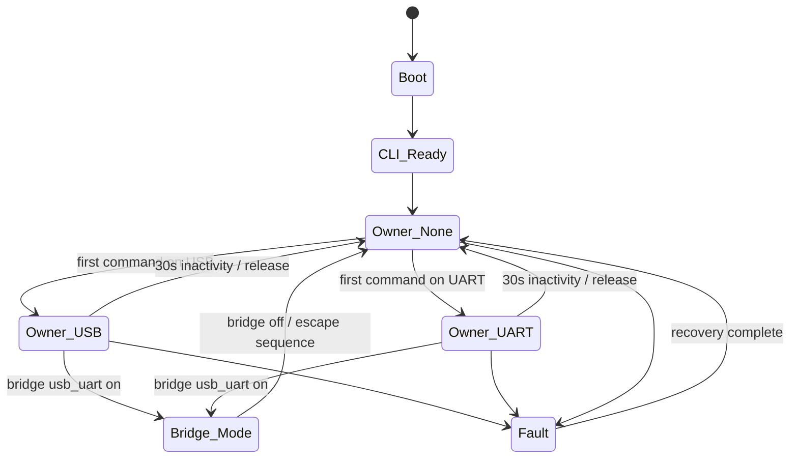
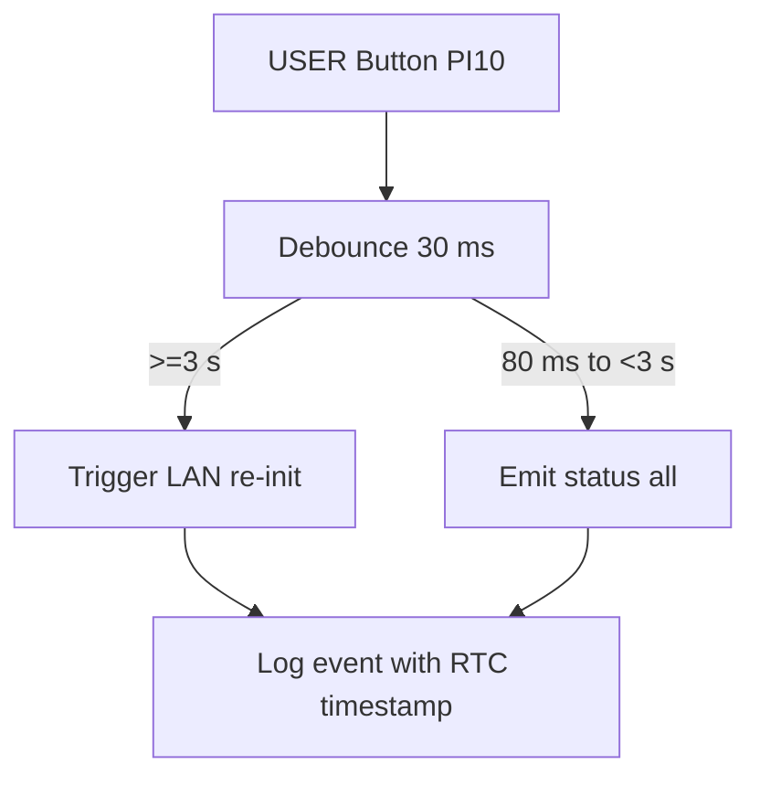

# STM32 Runtime IO and CLI Logic Specification (No Code)

## Scope
This document locks the runtime logic for:
- USB CDC COM port
- UART4 debug port
- RTC time source for logs
- HEART/STATUS/ERR LEDs
- USER button

This is a strict implementation contract for firmware preparation before coding.

---

## 1) Fixed Hardware Mapping (Locked)

| Function | STM32 Pin | Polarity/Role |
|---|---|---|
| USB CDC | `PA11/PA12` | primary CLI transport |
| UART4 TX/RX | `PA0` / `PI9` | secondary CLI transport |
| HEART LED | `PG6` | active high |
| STATUS LED | `PG7` | active high |
| ERR LED | `PG8` | active high |
| USER button | `PI10` | active low |
| LAN reset | `PD5` | output, active low |
| LAN IRQ0 | `PD6` | input interrupt |

---

## 2) Runtime Modules (Mandatory)

1. `transport_manager`
- owns USB CDC and UART4 RX/TX endpoints
- manages active CLI channel ownership

2. `cli_core`
- command parsing and execution dispatch
- command response formatting

3. `io_router`
- routes logs/responses to transport(s)
- handles USB<->UART bridge mode

4. `event_logger`
- generates timestamped events
- keeps last error/event counters

5. `ui_manager`
- controls HEART/STATUS/ERR LEDs
- handles USER button press timing/debounce

6. `rtc_service`
- provides wall-clock timestamp from RTC
- provides fallback uptime timestamp if RTC invalid

---

## 3) Boot-Time Runtime Logic (Deterministic)

1. Initialize GPIO (LEDs OFF, button input).
2. Initialize RTC service.
3. Initialize USB CDC.
4. Initialize UART4.
5. Initialize CLI core and register commands.
6. Set transport policy:
- both USB and UART listeners enabled
- no owner initially
7. Start LAN bring-up sequence manager.
8. Set HEART LED periodic task active (1 Hz).

---

## 4) CLI Transport Ownership and Routing (Locked)

## 4.1 Channel ownership rule
- At runtime, there is exactly one `active_cli_owner` at a time:
  - `USB`
  - `UART4`
  - `NONE`
- First complete command line received when owner is `NONE` becomes owner.
- Owner timeout: 30 s of command inactivity -> owner returns to `NONE`.

## 4.2 Command response routing
- Command responses go only to current owner channel.
- Critical alarms/errors go to both USB and UART4.
- Periodic status summaries go to owner only.

## 4.3 Explicit redirect commands (mandatory)
- `console owner usb` -> force owner to USB
- `console owner uart` -> force owner to UART4
- `console owner release` -> owner = NONE

## 4.4 USB <-> UART traffic redirection mode
Purpose: forward traffic from USB side to UART side (and reverse) under CLI control.

Commands:
- `bridge usb_uart on`
- `bridge usb_uart off`
- `bridge status`

Behavior when `bridge usb_uart on`:
- raw bytes USB RX -> UART TX
- raw bytes UART RX -> USB TX
- CLI command parser disabled for bridged data stream
- escape sequence to exit bridge: `+++` followed by 1 second idle window

Behavior when `bridge usb_uart off`:
- normal CLI mode restored
- previous owner policy restored

---

## 5) RTC and Log Formatting Logic (Locked)

## 5.1 Timestamp source
- If RTC date/time valid: use RTC wall-clock.
- If RTC invalid/unset: use uptime timestamp format `T+<ms>`.

## 5.2 Log line format
- `[timestamp][level][module][event_id] message`

Examples:
- `[2026-04-04 14:32:10][INFO][CLI][I_BOOT] CLI ready on USB/UART`
- `[T+0012456][ERR][LAN][E_SPI_TIMEOUT] SPI transaction timeout`

## 5.3 Log levels
- `INFO`
- `WARN`
- `ERR`
- `DBG` (enabled only by CLI command)

---

## 6) LED Logic (Locked)

## 6.1 HEART LED (`PG6`)
- 1 Hz blink continuously after scheduler/main loop start.

## 6.2 STATUS LED (`PG7`)
- OFF during boot and LAN config.
- ON when:
  - LAN config sequence completed successfully, and
  - RMII/host link is operational.
- OFF again if LAN enters fault state or link is lost for >2 s.

## 6.3 ERR LED (`PG8`)
- OFF in healthy state.
- Blink codes for recoverable faults:
  - 1 blink: SPI/SI comm error
  - 2 blinks: strap mismatch
  - 3 blinks: RMII link failure
  - 4 blinks: SerDes link failure
  - 5 blinks: IRQ handling error
- Steady ON for fatal/non-recoverable halt.

---

## 7) USER Button Logic (Locked)

Button is active-low (`PI10`).

Debounce:
- 30 ms stable state required before event acceptance.

Press actions:
- Short press: `80 ms` to `<3 s`
  - print `status all` to active owner (or both if owner `NONE`)
- Long press: `>=3 s`
  - trigger LAN soft re-initialization sequence
  - emit event log with timestamp

No other button functions are allowed in phase 1.

---

## 8) Mandatory CLI Commands for IO/UI Control

- `help`
- `version`
- `status all`
- `status errors`
- `console owner usb`
- `console owner uart`
- `console owner release`
- `bridge usb_uart on`
- `bridge usb_uart off`
- `bridge status`
- `log level <info|warn|err|dbg>`
- `time show`

---

## 9) Runtime State Model (Mermaid)

---

## 10) Acceptance Criteria (Before Firmware Coding Starts)

1. Team agrees the owner-routing model above is final.
2. Team agrees bridge mode behavior and escape sequence are final.
3. LED and button behavior is frozen for phase 1.
4. RTC log timestamp format is frozen.
5. This document is used as the reference for implementation tickets.

