# LAN9645 Library Implementation Plan (STM32H743 + USER_PHY + LwIP)

## Purpose
This document is the implementation planning reference for building the firmware library cleanly from the current generated project.

It is aligned with:
- `LAN9645_user_phy_driver_spec.md`
- `LAN9645_managed_control_library_spec.md`
- generated Cube files in `firmware/`

Locked targets for phase 1:
- managed LAN9645 control through SPI
- STM32 RMII MAC + LwIP ping bring-up
- copper advertisement only `10/100` (no 1000)
- deterministic CLI-visible fault handling

---

## 1) Final File Architecture to Implement

```mermaid
flowchart TD
    A[firmware/] --> B[Core integration]
    A --> C[lan9645 library]
    A --> D[LwIP adapter glue]
    A --> E[CLI/status layer]

    C --> C1[src/lan9645_spi.c]
    C --> C2[src/lan9645_reg.c]
    C --> C3[src/lan9645_core.c]
    C --> C4[src/lan9645_port.c]
    C --> C5[src/lan9645_phy.c]
    C --> C6[src/lan9645_irq.c]
    C --> C7[src/lan9645_stats.c]
    C --> C8[src/lan9645_profile_managed_rmii1.c]
    C --> C9[src/lan9645_user_phy_adapter.c]
    C --> C10[inc/lan9645/*.h]

    D --> D1[LWIP/Target/ethernetif.c]
    D --> D2[LWIP/Target/eth_custom_phy_interface.c]
    D --> D3[LWIP/App/lwip.c]

    B --> B1[Core/Src/main.c]
    B --> B2[Core/Src/stm32h7xx_hal_msp.c]
    B --> B3[STM32H743BITX_FLASH.ld]
```

---

## 2) Dependency Order (No Optional Path)

---

## 3) Step-by-Step Implementation Plan

## Step 1 - Transport and Register Foundation
Implement first:
- `lan9645_spi.c`
- `lan9645_reg.c`

Mandatory outputs:
- SPI transaction wrapper with timeout/retry
- read/write/rmw 32-bit register helpers
- address conversion helper for SI register access
- normalized return codes for read/write errors

Done when:
- repeated SPI read/write sanity test passes
- communication errors map to common LAN error IDs

## Step 2 - Managed Profile Bring-Up
Implement:
- `lan9645_core.c`
- `lan9645_profile_managed_rmii1.c`

Mandatory outputs:
- LAN reset sequence control (`PD5`)
- strap expectation checks
- RMII CPU-port path setup
- copper port0/port1 enablement
- SerDes0/SerDes1 baseline setup for your board profile

Done when:
- profile apply function is deterministic and idempotent
- failure exits with explicit error code and CLI message

## Step 3 - USER_PHY Adapter Layer
Implement:
- `lan9645_user_phy_adapter.c`
- integration hooks in generated `eth_custom_phy_interface.c`

Mandatory outputs:
- map `USER_PHY_BCR/BSR/ANAR/ANLPAR/PHYI1R/PHYI2R` semantics to LAN9645 managed status
- enforce 10/100-only advertisement policy
- explicit rejection of 1000 mode requests
- per-port logical context (`port0`/`port1`)

Done when:
- USER_PHY API returns stable link/speed/duplex states for both copper ports

## Step 4 - Ethernet Link-State Integration
Implement in:
- `LWIP/Target/ethernetif.c`
- `Core/Src/stm32h7xx_hal_msp.c`
- linker script (`STM32H743BITX_FLASH.ld`)

Mandatory outputs:
- fill `ethernet_link_check_state()`
- ETH MSP init for clocks + RMII AF pins
- ETH start/stop policy based on LAN managed link state
- linker sections for `.RxDescripSection`, `.TxDescripSection`, `.Rx_PoolSection` in `RAM_D2`
- complete cache coherency handling for ETH DMA ownership changes

Done when:
- no random frame corruption/loss under ping stress

## Step 5 - Main Loop Runtime Contract
Implement in:
- `Core/Src/main.c`
- `LWIP/App/lwip.c`

Mandatory outputs:
- `MX_LWIP_Process()` called continuously in `while(1)`
- heartbeat/status/error LED service hooks
- startup order: LAN init first, then network stack active service loop

Done when:
- network stack remains responsive continuously in no-RTOS mode

## Step 6 - CLI and Fault Reporting Contract
Implement in:
- CLI module files (or app layer files you choose)
- USB CDC and UART4 output path

Mandatory outputs:
- `status all`, `status errors`, `link show`, `phy show`, register read/write commands
- mandatory error routing to active serial owner (USB or UART4)
- if owner none: mirror errors to both channels

Done when:
- every LAN comm fault is visible in serial debug line

## Step 7 - Ping Validation Matrix
Validation order:
1. copper port 0 ping
2. copper port 1 ping
3. serdes/sfp path 0 ping
4. serdes/sfp path 1 ping

Done when:
- all four paths reply consistently
- no escalating error counters during repeated ping tests

---

## 4) Work Package Breakdown by File Ownership

| Package | Files | Main responsibility |
|---|---|---|
| WP1 Transport | `lan9645_spi.*`, `lan9645_reg.*` | reliable SI read/write |
| WP2 Profile | `lan9645_core.*`, `lan9645_profile_managed_rmii1.*` | reset + managed switch config |
| WP3 USER_PHY | `lan9645_user_phy_adapter.*`, `eth_custom_phy_interface.c` user sections | PHY compatibility mapping |
| WP4 Netif | `ethernetif.c`, `stm32h7xx_hal_msp.c`, linker script | ETH data path + memory/caches |
| WP5 Runtime | `main.c`, CLI modules | loop service + diagnostics |

---

## 5) Risk Controls (Must Check During Implementation)

1. SPI frame format mismatch:
- guard with transport self-test and error escalation.

2. ETH DMA/cache coherency faults:
- enforce linker + cache policy before ping tests.

3. USER_PHY semantic drift:
- keep adapter state synchronized with LAN9645 managed status only.

4. Link-up false positive:
- do not mark netif up until LAN managed link state confirms readiness.

5. Silent failures:
- every fault must produce error ID + serial output.

---

## 6) Definition of Done (Implementation Planning Complete)

- [ ] All planned files/modules are created with clear ownership.
- [ ] USER_PHY adapter behavior matches dedicated spec exactly.
- [ ] LwIP service/runtime contract is satisfied (`NO_SYS=1` loop).
- [ ] ETH memory + cache policy is stable under repeated ping traffic.
- [ ] CLI fault visibility contract is fully active.
- [ ] Ping matrix passes on all target ports.

