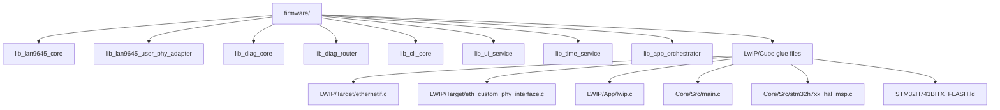

# LAN9645 Library Implementation Plan (STM32H743 + USER_PHY + LwIP)

## Purpose
This document is the implementation planning reference for building the firmware library cleanly from the current generated project.

It is aligned with:
- `LAN9645_user_phy_driver_spec.md`
- `LAN9645_managed_control_library_spec.md`
- `STM32_library_api_dependency_contract.md`
- generated Cube files in `firmware/`

Locked targets for phase 1:
- managed LAN9645 control through SPI
- STM32 RMII MAC + LwIP ping bring-up
- copper advertisement only `10/100` (no 1000)
- deterministic CLI-visible fault handling

---

## 1) Final File Architecture to Implement

---

## 2) Phase Order (No Optional Path)

```mermaid
flowchart LR
    P0[Phase 0<br/>LAN docs + register map freeze] --> P1[Phase 1<br/>time service]
    P1 --> P2[Phase 2<br/>diag core]
    P2 --> P3[Phase 3<br/>diag router + serial adapters]
    P3 --> P4[Phase 4<br/>LAN transport + register layer]
    P4 --> P5[Phase 5<br/>LAN managed profile/core]
    P5 --> P6[Phase 6<br/>USER_PHY adapter mapping]
    P6 --> P7[Phase 7<br/>ethernetif/netif/linker/cache glue]
    P7 --> P8[Phase 8<br/>CLI + orchestrator + UI integration]
    P8 --> P9[Phase 9<br/>Ping matrix validation]
```

---

## 2.1) Current Implementation Snapshot (April 5, 2026)

Implemented in firmware:
- `Core/Inc/lan9645/lan9645_regs.h`
- `Core/Src/lan9645/lan9645_regs.c`
- `Core/Inc/lan9645/lan9645_reg.h`
- `Core/Src/lan9645/lan9645_reg.c`
- `Core/Inc/lan9645/lan9645_core.h`
- `Core/Src/lan9645/lan9645_core.c`
- `Core/Inc/lan9645/lan9645_target_map.h`
- `Core/Src/lan9645/lan9645_target_map.c`
- `Core/Inc/lan9645/lan9645_profile_managed_rmii1.h`
- `Core/Src/lan9645/lan9645_profile_managed_rmii1.c`
- `Core/Inc/lan9645/lan9645_user_phy_adapter.h`
- `Core/Src/lan9645/lan9645_user_phy_adapter.c`
- `Core/Inc/lan9645/lan9645_runtime.h`
- `Core/Src/lan9645/lan9645_runtime.c`
- `Core/Inc/cli/cli_core.h`
- `Core/Src/cli/cli_core.c`
- `Core/Inc/cli/cli_ingress.h`
- `Core/Src/cli/cli_ingress.c`
- `Core/Inc/ui/ui_service.h`
- `Core/Src/ui/ui_service.c`
- `Core/Inc/app/app_orchestrator.h`
- `Core/Src/app/app_orchestrator.c`
- `Core/Src/main.c` integration for LAN boot path
- `LWIP/Target/ethernetif.c` USER_PHY + link-state integration baseline

What is now in place:
- descriptor-based LAN9645 register definitions and field masks from LAN9645x autogenerated tuples
- register access API that resolves descriptor tuples to runtime addresses
- boot path that applies target map, does reset, and applies managed profile baseline

Critical warning (must be respected):
- target base addresses in `lan9645_target_map.c` are currently provisional and must be validated on real hardware before trusting register transactions for production behavior

Hard gate before production sign-off:
- do not treat LAN bring-up as final until target base validation is completed and documented

---

## 2.2) Continue Decision (Locked)

Yes, implementation continues now.

Why this is valid:
- SPI transport, register layer, target-map apply path, core reset path, and managed profile apply path are already implemented in firmware.
- startup path in `Core/Src/main.c` already initializes these modules and reports failures through diagnostics.

Current constraint:
- target base values in `lan9645_target_map.c` are still provisional.
- this is a validation gate for production trust, not a blocker for continuing software implementation.

Execution rule:
- continue coding with the current register model.
- keep all new LAN logic behind explicit error reporting so target-map mistakes are visible immediately during board tests.

---

## 2.3) Current Phase Status Board (April 5, 2026)

| Phase | Status | Evidence in repo | Gate to close |
|---|---|---|---|
| Phase 0 docs + register map | In progress | `lan9645_regs.*`, `lan9645_target_map.*`, reference docs added in `Design/ref/` | hardware validation of target-base mapping |
| Phase 1 time service | Completed | `Core/Inc/time/time_service.h`, `Core/Src/time/time_service.c` | none |
| Phase 2 diag core | Completed | `Core/Inc/diag/diag_core.h`, `Core/Src/diag/diag_core.c` | none |
| Phase 3 diag router | Completed (baseline) | `Core/Inc/diag/diag_router.h`, `Core/Src/diag/diag_router.c` | USB/UART owner policy verification on board |
| Phase 4 LAN transport + reg | Completed (baseline) | `lan9645_spi.*`, `lan9645_reg.*` | SPI read/write sanity on real board |
| Phase 5 managed profile/core | Completed (baseline) | `lan9645_core.*`, `lan9645_profile_managed_rmii1.*`, `main.c` startup integration; managed profile now enables `ANA_ANAINTR.INTR_ENA` and `CPU_DEV_INTR_ENA` mask for IRQ cause visibility | confirm profile writes on hardware |
| Phase 6 USER_PHY adapter | Completed (baseline) | `lan9645_user_phy_adapter.*` created with virtual Clause-22 register model, per-port context, and 10/100 policy | validate link behavior on board |
| Phase 7 netif/linker/cache glue | Completed (software closure) | `MX_LWIP_Process()` loop active; `ethernet_link_check_state()` uses USER_PHY + adapter path and sets ETH MAC speed/duplex/start-stop; `ethernetif_preflight()` gate is active; `HAL_ETH_MspInit/DeInit()` added with RMII pinmux + ETH clocks; linker script now places `.RxDescripSection`, `.TxDescripSection`, `.Rx_PoolSection` in `RAM_D2`; MPU now marks `0x30000000..0x3003FFFF` non-cacheable for ETH DMA coherence | run DMA/cache stress on real board |
| Phase 8 CLI/runtime contract | Completed (software closure) | `cli_core` + `cli_ingress` + `ui_service` + `app_orchestrator` integrated; USB CDC and UART4 feed CLI and ownership is source-bound; startup transitions are explicit (`BOOT` to `RUN`); IRQ monitor + acknowledge + event escalation path active; `serial show`, `eth show`, `net show`, `net check`, `bringup check` operational; `main.c` now computes effective SPI clock from RCC + SPI prescaler (fallback guarded) before `lan9645_core_spi_setup()` | confirm command behavior on board |
| Phase 9 ping matrix | Deferred hardware execution | software progression assumes expected pass path; no board-side packet validation performed yet | execute copper/SFP ping matrix on hardware and capture evidence |

---

## 2.3.1) Refactor Progress Note (April 5, 2026, SPI Alignment Pass)

Completed in code:
- `lan9645_spi.*` aligned to Linux MFD strategy:
  - default/max padding set to `15`
  - SPI padding formula helper added (`ceil((kHz*2 + 1500) / 8000)`)
  - read path changed to one full SPI transfer (addr + padding + value)
- `lan9645_target_map.*` base addresses aligned to Linux BSP resource map for active targets:
  - `gcb=0x4000`, `qs=0x8000`, `chip_top=0x10000`, `rew=0x18000`, `sys=0x2C000`, `hsio=0x30000`
  - `dev0..dev8=0x38000 + n*0x4000`, `qsys=0x100000`, `afi=0x120000`, `ana=0x140000`
- `lan9645_core.*` now includes mandatory SPI setup and reset sequencing:
  - `lan9645_core_spi_setup()` programs `IF_CTRL` and `IF_CFGSTAT`, then readback-verifies
  - `lan9645_core_soft_reset()` uses `GCB SOFT_RST` flow and re-applies SPI setup after reset
- `main.c` startup now calls `lan9645_core_spi_setup()` immediately after external reset and before profile apply.

Validation completed in workspace:
- syntax checks passed for all files in `Core/Src/lan9645/*.c`
- syntax check passed for `Core/Src/main.c`

Remaining gate (not optional):
- on-board validation is still required to confirm:
  - measured SPI clock and computed padding are stable for this board/SPI routing
  - computed padding is stable on real hardware
  - IF readback/reset flow is stable across cold boots

---

## 2.3.3) BSP Closure Pass (April 5, 2026, No-Board Continuation)

Completed in code:
- ETH MSP implemented in `Core/Src/stm32h7xx_hal_msp.c`:
  - `HAL_ETH_MspInit()` and `HAL_ETH_MspDeInit()` added
  - RMII pins configured (`PA1/PA2/PA7`, `PB11/PB12/PB13`, `PC1/PC4/PC5`)
  - ETH clocks enabled/disabled (`ETH1MAC`, `ETH1TX`, `ETH1RX`)
- ETH DMA section placement implemented in `STM32H743BITX_FLASH.ld`:
  - `.RxDescripSection`, `.TxDescripSection`, `.Rx_PoolSection` mapped to `RAM_D2` and 32-byte aligned
- Cache coherency hardening in `Core/Src/main.c`:
  - MPU region added for `RAM_D2` window `0x30000000` size `256KB` as non-cacheable/shareable
- SPI setup robustness in `Core/Src/main.c`:
  - SPI clock now derived from `HAL_RCCEx_GetPeriphCLKFreq(RCC_PERIPHCLK_SPI1)` and SPI prescaler
  - fallback kept to `24 MHz` if runtime derivation is unavailable

Validation completed in workspace:
- syntax check passed:
  - `Core/Src/main.c`
  - `Core/Src/stm32h7xx_hal_msp.c`

Locked policy while board is unavailable:
- ping matrix is treated as software-flow success for implementation continuity only.
- hardware status remains `not performed` until physical tests are run and logged.

---

## 2.3.2) CLI Scope Policy (Locked)

Yes. The current CLI is intentionally a bring-up baseline only.

What is locked for now (baseline CLI):
- `status all`
- `status errors`
- `bringup check`
- `diag clear`
- `link show`
- `phy show`
- `lan id`
- `lan check`
- `lan profile apply`
- `lan preflight`
- `eth show`
- `net show`
- `net check`
- `serial show`
- `spi status`
- `reg read` / `reg write`
- `sanity spi`

What is deferred on purpose:
- advanced QoS/TSN controls
- advanced filtering/VCAP controls
- FRER/HSR/PRP/MRP/PSFP runtime controls
- advanced per-feature error counters and deep diagnostics

Expansion rule (no ambiguity):
- CLI commands and error-report channels are expanded only when the matching BSP feature phase is implemented and validated.
- No advanced command is exposed before its underlying register path and diagnostics are stable.

---

## 2.4) Next Implementation Block (No Optional Path, Board Absent)

Locked execution policy:
- continue software implementation as if ping workflow succeeds.
- keep physical test status as `not performed` until board execution is available.

Start immediately with this exact order:

1. Keep BSP software closure aligned with generated project:
- preserve ETH MSP + linker + MPU settings on each Cube regeneration
- preserve USER sections for LAN/CLI/diag integration

2. Continue advanced software-side BSP build-out:
- expand register coverage and APIs only from verified docs/source map
- keep deterministic diagnostics for every new control path

3. Freeze hardware validation backlog for return-to-board session:
- command-path board checks
- LAN/SPI stability checks
- full ping matrix for copper + SFP/SerDes
- target-base map validation log

Done when this block is complete:
- software implementation can continue without hardware blockers
- every deferred physical test is explicitly listed and traceable

---

## 2.6) Locked Goal and Feature Add Plan (Precise, No Optional Path)

Primary goal until board return:
- complete a deterministic **managed-switch BSP software closure** that includes full control of the required baseline features over SPI, with CLI and diagnostics coverage for each feature.
- all physical checks remain recorded as **not performed** until hardware execution.

Feature additions are locked to this exact sequence:

| ID | Feature to Add | How It Will Be Implemented | Files/APIs | Register Scope | Done Condition (Software) | Hardware Status |
|---|---|---|---|---|---|---|
| F1 | SPI transport telemetry and failure visibility | add transport counters (reads, writes, retries, failures, timeout class), expose reset/get APIs, route failures through diagnostics | `lan9645_spi.h/.c`, `cli_core.c`, `diag_core.*` | SPI transport layer only | `spi stats` and `status all` show deterministic counters and no silent error path remains | not performed |
| F2 | Port administrative and MAC mode control (ports 0,1,8) | add explicit set/get APIs for admin up/down, 10/100 speed, half/full duplex, MAC RX/TX enable, with readback verification | `lan9645_core.h/.c`, optional helper `lan9645_port_ctrl.h/.c`, `cli_core.c` | `QSYS_SW_PORT_MODE`, `DEV_CLOCK_CFG`, `DEV_MAC_MODE_CFG`, `DEV_MAC_ENA_CFG` | each CLI command writes + readback-verifies and errors are routed to diag | not performed |
| F3 | VLAN baseline management for managed mode | add minimal VLAN service for membership/untag policy used by CPU and copper ports; keep scope to required bring-up VLANs only | `lan9645_vlan.h/.c` (new), `cli_core.c` | `ANA_PGID`, `ANA_PGID_CFG`, `ANA_AGGR_CFG` | VLAN set/show commands are deterministic and validate masks on readback | not performed |
| F4 | Counter/statistics read-clear service | add API to select/read `SYS_CNT` views and trigger clear-shot flows; expose stable CLI surface for diagnostics | `lan9645_stats.h/.c` (new), `cli_core.c` | `SYS_STAT_CFG`, `SYS_CNT`, `SYS_SW_STATUS` | counters are readable, clear-shot behavior is explicit, and failure path is diagnosable | not performed |
| F5 | IRQ/cause contract completion | keep existing IRQ monitor, add explicit cause-to-action mapping per event class, and unify acknowledgement/reporting paths | `main.c`, `lan9645_core.c`, `cli_core.c`, `diag_core.*` | `ANA_ANAINTR`, `ANA_ANEVENTS`, `CPU_INTR_*`, `CPU_DEV_INTR_*` | repeated `irq show/ack` behavior is deterministic in software and every ack failure is visible | not performed |
| F6 | CLI contract completion for BSP baseline | finalize command set for F1..F5 with strict syntax and stable response format for logging/automation | `cli_core.c`, `cli_ingress.c`, `diag_router.c` | n/a (command surface) | help/output format frozen and command errors map to explicit codes | not performed |
| F7 | Documentation and traceability closure | for every F1..F6 feature, update plan evidence section and keep board-test rows explicitly marked pending | `LAN9645_library_implementation_plan.md` | n/a | plan reflects exact implemented feature set and pending physical backlog | not performed |

Locked command additions that must exist after F6:
- `spi stats`
- `port admin <0|1|8> <up|down>`
- `port mode <0|1|8> <10|100> <half|full>`
- `vlan set <vid> <member_mask_hex> <untag_mask_hex>`
- `vlan show <vid>`
- `cnt read <view>`
- `cnt clear <view>`

Rules for this locked feature pass:
- every setter command must do readback verification.
- every failure must emit a diagnostics event and a CLI-visible error line.
- no advanced TSN/VCAP/FRER/PTP controls are added in this pass.
- physical validation rows remain `not performed` until board return.

---

## 2.5) Section-by-Section Tracker (Implementation Order)

| Section | Scope | Status | Evidence |
|---|---|---|---|
| S1 | LAN transport + register descriptors | Completed (baseline) | `lan9645_spi.*`, `lan9645_reg.*`, `lan9645_regs.*`, `lan9645_target_map.*` |
| S2 | Managed profile and reset path | Completed (baseline) | `lan9645_core.*`, `lan9645_profile_managed_rmii1.*`, `main.c` reset/profile apply |
| S3 | USER_PHY adapter model | Completed (baseline) | `lan9645_user_phy_adapter.*` + deterministic logical address initialization in `eth_custom_phy_interface.c` |
| S4 | LwIP netif link integration | Completed (baseline) | `LWIP/Target/ethernetif.c` link check uses USER_PHY + MAC speed/duplex update |
| S5 | CLI command layer | Completed (baseline only) | `cli_core.*` with `help`, `state`, `status`, `bringup check`, `diag clear`, `link`, `phy`, `lan id`, `lan check` (incl. IRQ gate checks), `lan profile apply`, `lan preflight`, `eth show`, `net show`, `net check`, `spi status`, `serial show`, `irq`, `reg`, `port`, `sanity spi` commands |
| S6 | UI service (HEART/STATUS/ERR + USER button) | Completed (baseline) | `ui_service.*`, `main.c` polling, button triggers `status all` |
| S7 | Serial command ingress and runtime orchestrator | Completed (baseline) | `cli_ingress.*`, `app_orchestrator.*`, USB CDC + UART4 ingress wired in `main.c` and `usbd_cdc_if.c` |
| S8 | Ping validation matrix | Deferred (not performed on hardware) | software progression assumes expected pass path; board execution pending |
| S9 | Managed BSP feature closure (F1..F7) | In progress | precise feature sequence defined in section 2.6; implementation continues without board |

Locked next section:
- continue software-side BSP expansion while hardware test backlog remains explicit.
- execute `S8` ping matrix and target-map hardware validation closure when board access returns.

---

## 3) Phase-by-Phase Implementation Plan (Locked)

## Phase 0 - LAN9645 Documentation and Register Map Freeze (Mandatory Before LAN Coding)
Objective:
- lock the exact register addresses/bitfields used by firmware before implementing LAN driver modules.

Required activities:
1. Review LAN9645 documentation sections needed for phase 1:
- SI/SPI client interface access rules
- global reset/clock/control registers
- RMII CPU-port link status path (`DEV8`)
- copper PHY0/PHY1 mode and advertisement control
- IRQ/status clear path
- statistics counters used for health checks
2. Build a phase-1 register map source table.
3. Generate/author:
- `Core/Inc/lan9645/lan9645_regs.h` and `Core/Src/lan9645/lan9645_regs.c` (descriptor tuples + masks)
- `Core/Src/lan9645/lan9645_target_map.c` (target base table used by descriptor resolution)
4. Cross-check register names and fields with existing design docs.
5. Validate target base addresses against hardware behavior.

Outputs:
- frozen register/address list for all phase-1 API calls
- no unresolved placeholder register symbol in phase-1 scope
- validated target base table for this board profile (required)

Done when:
- every phase-1 LAN API in this plan has known address + field masks in `lan9645_regs.h`
- register map reviewed and accepted as implementation baseline
- target map has been validated with repeatable SPI read/write sanity checks on hardware

## Phase 1 - Time Service Foundation
Implement first:
- `lib_time_service`

Mandatory outputs:
- RTC or uptime timestamp API for all modules
- deterministic formatting helpers for logs

Done when:
- timestamps available before diagnostics and CLI are initialized

## Phase 2 - Diagnostics Core Foundation
Implement:
- `lib_diag_core`

Mandatory outputs:
- canonical event/error IDs
- counters, first/last timestamps, context tracking
- query API for `status errors`

Done when:
- any module can report structured events and read back counters

## Phase 3 - Diagnostics Router and Serial Adapters
Implement:
- `lib_diag_router`
- USB CDC adapter
- UART4 adapter

Mandatory outputs:
- owner policy (`USB`, `UART4`, `NONE`)
- mirror-on-none rule for errors
- text/event routing API

Done when:
- routed error lines appear on correct serial channel(s)

## Phase 4 - LAN Transport and Register Foundation
Implement first:
- `lan9645_spi.c`
- `lan9645_reg.c`

Mandatory outputs:
- SPI transaction wrapper with timeout/retry
- read/write/rmw 32-bit register helpers
- address conversion helper for SI register access
- normalized return codes for read/write errors
- use only addresses/masks from Phase 0 `lan9645_regs.h`

Done when:
- repeated SPI read/write sanity test passes
- communication errors map to common LAN error IDs

## Phase 5 - LAN Managed Profile Bring-Up
Implement:
- `lan9645_core.c`
- `lan9645_profile_managed_rmii1.c`

Mandatory outputs:
- LAN reset sequence control (`PD5`)
- strap expectation checks
- RMII CPU-port path setup
- copper port0/port1 enablement
- SerDes0/SerDes1 baseline setup for your board profile

Done when:
- profile apply function is deterministic and idempotent
- failure exits with explicit error code and CLI message

## Phase 6 - USER_PHY Adapter Layer
Implement:
- `lan9645_user_phy_adapter.c`
- integration hooks in generated `eth_custom_phy_interface.c`

Mandatory outputs:
- map `USER_PHY_BCR/BSR/ANAR/ANLPAR/PHYI1R/PHYI2R` semantics to LAN9645 managed status
- enforce 10/100-only advertisement policy
- explicit rejection of 1000 mode requests
- per-port logical context (`port0`/`port1`)

Done when:
- USER_PHY API returns stable link/speed/duplex states for both copper ports

## Phase 7 - Ethernet Link-State Integration
Implement in:
- `LWIP/Target/ethernetif.c`
- `Core/Src/stm32h7xx_hal_msp.c`
- linker script (`STM32H743BITX_FLASH.ld`)

Mandatory outputs:
- fill `ethernet_link_check_state()`
- ETH MSP init for clocks + RMII AF pins
- ETH start/stop policy based on LAN managed link state
- linker sections for `.RxDescripSection`, `.TxDescripSection`, `.Rx_PoolSection` in `RAM_D2`
- complete cache coherency handling for ETH DMA ownership changes

Done when:
- no random frame corruption/loss under ping stress

## Phase 8 - CLI + Orchestrator + UI Runtime Contract
Implement in:
- `lib_cli_core`
- `lib_app_orchestrator`
- `lib_ui_service`
- `Core/Src/main.c`
- `LWIP/App/lwip.c`

Mandatory outputs:
- `MX_LWIP_Process()` called continuously in main runtime
- baseline commands only:
  - `status all`, `status errors`, `diag clear`
  - `link show`, `phy show`
  - `lan id`, `lan check`, `lan profile apply`, `lan preflight`, `spi status`
  - register read/write and SPI sanity
- deterministic startup state machine (`BOOT` -> `LAN_RESET` -> `LAN_SPI_TEST` -> `LAN_PROFILE_APPLY` -> `NET_READY` -> `RUN`)
- locked LED and button behavior
- periodic poll schedule for LAN, CLI, diag router, and LwIP service
- ETH link monitoring bound to managed RMII1 path (`USER_PHY` logical port1) for deterministic MAC link state.

Deferred from this phase:
- feature-specific CLI controls and deep per-feature diagnostics for QoS/TSN/VCAP/FRER/PTP.
- these are added only in the matching advanced BSP phases.

Done when:
- startup and fault transitions are deterministic and repeatable
- every LAN comm fault is visible in serial debug line

## Phase 9 - Ping Validation Matrix
Validation order:
1. copper port 0 ping
2. copper port 1 ping
3. serdes/sfp path 0 ping
4. serdes/sfp path 1 ping

Done when:
- all four paths reply consistently
- no escalating error counters during repeated ping tests

---

## 4) Work Package Breakdown by File Ownership

| Package | Files | Main responsibility |
|---|---|---|
| WP0 Register Map | `lan9645_regs.h` | freeze addresses/bitfields from documentation |
| WP1 Transport | `lan9645_spi.*`, `lan9645_reg.*` | reliable SI read/write |
| WP2 Profile | `lan9645_core.*`, `lan9645_profile_managed_rmii1.*` | reset + managed switch config |
| WP3 USER_PHY | `lan9645_user_phy_adapter.*`, `eth_custom_phy_interface.c` user sections | PHY compatibility mapping |
| WP4 Netif | `ethernetif.c`, `stm32h7xx_hal_msp.c`, linker script | ETH data path + memory/caches |
| WP5 Diagnostics | `diag_core.*`, `time_service.*` | event model, counters, timestamps |
| WP6 CLI/Router | `diag_router.*`, `cli_core.*`, USB/UART adapters | serial ownership and command routing |
| WP7 Runtime | `app_orchestrator.*`, `ui_service.*`, `main.c` glue | deterministic startup/run/fault behavior |

---

## 5) Risk Controls (Must Check During Implementation)

1. SPI frame format mismatch:
- guard with transport self-test and error escalation.

2. ETH DMA/cache coherency faults:
- enforce linker + cache policy before ping tests.

3. USER_PHY semantic drift:
- keep adapter state synchronized with LAN9645 managed status only.

4. Link-up false positive:
- do not mark netif up until LAN managed link state confirms readiness.

5. Silent failures:
- every fault must produce error ID + serial output.

6. Wrong target-base mapping:
- descriptor tuples can be correct while absolute accesses are still wrong if target base values are wrong.
- require explicit hardware validation of `lan9645_target_map.c` before higher-level bring-up confidence.

---

## 6) Definition of Done (Implementation Planning Complete)

- [ ] Phase 0 documentation review and register map freeze are completed.
- [x] Module dependencies and public APIs match `STM32_library_api_dependency_contract.md`.
- [x] All planned files/modules are created with clear ownership.
- [x] USER_PHY adapter behavior matches dedicated spec exactly (software implementation level).
- [x] LwIP service/runtime contract is satisfied (`NO_SYS=1` loop).
- [x] ETH memory + cache policy software setup is in place (MSP + linker + MPU).
- [x] CLI fault visibility contract is fully active.
- [ ] Ping matrix passes on all target ports.
