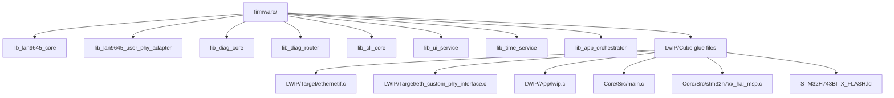

# LAN9645 Library Implementation Plan (STM32H743 + USER_PHY + LwIP)

## Purpose
This document is the implementation planning reference for building the firmware library cleanly from the current generated project.

It is aligned with:
- `LAN9645_user_phy_driver_spec.md`
- `LAN9645_managed_control_library_spec.md`
- `STM32_library_api_dependency_contract.md`
- generated Cube files in `firmware/`

Locked targets for phase 1:
- managed LAN9645 control through SPI
- STM32 RMII MAC + LwIP ping bring-up
- copper advertisement only `10/100` (no 1000)
- deterministic CLI-visible fault handling

---

## 1) Final File Architecture to Implement

---

## 2) Phase Order (No Optional Path)

```mermaid
flowchart LR
    P0[Phase 0<br/>LAN docs + register map freeze] --> P1[Phase 1<br/>time service]
    P1 --> P2[Phase 2<br/>diag core]
    P2 --> P3[Phase 3<br/>diag router + serial adapters]
    P3 --> P4[Phase 4<br/>LAN transport + register layer]
    P4 --> P5[Phase 5<br/>LAN managed profile/core]
    P5 --> P6[Phase 6<br/>USER_PHY adapter mapping]
    P6 --> P7[Phase 7<br/>ethernetif/netif/linker/cache glue]
    P7 --> P8[Phase 8<br/>CLI + orchestrator + UI integration]
    P8 --> P9[Phase 9<br/>Ping matrix validation]
```

---

## 3) Phase-by-Phase Implementation Plan (Locked)

## Phase 0 - LAN9645 Documentation and Register Map Freeze (Mandatory Before LAN Coding)
Objective:
- lock the exact register addresses/bitfields used by firmware before implementing LAN driver modules.

Required activities:
1. Review LAN9645 documentation sections needed for phase 1:
- SI/SPI client interface access rules
- global reset/clock/control registers
- RMII CPU-port link status path (`DEV8`)
- copper PHY0/PHY1 mode and advertisement control
- IRQ/status clear path
- statistics counters used for health checks
2. Build a phase-1 register map source table.
3. Generate/author:
- `Core/Inc/lan9645/lan9645_regs.h` (absolute addresses + masks)
4. Cross-check register names and fields with existing design docs.

Outputs:
- frozen register/address list for all phase-1 API calls
- no unresolved placeholder register symbol in phase-1 scope

Done when:
- every phase-1 LAN API in this plan has known address + field masks in `lan9645_regs.h`
- register map reviewed and accepted as implementation baseline

## Phase 1 - Time Service Foundation
Implement first:
- `lib_time_service`

Mandatory outputs:
- RTC or uptime timestamp API for all modules
- deterministic formatting helpers for logs

Done when:
- timestamps available before diagnostics and CLI are initialized

## Phase 2 - Diagnostics Core Foundation
Implement:
- `lib_diag_core`

Mandatory outputs:
- canonical event/error IDs
- counters, first/last timestamps, context tracking
- query API for `status errors`

Done when:
- any module can report structured events and read back counters

## Phase 3 - Diagnostics Router and Serial Adapters
Implement:
- `lib_diag_router`
- USB CDC adapter
- UART4 adapter

Mandatory outputs:
- owner policy (`USB`, `UART4`, `NONE`)
- mirror-on-none rule for errors
- text/event routing API

Done when:
- routed error lines appear on correct serial channel(s)

## Phase 4 - LAN Transport and Register Foundation
Implement first:
- `lan9645_spi.c`
- `lan9645_reg.c`

Mandatory outputs:
- SPI transaction wrapper with timeout/retry
- read/write/rmw 32-bit register helpers
- address conversion helper for SI register access
- normalized return codes for read/write errors
- use only addresses/masks from Phase 0 `lan9645_regs.h`

Done when:
- repeated SPI read/write sanity test passes
- communication errors map to common LAN error IDs

## Phase 5 - LAN Managed Profile Bring-Up
Implement:
- `lan9645_core.c`
- `lan9645_profile_managed_rmii1.c`

Mandatory outputs:
- LAN reset sequence control (`PD5`)
- strap expectation checks
- RMII CPU-port path setup
- copper port0/port1 enablement
- SerDes0/SerDes1 baseline setup for your board profile

Done when:
- profile apply function is deterministic and idempotent
- failure exits with explicit error code and CLI message

## Phase 6 - USER_PHY Adapter Layer
Implement:
- `lan9645_user_phy_adapter.c`
- integration hooks in generated `eth_custom_phy_interface.c`

Mandatory outputs:
- map `USER_PHY_BCR/BSR/ANAR/ANLPAR/PHYI1R/PHYI2R` semantics to LAN9645 managed status
- enforce 10/100-only advertisement policy
- explicit rejection of 1000 mode requests
- per-port logical context (`port0`/`port1`)

Done when:
- USER_PHY API returns stable link/speed/duplex states for both copper ports

## Phase 7 - Ethernet Link-State Integration
Implement in:
- `LWIP/Target/ethernetif.c`
- `Core/Src/stm32h7xx_hal_msp.c`
- linker script (`STM32H743BITX_FLASH.ld`)

Mandatory outputs:
- fill `ethernet_link_check_state()`
- ETH MSP init for clocks + RMII AF pins
- ETH start/stop policy based on LAN managed link state
- linker sections for `.RxDescripSection`, `.TxDescripSection`, `.Rx_PoolSection` in `RAM_D2`
- complete cache coherency handling for ETH DMA ownership changes

Done when:
- no random frame corruption/loss under ping stress

## Phase 8 - CLI + Orchestrator + UI Runtime Contract
Implement in:
- `lib_cli_core`
- `lib_app_orchestrator`
- `lib_ui_service`
- `Core/Src/main.c`
- `LWIP/App/lwip.c`

Mandatory outputs:
- `MX_LWIP_Process()` called continuously in main runtime
- `status all`, `status errors`, `link show`, `phy show`, register read/write commands
- deterministic startup state machine (`BOOT` -> `LAN_RESET` -> `LAN_SPI_TEST` -> `LAN_PROFILE_APPLY` -> `NET_READY` -> `RUN`)
- locked LED and button behavior
- periodic poll schedule for LAN, CLI, diag router, and LwIP service

Done when:
- startup and fault transitions are deterministic and repeatable
- every LAN comm fault is visible in serial debug line

## Phase 9 - Ping Validation Matrix
Validation order:
1. copper port 0 ping
2. copper port 1 ping
3. serdes/sfp path 0 ping
4. serdes/sfp path 1 ping

Done when:
- all four paths reply consistently
- no escalating error counters during repeated ping tests

---

## 4) Work Package Breakdown by File Ownership

| Package | Files | Main responsibility |
|---|---|---|
| WP0 Register Map | `lan9645_regs.h` | freeze addresses/bitfields from documentation |
| WP1 Transport | `lan9645_spi.*`, `lan9645_reg.*` | reliable SI read/write |
| WP2 Profile | `lan9645_core.*`, `lan9645_profile_managed_rmii1.*` | reset + managed switch config |
| WP3 USER_PHY | `lan9645_user_phy_adapter.*`, `eth_custom_phy_interface.c` user sections | PHY compatibility mapping |
| WP4 Netif | `ethernetif.c`, `stm32h7xx_hal_msp.c`, linker script | ETH data path + memory/caches |
| WP5 Diagnostics | `diag_core.*`, `time_service.*` | event model, counters, timestamps |
| WP6 CLI/Router | `diag_router.*`, `cli_core.*`, USB/UART adapters | serial ownership and command routing |
| WP7 Runtime | `app_orchestrator.*`, `ui_service.*`, `main.c` glue | deterministic startup/run/fault behavior |

---

## 5) Risk Controls (Must Check During Implementation)

1. SPI frame format mismatch:
- guard with transport self-test and error escalation.

2. ETH DMA/cache coherency faults:
- enforce linker + cache policy before ping tests.

3. USER_PHY semantic drift:
- keep adapter state synchronized with LAN9645 managed status only.

4. Link-up false positive:
- do not mark netif up until LAN managed link state confirms readiness.

5. Silent failures:
- every fault must produce error ID + serial output.

---

## 6) Definition of Done (Implementation Planning Complete)

- [ ] Phase 0 documentation review and register map freeze are completed.
- [ ] Module dependencies and public APIs match `STM32_library_api_dependency_contract.md`.
- [ ] All planned files/modules are created with clear ownership.
- [ ] USER_PHY adapter behavior matches dedicated spec exactly.
- [ ] LwIP service/runtime contract is satisfied (`NO_SYS=1` loop).
- [ ] ETH memory + cache policy is stable under repeated ping traffic.
- [ ] CLI fault visibility contract is fully active.
- [ ] Ping matrix passes on all target ports.
