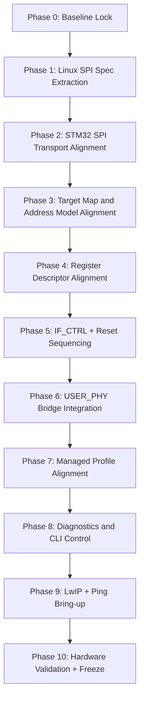

# LAN9645 STM32 SPI BSP Phase Plan (Phase 0 to Final)

## Goal
Build a STM32 LAN9645 BSP with full SPI-based control, using only:
- STM32 generated USER PHY interface:
  - `firmware/LWIP/Target/eth_custom_phy_interface.h`
  - `firmware/LWIP/Target/eth_custom_phy_interface.c`
- Linux BSP reference:
  - `Design/firmware/lan9645x/mfd/lan9645x-spi.c`
  - `Design/firmware/lan9645x/mfd/lan9645x.h`
  - `Design/firmware/lan9645x/lan9645x_regs.h`
  - `Design/firmware/lan9645x/lan9645x_main.c`
  - `Design/firmware/lan9645x/lan9645x_main.h`
  - supporting LAN9645x files in the same folder as needed

## Rule
No guessed SPI behavior, no guessed register bases, no provisional policy in production path.

## Phase Flow

## Sequencing Enforcement (Mandatory)
1. No phase may start before the previous phase exit criteria are fully met.
2. Every phase output must be documented in commit notes and diagnostics output.
3. Any failed gate returns execution to the failing phase; no skip-forward is allowed.

## Phase 0: Baseline Lock
### Objective
Lock inputs, remove deprecated references, and define source-of-truth links.

### Tasks
1. Confirm `Design/firmware/patch` is no longer used.
2. Confirm `Design/firmware/lan9645x` is the only Linux BSP reference tree.
3. Lock `LAN9645_stm32_bsp_porting_guide.md` as mandatory implementation guide.

### Exit Criteria
1. No implementation task references patch markdown files.
2. Team agrees Linux source tree is authoritative.

## Phase 1: Linux SPI Spec Extraction
### Objective
Extract exact SPI protocol and reset behavior from Linux MFD driver.

### Tasks
1. Extract and lock:
   - 24-bit command format
   - write flag `0x80`
   - reg stride `4`
   - downshift-by-2 addressing model
2. Extract and lock IF control model:
   - `IF_CTRL`
   - `IF_CFGSTAT`
3. Extract and lock padding policy:
   - formula
   - `MAX_PADDING=15`
   - `DEFAULT_PADDING=15`
4. Extract and lock reset/re-init order around SPI setup.

### Exit Criteria
1. Technical constants in STM32 headers match Linux values exactly.
2. No conflicting constants remain.

## Phase 2: STM32 SPI Transport Alignment
### Objective
Make STM32 SPI transport implementation Linux-equivalent for supported path.

### STM32 Files
- `firmware/Core/Inc/lan9645/lan9645_spi.h`
- `firmware/Core/Src/lan9645/lan9645_spi.c`

### Tasks
1. Update SPI constants and defaults to Linux-aligned values.
2. Confirm command packing and read/write byte order behavior.
3. Add runtime padding calculation helper based on SPI clock.
4. Keep retry/timeout behavior deterministic and logged.

### Exit Criteria
1. SPI read/write loopback test passes with stable values.
2. Padding sweep test selects stable operating point.

## Phase 3: Target Map and Address Model Alignment
### Objective
Replace guessed base map with Linux MFD resource base values.

### STM32 Files
- `firmware/Core/Inc/lan9645/lan9645_target_map.h`
- `firmware/Core/Src/lan9645/lan9645_target_map.c`
- `firmware/Core/Inc/lan9645/lan9645_reg.h`
- `firmware/Core/Src/lan9645/lan9645_reg.c`

### Tasks
1. Align used target base addresses to Linux resource map.
2. Verify target index mapping matches `lan9645x_regs.h` target IDs.
3. Ensure descriptor address resolution is consistent with downshift model.

### Exit Criteria
1. All used targets resolve to expected absolute addresses.
2. Descriptor read/write tests pass on key registers.

## Phase 4: Register Descriptor Alignment
### Objective
Ensure STM32 descriptor set exactly matches Linux register definitions used by current scope.

### STM32 Files
- `firmware/Core/Inc/lan9645/lan9645_regs.h`
- `firmware/Core/Src/lan9645/lan9645_regs.c`

### Tasks
1. Audit each descriptor used by core/profile against `lan9645x_regs.h`.
2. Audit bit masks used by core/profile against Linux field definitions.
3. Remove or mark any descriptor not tied to active scope.

### Exit Criteria
1. Descriptor-to-Linux trace table completed.
2. No unverified descriptor remains in active path.

## Phase 5: IF_CTRL + Reset Sequencing
### Objective
Implement Linux-equivalent SPI initialization sequence on STM32.

### STM32 Files
- `firmware/Core/Inc/lan9645/lan9645_core.h`
- `firmware/Core/Src/lan9645/lan9645_core.c`
- `firmware/Core/Src/main.c` (startup sequence usage)

### Tasks
1. Add explicit API for IF setup:
   - program `IF_CTRL`
   - compute/program `IF_CFGSTAT`
   - readback validation
2. Integrate reset flow:
   - external reset
   - soft reset
   - re-initialize IF setup when required
3. Report failures via diag/CLI channel.

### Exit Criteria
1. Bring-up reaches post-reset ready state reliably.
2. IF readback validation passes across cold boots.

## Phase 6: USER_PHY Bridge Integration
### Objective
Use generated USER_PHY API as external interface while backing it with LAN9645-managed logic.

### STM32 Files
- `firmware/LWIP/Target/eth_custom_phy_interface.h`
- `firmware/LWIP/Target/eth_custom_phy_interface.c`
- `firmware/Core/Inc/lan9645/lan9645_user_phy_adapter.h`
- `firmware/Core/Src/lan9645/lan9645_user_phy_adapter.c`

### Tasks
1. Keep generated USER_PHY API contract unchanged.
2. Ensure IO callbacks route through adapter with deterministic behavior.
3. Align adapter link-state behavior with managed LAN profile assumptions.
4. Remove remaining provisional comments once mapping is validated.

### Exit Criteria
1. USER_PHY init/reset/get-link works through adapter path.
2. ETH layer sees consistent link state transitions.

## Phase 7: Managed Profile Alignment
### Objective
Align managed profile implementation with validated descriptor/base map and selected hardware topology.

### STM32 Files
- `firmware/Core/Inc/lan9645/lan9645_profile_managed_rmii1.h`
- `firmware/Core/Src/lan9645/lan9645_profile_managed_rmii1.c`

### Tasks
1. Validate CPU port and copper port configuration sequence.
2. Validate port enable sequence and speed/duplex handling.
3. Ensure profile outputs deterministic diagnostic data.

### Exit Criteria
1. Profile apply function is deterministic and repeatable.
2. Profile failures are explicit and actionable through diagnostics.

## Phase 8: Diagnostics and CLI Control
### Objective
Expose complete SPI bring-up status and failure causes through serial interfaces.

### STM32 Files
- `firmware/Core/Src/diag/*`
- `firmware/Core/Src/cli/*`
- `firmware/Core/Src/ui/*`

### Tasks
1. Add CLI commands for:
   - SPI frequency/padding status
   - register read/write probe
   - IF_CTRL/IF_CFGSTAT dump
   - profile status
2. Ensure errors route to USB CDC and UART4 uniformly.
3. Keep CLI scope limited to bring-up baseline at this phase.
4. Defer advanced per-feature controls and advanced error reporting to the matching later phases (11-16).

### Exit Criteria
1. All critical bring-up checks can be run from CLI.
2. Error messages identify phase and failing register.
3. Advanced feature CLI is not exposed before underlying BSP feature implementation is validated.

## Phase 9: LwIP + Ping Bring-up
### Objective
Reach stable ping test on intended LAN paths.

### STM32 Files
- `firmware/LWIP/Target/ethernetif.c`
- `firmware/LWIP/App/lwip.c`
- `firmware/LWIP/Target/lwipopts.h`

### Tasks
1. Validate ETH/LwIP startup ordering with LAN profile readiness.
2. Confirm static IP settings and link-up conditions.
3. Run ping tests per targeted copper/SFP path in test matrix.

### Exit Criteria
1. Ping success criteria met and reproducible.
2. No intermittent SPI/link failures during sustained ping.

## Phase 10: Hardware Validation and Freeze
### Objective
Freeze BSP behavior and lock documentation for implementation handoff.

### Tasks
1. Execute full validation checklist from porting guide.
2. Capture known limits:
   - max stable SPI frequency
   - required padding
   - reset timing
3. Freeze APIs and update design docs.

### Exit Criteria
1. Validation report signed off.
2. BSP files tagged as baseline for next feature phase.

## Phase 11: Advanced L2 Offloads
### Objective
Sequence Linux L2 feature modules after baseline SPI BSP is stable.

### Linux Files
- `lan9645x_lag.c`
- `lan9645x_mdb.c`
- `lan9645x_mirror.c`
- `lan9645x_bum.c`

### Exit Criteria
1. Porting decision made per module (implement/defer).
2. Dependencies to register blocks captured.

## Phase 12: QoS and TSN Scheduling Blocks
### Objective
Sequence QoS and scheduler-related modules after L2 baseline.

### Linux Files
- `lan9645x_qos.c`
- `lan9645x_dcb.c`
- `lan9645x_mqprio.c`
- `lan9645x_ets.c`
- `lan9645x_cbs.c`
- `lan9645x_tbf.c`
- `lan9645x_taprio.c`
- `lan9645x_cut_thru.c`
- `lan9645x_afi.c`
- `lan9645x_eee.c`

### Exit Criteria
1. Scheduling and QoS register paths mapped and reviewed.
2. Implementation decision logged for each file.

## Phase 13: Classification and ACL (VCAP/TC)
### Objective
Sequence traffic classification modules and associated autogenerated APIs.

### Linux Files
- `lan9645x_tc_flower.c`
- `lan9645x_tc_matchall.c`
- `lan9645x_vcap_ag_api.c`
- `lan9645x_vcap_ag_api.h`
- `lan9645x_vcap_impl.c`
- `lan9645x_vcap_utils.c`
- `lan9645x_vcap_utils.h`
- `lan9645x_vcap_debugfs.c`

### Exit Criteria
1. VCAP pipeline dependencies documented.
2. STM32 feasibility decision recorded.

## Phase 14: FRER/Redundancy and Protection
### Objective
Sequence resiliency-oriented modules (FRER/HSR/PRP/MRP/PSFP/stream).

### Linux Files
- `lan9645x_hsr_prp.c`
- `lan9645x_mrp.c`
- `lan9645x_mrp.h`
- `lan9645x_psfp.c`
- `lan9645x_stream.c`
- `lan9645x_fp.c`
- `lan9645x_police.c`

### Exit Criteria
1. Dependency map for advanced resiliency features is complete.
2. Optional roadmap for future firmware phase is defined.

## Phase 15: PTP and Time Features
### Objective
Sequence timestamping/time synchronization modules.

### Linux Files
- `lan9645x_ptp.c`
- `lan9645x_ptp_logs.c`

### Exit Criteria
1. PTP dependency and required hardware lines documented.
2. Decision logged for phase-in timing.

## Phase 16: Linux-Specific Integration Boundary Review
### Objective
Explicitly classify Linux-only integration files that are references, not direct STM32 ports.

### Linux Files
- `lan9645x_netlink_fp.c`
- `lan9645x_netlink_fp.h`
- `lan9645x_netlink_frer.c`
- `lan9645x_netlink_frer.h`
- `lan9645x_netlink_frer_impl.c`
- `lan9645x_netlink_qos.c`
- `lan9645x_netlink_qos.h`
- `Kconfig`
- `Makefile`

### Exit Criteria
1. Linux-only boundaries are explicit in docs.
2. No Linux-specific user-space/control-plane API is accidentally assumed in STM32 BSP.

## Complete File Sequencing Matrix (All lan9645x Files)
| Linux File | Subsystem | Planned Phase | Baseline BSP | STM32 Action |
| --- | --- | --- | --- | --- |
| `mfd/lan9645x-spi.c` | SPI transport/MFD | 1-5 | Yes | Port behavior |
| `mfd/lan9645x.h` | SPI constants/IF encoding | 1-5 | Yes | Port constants |
| `lan9645x_regs.h` | Register map/macros | 1-4 | Yes | Port used subset with traceability |
| `lan9645x_main.c` | Core switch init orchestration | 1,5,7 | Yes | Reference sequencing |
| `lan9645x_main.h` | Core data model/contracts | 1,5,7 | Yes | Reference contracts |
| `lan9645x_mac.c` | MAC config logic | 7 | Yes | Port relevant logic |
| `lan9645x_npi.c` | CPU/NPI path setup | 7 | Yes | Port relevant logic |
| `lan9645x_phylink.c` | link-mode orchestration | 7 | Yes | Reference/port relevant parts |
| `lan9645x_vlan.c` | VLAN baseline | 7 | Yes | Port baseline behavior |
| `lan9645x_stats.c` | Counters | 8 | Yes | Port baseline stats path |
| `lan9645x_stats.h` | Counter types/API | 8 | Yes | Port baseline types |
| `lan9645x_manual_inj.c` | Manual injection path | 8 | Optional in baseline | Reference/diagnostic port |
| `lan9645x_lag.c` | Link aggregation | 11 | No | Defer after baseline |
| `lan9645x_mdb.c` | Multicast DB | 11 | No | Defer after baseline |
| `lan9645x_mirror.c` | Mirror control | 11 | No | Defer after baseline |
| `lan9645x_bum.c` | Broadcast/unknown handling | 11 | No | Defer after baseline |
| `lan9645x_qos.c` | QoS controls | 12 | No | Defer |
| `lan9645x_dcb.c` | DCB controls | 12 | No | Defer |
| `lan9645x_mqprio.c` | MQPRIO | 12 | No | Defer |
| `lan9645x_ets.c` | ETS scheduling | 12 | No | Defer |
| `lan9645x_cbs.c` | CBS shaping | 12 | No | Defer |
| `lan9645x_tbf.c` | TBF shaping | 12 | No | Defer |
| `lan9645x_taprio.c` | TAPRIO scheduling | 12 | No | Defer |
| `lan9645x_cut_thru.c` | Cut-through | 12 | No | Defer |
| `lan9645x_afi.c` | AFI block | 12 | No | Defer |
| `lan9645x_eee.c` | EEE behavior | 12 | No | Defer |
| `lan9645x_tc_flower.c` | TC flower | 13 | No | Defer |
| `lan9645x_tc_matchall.c` | TC matchall | 13 | No | Defer |
| `lan9645x_vcap_ag_api.c` | VCAP AG API | 13 | No | Defer |
| `lan9645x_vcap_ag_api.h` | VCAP AG API types | 13 | No | Defer |
| `lan9645x_vcap_impl.c` | VCAP implementation | 13 | No | Defer |
| `lan9645x_vcap_utils.c` | VCAP utilities | 13 | No | Defer |
| `lan9645x_vcap_utils.h` | VCAP utility types | 13 | No | Defer |
| `lan9645x_vcap_debugfs.c` | VCAP Linux debugfs | 13 | No | Reference only |
| `lan9645x_hsr_prp.c` | HSR/PRP | 14 | No | Defer |
| `lan9645x_mrp.c` | MRP | 14 | No | Defer |
| `lan9645x_mrp.h` | MRP types/API | 14 | No | Defer |
| `lan9645x_psfp.c` | PSFP | 14 | No | Defer |
| `lan9645x_stream.c` | Stream handling | 14 | No | Defer |
| `lan9645x_fp.c` | Frame preemption | 14 | No | Defer |
| `lan9645x_police.c` | Policing | 14 | No | Defer |
| `lan9645x_ptp.c` | PTP | 15 | No | Defer |
| `lan9645x_ptp_logs.c` | PTP logs | 15 | No | Defer |
| `lan9645x_netlink_fp.c` | Linux netlink FP | 16 | No | Reference only |
| `lan9645x_netlink_fp.h` | Linux netlink FP types | 16 | No | Reference only |
| `lan9645x_netlink_frer.c` | Linux netlink FRER | 16 | No | Reference only |
| `lan9645x_netlink_frer.h` | Linux netlink FRER types | 16 | No | Reference only |
| `lan9645x_netlink_frer_impl.c` | Linux netlink FRER impl | 16 | No | Reference only |
| `lan9645x_netlink_qos.c` | Linux netlink QoS | 16 | No | Reference only |
| `lan9645x_netlink_qos.h` | Linux netlink QoS types | 16 | No | Reference only |
| `Kconfig` | Linux build config | 16 | No | Reference only |
| `Makefile` | Linux build wiring | 16 | No | Reference only |

## Linux to STM32 Mapping Matrix
| Linux Reference | STM32 Target | Purpose |
| --- | --- | --- |
| `mfd/lan9645x-spi.c` | `lan9645_spi.*`, `lan9645_core.*`, `main.c` | SPI protocol, padding, reset ordering |
| `mfd/lan9645x.h` | `lan9645_spi.h`, `lan9645_core.*` | constants for padding and IF byte-order |
| `lan9645x_regs.h` | `lan9645_regs.*`, `lan9645_reg.*`, `lan9645_target_map.*` | register tuples and bit fields |
| `lan9645x_main.c` | `lan9645_profile_managed_rmii1.c`, `lan9645_core.c` | initialization and port-management ordering |
| generated `eth_custom_phy_interface.*` | `lan9645_user_phy_adapter.*` bridge | ETH driver PHY API contract |

## Global Definition of Done
1. SPI stack behavior matches Linux reference for in-scope features.
2. USER_PHY generated interface is fully operational through adapter.
3. Managed profile configures LAN9645 reliably from reset.
4. CLI exposes complete status/error visibility.
5. Ping bring-up is stable and repeatable.
