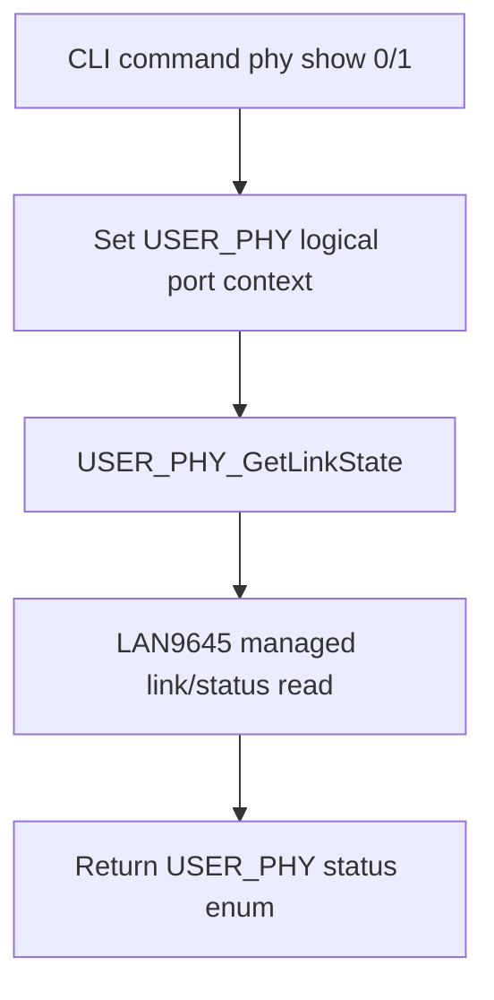

# LAN9645 USER_PHY Driver Specification (Generated `eth_custom_phy_interface` Based)

## Purpose
This document defines the PHY-driver layer for this project using the Cube-generated `USER_PHY` interface:
- `firmware/LWIP/Target/eth_custom_phy_interface.c`
- `firmware/LWIP/Target/eth_custom_phy_interface.h`

Goal:
- keep Cube/LwIP compatibility,
- but map PHY behavior to LAN9645 managed control over SPI,
- with locked phase-1 policy: **10/100 only**, no 1000 advertisement.

---

## 1) Context and Constraints

- Hardware:
  - LAN9645 managed switch
  - copper ports used: `port0`, `port1`
  - STM32H743 MAC on RMII CPU-facing path
- Firmware stack:
  - HAL ETH + LwIP (`NO_SYS=1`)
  - platform PHY component = `USER_PHY`
- Important:
  - this is **not** a real external MDIO PHY chip driver
  - this is a compatibility adapter between Cube `USER_PHY` API and LAN9645 managed register control.

---

## 2) Driver Role

Driver role in one line:
- provide expected `USER_PHY_*` behavior while using LAN9645 managed registers as source of truth.

---

## 3) Locked Behavior (Phase 1)

1. Advertised copper capabilities are fixed to:
- `10HD`
- `10FD`
- `100HD`
- `100FD`

2. 1000M advertisement is always disabled.

3. Link status returned to upper layer must be derived from LAN9645 managed status, not generic MDIO scanning assumptions.

4. USER_PHY function calls must remain deterministic and fast (no long blocking scans).

5. Any unsupported request must return explicit error status (`USER_PHY_STATUS_ERROR` or read/write error where appropriate).

---

## 4) Generated File Gap to Address

Current generated code is generic for a normal MDIO PHY model. For this project:
- do not rely on MDIO PHY address auto-scan behavior as the primary truth source.
- do not treat `USER_PHY` as independent hardware state from LAN9645 managed state.
- do not allow mode transitions outside locked policy.

---

## 5) API Contract (Function-by-Function)

## 5.1 `USER_PHY_RegisterBusIO`
- Keep function signature unchanged.
- Required callbacks:
  - `ReadReg`
  - `WriteReg`
  - `GetTick`
- These callbacks must be bound to LAN9645 adapter accessors.

## 5.2 `USER_PHY_Init`
- Must initialize adapter context only once.
- Must validate LAN9645 communication path is alive (SPI read sanity).
- Must not depend on blind external-PHY address probing as final source of truth.
- Should set deterministic logical device context (default copper port `0` unless explicitly changed).

## 5.3 `USER_PHY_DeInit`
- Must deinitialize adapter context cleanly.
- Must not alter strap-defined hardware mode.

## 5.4 `USER_PHY_SoftwareReset`
- Must map reset behavior to LAN9645 copper PHY control for selected logical port.
- Must honor timeout and return `USER_PHY_STATUS_RESET_TIMEOUT` on expiration.

## 5.5 `USER_PHY_GetLinkState`
- Must return one of:
  - `USER_PHY_STATUS_LINK_DOWN`
  - `USER_PHY_STATUS_10MBITS_HALFDUPLEX`
  - `USER_PHY_STATUS_10MBITS_FULLDUPLEX`
  - `USER_PHY_STATUS_100MBITS_HALFDUPLEX`
  - `USER_PHY_STATUS_100MBITS_FULLDUPLEX`
  - `USER_PHY_STATUS_AUTONEGO_NOTDONE`
- Source for this decision is LAN9645 managed link state + mode.

## 5.6 `USER_PHY_SetLinkState`
- Allowed requests:
  - force 10HD
  - force 10FD
  - force 100HD
  - force 100FD
  - auto-negotiation mode
- Disallowed requests:
  - any 1000 mode/advertisement request
- Disallowed request response:
  - return `USER_PHY_STATUS_ERROR`
  - log LAN error/event for CLI visibility.

## 5.7 `USER_PHY_EnableLoopbackMode` / `DisableLoopbackMode`
- Must map to LAN9645 copper PHY loopback control for selected logical port.
- Return read/write error if LAN9645 access fails.

---

## 6) Virtual Register Semantics to Preserve

The adapter must emulate the following standard registers expected by middleware:

| Register | Expected semantics in adapter |
|---|---|
| `BCR` | reports/accepts local control bits that map to forced mode, restart AN, duplex/speed policy |
| `BSR` | reports link-up, AN complete, and capability bits based on LAN9645 managed state |
| `ANAR` | must expose only 10/100 advertised combinations |
| `ANLPAR` | reflects partner capability intersection as seen by LAN9645 |
| `PHYI1R` / `PHYI2R` | stable identification values for compatibility path |

Policy:
- if a field has no reliable mapping in managed mode, keep a deterministic emulated value and document it.

---

## 7) Logical Port Selection Model (2 Copper Ports)

Because `USER_PHY` object is single-instance but board uses two copper ports:

- default logical port context = `port0`
- adapter must expose port-select helper internally:
  - `lan9645_user_phy_set_port(0|1)`
- CLI and higher-level LAN library APIs should call port-select explicitly before per-port operations.

---

## 8) Error Mapping (Mandatory)

Adapter must map LAN communication failures to USER_PHY status cleanly:

| Condition | USER_PHY return |
|---|---|
| SPI read failure | `USER_PHY_STATUS_READ_ERROR` |
| SPI write failure | `USER_PHY_STATUS_WRITE_ERROR` |
| reset did not complete in timeout | `USER_PHY_STATUS_RESET_TIMEOUT` |
| unsupported mode request | `USER_PHY_STATUS_ERROR` |

And also publish normalized LAN errors to common error path:
- `LAN9645_E_SPI_IFSTAT`
- `LAN9645_E_SPI_TIMEOUT`
- `LAN9645_E_STRAP_EXPECTATION`
- `LAN9645_E_IRQ_STUCK`
- `LAN9645_E_DROP_COUNTER_ALERT`

---

## 9) Integration Points with Current Generated Code

Files directly involved:
- `firmware/LWIP/Target/eth_custom_phy_interface.c`
- `firmware/LWIP/Target/eth_custom_phy_interface.h`
- `firmware/LWIP/Target/ethernetif.c`

Mandatory integration rule:
- `ethernet_link_check_state()` and USER_PHY adapter must agree on the same LAN9645-managed link source and policy.

---

## 10) Non-Goals for This Driver (Phase 1)

- No 1000BASE-T advertisement handling.
- No advanced PHY diagnostics beyond required bring-up and status path.
- No autonomous strap-mode reconfiguration from firmware.

---

## 11) Completion Criteria for USER_PHY Driver

- [ ] All `USER_PHY_*` functions compile and run through LAN9645 adapter path.
- [ ] Link/mode values returned are coherent with LAN9645 managed status.
- [ ] 10/100-only policy is enforced in set/advertisement behavior.
- [ ] Unsupported speed requests return explicit error.
- [ ] Error mapping propagates to CLI status/error reporting path.
- [ ] Per-port context switching (`port0`/`port1`) behaves deterministically.

---

## 12) Current Implementation Snapshot (April 5, 2026)

Implemented:
- `firmware/Core/Inc/lan9645/lan9645_user_phy_adapter.h`
- `firmware/Core/Src/lan9645/lan9645_user_phy_adapter.c`
- `firmware/Core/Inc/lan9645/lan9645_runtime.h`
- `firmware/Core/Src/lan9645/lan9645_runtime.c`
- `firmware/LWIP/Target/ethernetif.c` link-state path bound to USER_PHY + adapter

Implemented behavior in adapter:
- virtual Clause-22 register model for `BCR`, `BSR`, `PHYI1R`, `PHYI2R`, `ANAR`, `ANLPAR`
- strict 10/100 advertisement model
- per-port context (`port0`, `port1`) with explicit active-port selection
- callback-friendly IO wrappers for generated `USER_PHY` bus hooks
- lazy USER_PHY initialization in `ethernet_link_check_state()` after LAN core runtime context is available

Current limitation to validate:
- live link sampling currently uses `lan9645_core_get_rgmii_link()` mapping by logical port index as a bring-up baseline.
- this mapping is provisional until target-base and status-path validation is completed on hardware.
