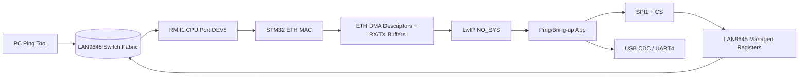
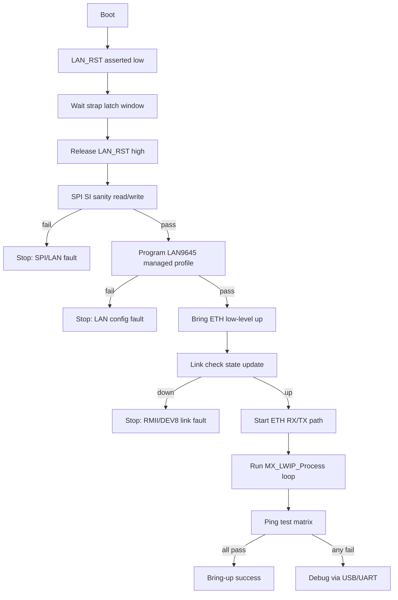
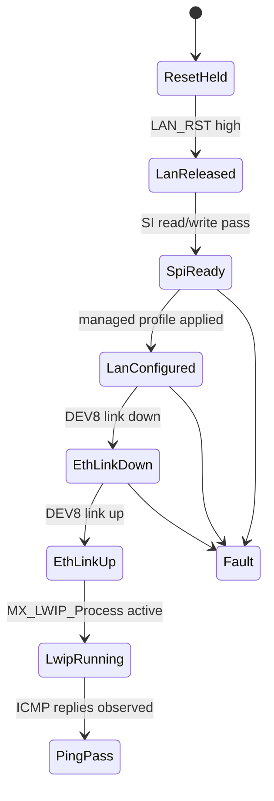
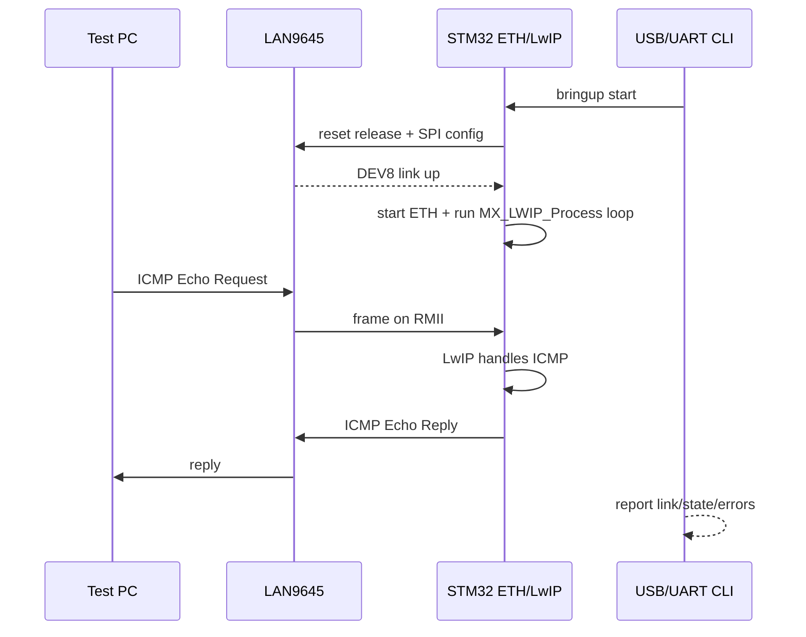
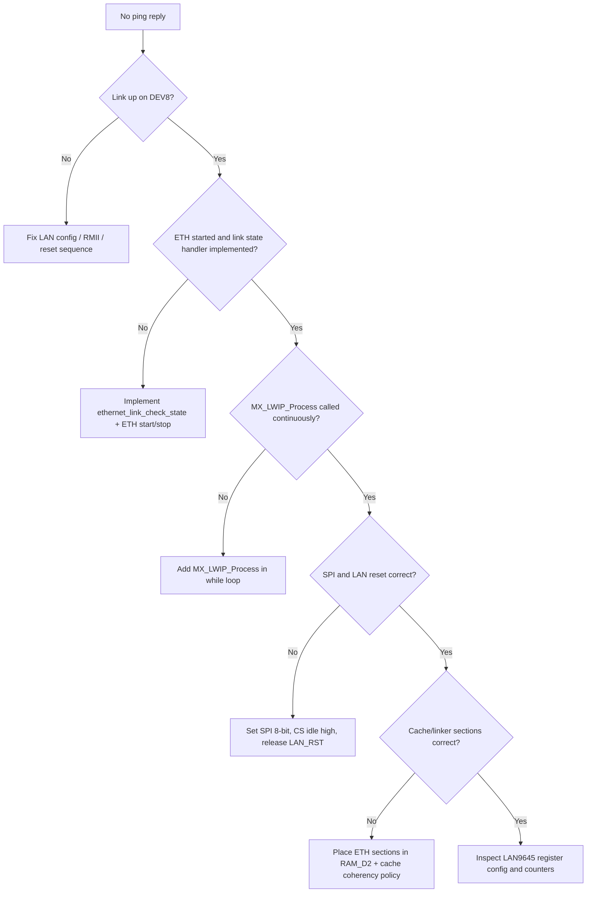

# STM32 Generated Code Ping Bring-Up Checklist (Audit-Based)

## Scope
This document is based on the **current generated firmware code** in `firmware/` and lists what must be ON/checked so LAN9645 bring-up + STM32 ping test can work reliably.

Baseline target:
- STM32H743 MAC in RMII mode
- LAN9645 managed over SPI
- LwIP `NO_SYS=1` static IPv4
- USB CDC / UART4 diagnostics

---

## 1) Current Audit Snapshot (from generated code)

| Item | Required State | Current State | Status |
|---|---|---|---|
| CPU caches | I-Cache ON, D-Cache ON | `Enabled` in `.ioc`, enabled in `main.c` | OK |
| ETH interface | RMII | `HAL_ETH_RMII_MODE` | OK |
| LwIP mode | `NO_SYS=1` | `#define NO_SYS 1` | OK |
| DHCP | disabled for fixed test IP | `LWIP_DHCP=0` | OK |
| PHY platform | `USER_PHY` | `LWIP0.BSP.solution=USER_PHY` | OK |
| USB CDC | enabled | `USB_DEVICE` CDC + init call present | OK |
| USB internal DMA | disabled for FS CDC | `hpcd_USB_OTG_FS.Init.dma_enable = DISABLE` | OK |
| IRQ0 EXTI | enabled | `PD6` EXTI9_5 configured | OK |
| SPI MISO path | enabled | `PA6 = SPI1_MISO` | OK |
| LwIP service in main loop | `MX_LWIP_Process()` called continuously | not called in `while(1)` | **BLOCKER** |
| Link-state function | implemented | `ethernet_link_check_state()` empty | **BLOCKER** |
| ETH MSP low-level config | ETH clocks + RMII AF pins configured | no `HAL_ETH_MspInit` implementation found | **BLOCKER** |
| ETH runtime start path | ETH started when link is up | no `HAL_ETH_Start`/`HAL_ETH_Start_IT` path found | **BLOCKER** |
| SPI frame size for LAN9645 SI | 8-bit transfers | `SPI_DATASIZE_4BIT` | **BLOCKER** |
| SPI CS idle state | CS idle high | `SPI_NSS` initialized low | **BLOCKER** |
| LAN reset line | released high after reset pulse | `LAN_RST` initialized low, no release path | **BLOCKER** |
| Static gateway | not self-IP for direct bench | gateway currently equals device IP | **BLOCKER** |
| ETH descriptor/pool linker sections | explicit placement in `RAM_D2` | sections absent in linker script | **BLOCKER** |
| D-Cache coherency policy | non-cacheable ETH regions or full clean/invalidate flow | only RX invalidate is present | **BLOCKER** |

---

## 2) Architecture View (what must be alive)

---

## 3) Mandatory Bring-Up Gates (No Optional Path)

---

## 4) Exact Items To Turn ON / Verify

## 4.1 CubeMX settings (must stay ON)
- `CORTEX_M7.CPU_ICache=Enabled`
- `CORTEX_M7.CPU_DCache=Enabled`
- `ETH.MediaInterface=HAL_ETH_RMII_MODE`
- `LWIP` enabled
- `LWIP_DHCP=0`
- `LWIP0.BSP.solution=USER_PHY`
- `USB_DEVICE` class `CDC`
- `EXTI9_5` IRQ enabled for `PD6` (`IRQ0`)

## 4.2 Immediate generated-code corrections (must be done before ping)
1. Call `MX_LWIP_Process()` continuously in main loop.
2. Implement `ethernet_link_check_state()` (link read, netif link up/down, ETH start/stop policy).
3. Add ETH low-level MSP (`HAL_ETH_MspInit`) with:
- ETH peripheral clocks
- RMII pin alternate-function setup
- optional ETH IRQ if using interrupt start mode
4. Change SPI1 data size to 8-bit (LAN9645 SI transaction framing).
5. Set SPI CS idle high; assert low only during transaction.
6. Pulse/reset LAN and release `LAN_RST` high before any SI transaction.
7. Set gateway for direct bench profile to `0.0.0.0` (or a valid router IP, not self-IP).
8. Add linker sections for `.RxDescripSection`, `.TxDescripSection`, `.Rx_PoolSection` in `RAM_D2`.
9. Enforce D-Cache coherency:
- non-cacheable MPU for ETH memory regions, or
- explicit clean/invalidate for both TX and RX ownership transitions.
10. Add IRQ callback path for `IRQ0` (PD6 EXTI) to service/clear LAN9645 interrupt source.
11. Bind USER_PHY read/write/tick IO callbacks to LAN9645 SPI-backed accessors.

---

## 5) Generated-Code Evidence Pointers

- Caches enabled:
  - `firmware/ethernetSwitch.ioc` (`CORTEX_M7.CPU_ICache=Enabled`, `CPU_DCache=Enabled`)
  - `firmware/Core/Src/main.c` (`SCB_EnableICache()`, `SCB_EnableDCache()`)
- LwIP init and missing process call:
  - `firmware/Core/Src/main.c` calls `MX_LWIP_Init()` but does not call `MX_LWIP_Process()` in `while(1)`
- Gateway currently set to self-IP:
  - `firmware/LWIP/App/lwip.c` gateway bytes = `192.168.10.50`
- Link-state hook empty:
  - `firmware/LWIP/Target/ethernetif.c` `ethernet_link_check_state(struct netif *netif)` is empty
- SPI data size currently 4-bit:
  - `firmware/Core/Src/main.c` `hspi1.Init.DataSize = SPI_DATASIZE_4BIT`
- SPI CS and LAN reset default low:
  - `firmware/Core/Src/main.c` initializes both `SPI_NSS` and `LAN_RST` to `GPIO_PIN_RESET`
- USB FS internal DMA disabled:
  - `firmware/USB_DEVICE/Target/usbd_conf.c` `hpcd_USB_OTG_FS.Init.dma_enable = DISABLE`
- LwIP memory pointer in D2 space:
  - `firmware/LWIP/Target/lwipopts.h` `LWIP_RAM_HEAP_POINTER 0x30004000`
- ETH linker sections missing:
  - `firmware/STM32H743BITX_FLASH.ld` does not currently define `.RxDescripSection` / `.TxDescripSection` / `.Rx_PoolSection`

---

## 6) Runtime State Model

---

## 7) Ping Test Sequence (expected)

---

## 8) Fault Triage Flow

---

## 9) Acceptance Checklist (pass/fail)

- [ ] LAN reset sequence executes and `LAN_RST` ends high.
- [ ] SPI SI read/write sanity test passes.
- [ ] `ethernet_link_check_state()` is implemented and active.
- [ ] ETH low-level MSP is present and ETH init succeeds.
- [ ] `MX_LWIP_Process()` runs in every main loop iteration.
- [ ] Static IP is valid and gateway is not set to self-IP.
- [ ] ETH descriptor/pool sections are linked into `RAM_D2`.
- [ ] D-Cache coherency policy is fully handled for ETH path.
- [ ] Ping reply works from copper port 0.
- [ ] Ping reply works from copper port 1.
- [ ] Ping reply works from SFP/SGMII port 0.
- [ ] Ping reply works from SFP/SGMII port 1.

