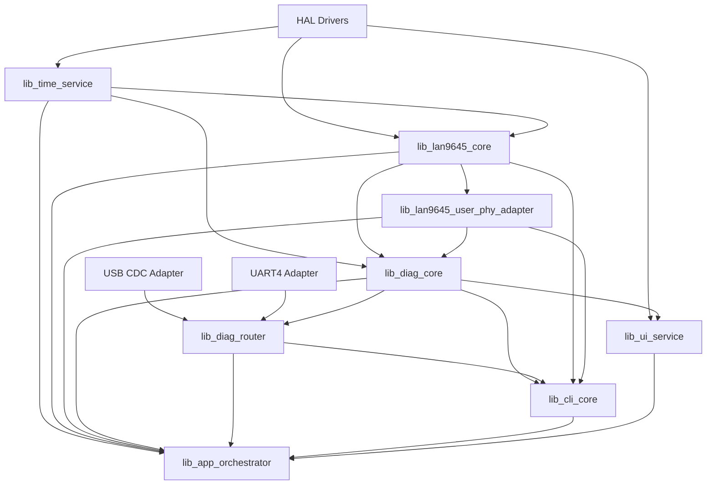
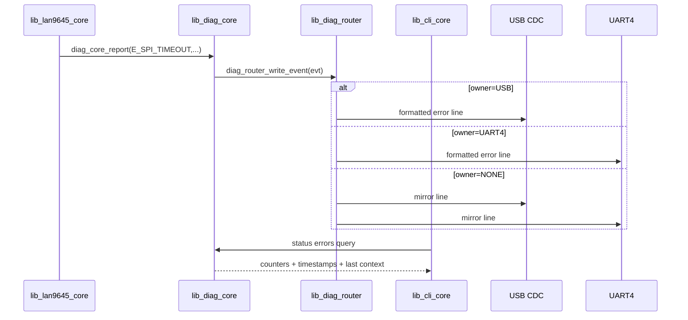

# STM32 User Library API and Dependency Contract (Locked)

## Purpose
This document locks the API boundaries and dependencies for all user-created firmware libraries in this project.

It defines:
- what each library owns,
- what each library is allowed to call,
- exact public APIs (C signatures),
- runtime data flow for status/health/error reporting on USB/UART serial.

This is the baseline for implementation start.

---

## 1) Locked User-Created Libraries

| Library | Responsibility | May depend on | Must not depend on |
|---|---|---|---|
| `lib_lan9645_core` | LAN9645 register control, port/PHY/SerDes/IRQ/stats | HAL SPI/GPIO, `time_service` | CLI/parser logic |
| `lib_lan9645_user_phy_adapter` | `USER_PHY` compatibility mapping to LAN9645 managed state | `lib_lan9645_core`, generated `eth_custom_phy_interface.*` | USB/UART routing |
| `lib_diag_core` | canonical error/event/status model, counters, ring buffer | `time_service` | transport drivers |
| `lib_diag_router` | routes formatted diagnostics to USB/UART with owner policy | USB CDC adapter, UART4 adapter, `lib_diag_core` | LAN register logic |
| `lib_cli_core` | command parsing and dispatch | `lib_diag_core`, `lib_diag_router`, `lib_lan9645_core`, `lib_lan9645_user_phy_adapter` | direct HAL SPI register accesses |
| `lib_ui_service` | HEART/STATUS/ERR LEDs and USER button policy | HAL GPIO, `lib_diag_core` | direct LAN register accesses |
| `lib_time_service` | RTC/uptime timestamps | HAL RTC/Tick | all high-level modules |
| `lib_app_orchestrator` | startup state machine and periodic poll scheduling | all above libraries | none |

---

## 2) Dependency Graph (Locked)



---

## 3) Core Shared Types (Headers)

Create common header:
- `inc/app_common_types.h`

Locked shared types:

```c
typedef enum {
  APP_OK = 0,
  APP_EINVAL = -1,
  APP_EIO = -2,
  APP_ETIMEOUT = -3,
  APP_ENOTSUP = -4,
  APP_ESTATE = -5
} app_status_t;

typedef enum {
  APP_CH_USB = 0,
  APP_CH_UART4 = 1,
  APP_CH_BOTH = 2
} app_channel_t;

typedef enum {
  APP_OWNER_NONE = 0,
  APP_OWNER_USB = 1,
  APP_OWNER_UART4 = 2
} app_owner_t;

typedef struct {
  uint32_t ms_from_boot;
  uint8_t rtc_valid;
  uint16_t year;
  uint8_t month, day, hour, min, sec;
} app_time_t;
```

---

## 4) `lib_diag_core` API (Locked)

Header:
- `inc/diag/diag_core.h`

```c
typedef enum {
  DIAG_SEV_INFO = 0,
  DIAG_SEV_WARN = 1,
  DIAG_SEV_ERR  = 2,
  DIAG_SEV_FATAL = 3
} diag_severity_t;

typedef enum {
  DIAG_EVT_BOOT = 0,
  DIAG_EVT_LAN_SPI_IFSTAT,
  DIAG_EVT_LAN_SPI_TIMEOUT,
  DIAG_EVT_LAN_STRAP_EXPECTATION,
  DIAG_EVT_LAN_RMII_LINK_TIMEOUT,
  DIAG_EVT_LAN_SERDES0_LINK_TIMEOUT,
  DIAG_EVT_LAN_SERDES1_LINK_TIMEOUT,
  DIAG_EVT_LAN_IRQ_STUCK,
  DIAG_EVT_LAN_DROP_COUNTER_ALERT
} diag_event_id_t;

typedef struct {
  diag_event_id_t id;
  diag_severity_t severity;
  uint32_t dev;
  uint32_t reg;
  uint32_t arg0;
  uint32_t arg1;
} diag_event_t;

typedef struct {
  diag_event_id_t id;
  uint32_t count;
  app_time_t first_ts;
  app_time_t last_ts;
  uint32_t last_dev;
  uint32_t last_reg;
  uint32_t last_arg0;
  uint32_t last_arg1;
} diag_error_counter_t;

app_status_t diag_core_init(void);
app_status_t diag_core_report(const diag_event_t *evt);
app_status_t diag_core_get_error(diag_event_id_t id, diag_error_counter_t *out);
app_status_t diag_core_get_last(diag_event_t *out);
app_status_t diag_core_clear_all(void);
```

Rules:
- all modules report faults through `diag_core_report`.
- `diag_core` is source of truth for `status errors`.

---

## 5) `lib_diag_router` API (Locked)

Header:
- `inc/diag/diag_router.h`

```c
typedef struct {
  app_owner_t owner;
  uint8_t usb_ready;
  uint8_t uart_ready;
  uint8_t mirror_when_none;
  uint8_t bridge_usb_uart_on;
} diag_router_state_t;

app_status_t diag_router_init(void);
app_status_t diag_router_set_owner(app_owner_t owner);
app_owner_t  diag_router_get_owner(void);
app_status_t diag_router_set_usb_ready(uint8_t ready);
app_status_t diag_router_set_uart_ready(uint8_t ready);
app_status_t diag_router_write_text(const char *line);
app_status_t diag_router_write_event(const diag_event_t *evt);
app_status_t diag_router_set_bridge(uint8_t on);
app_status_t diag_router_get_state(diag_router_state_t *out);
app_status_t diag_router_poll(void);
```

Rules:
- owner set -> outputs to owner only.
- owner none -> mirror errors to USB + UART4.
- this is the only library allowed to choose output channel.

---

## 6) `lib_cli_core` API (Locked)

Header:
- `inc/cli/cli_core.h`

```c
typedef app_status_t (*cli_cmd_handler_t)(int argc, const char **argv, app_channel_t src);

typedef struct {
  const char *name;
  cli_cmd_handler_t fn;
  const char *help;
} cli_cmd_entry_t;

app_status_t cli_core_init(void);
app_status_t cli_core_register(const cli_cmd_entry_t *entry);
app_status_t cli_core_feed_byte(app_channel_t src, uint8_t b);
app_status_t cli_core_poll(void);
app_status_t cli_core_print_help(app_channel_t dst);
```

Locked phase-1 command group:
- `help`, `version`
- `status all`, `status errors`
- `reg read`, `reg write`, `reg rmw`
- `link show`, `phy show`, `phy adv set`, `phy mode set`
- `console owner usb|uart|release`
- `bridge usb_uart on|off`, `bridge status`
- `debug line show`

---

## 7) `lib_lan9645_core` API (Phase-1 Required Surface)

Header:
- `inc/lan9645/lan9645.h`

```c
typedef struct lan9645_ctx lan9645_ctx_t;

app_status_t lan9645_init(lan9645_ctx_t *ctx);
app_status_t lan9645_reset(lan9645_ctx_t *ctx);
app_status_t lan9645_apply_profile_managed_rmii1(lan9645_ctx_t *ctx);

app_status_t lan9645_read32(lan9645_ctx_t *ctx, uint32_t reg, uint32_t *val);
app_status_t lan9645_write32(lan9645_ctx_t *ctx, uint32_t reg, uint32_t val);
app_status_t lan9645_rmw32(lan9645_ctx_t *ctx, uint32_t reg, uint32_t mask, uint32_t val);

app_status_t lan9645_get_link_dev8(lan9645_ctx_t *ctx, uint8_t *up, uint8_t *speed, uint8_t *duplex);
app_status_t lan9645_phy_get_status(lan9645_ctx_t *ctx, uint8_t port, uint8_t *up, uint8_t *speed, uint8_t *duplex);
app_status_t lan9645_phy_set_adv_10_100(lan9645_ctx_t *ctx, uint8_t port, uint8_t adv_mask);
app_status_t lan9645_phy_force_mode(lan9645_ctx_t *ctx, uint8_t port, uint8_t mode);

app_status_t lan9645_irq_get_and_clear(lan9645_ctx_t *ctx, uint32_t *irq_bitmap);
app_status_t lan9645_stats_snapshot(lan9645_ctx_t *ctx, uint8_t dev, void *stats_out);
```

Rules:
- no direct CLI formatting in this library.
- all failures report into `diag_core`.

---

## 8) `lib_lan9645_user_phy_adapter` API (Locked)

Header:
- `inc/lan9645/lan9645_user_phy_adapter.h`

```c
app_status_t lan9645_uphy_init(lan9645_ctx_t *ctx);
app_status_t lan9645_uphy_set_port(uint8_t port01);
uint8_t      lan9645_uphy_get_port(void);

int32_t lan9645_uphy_ioc_read(uint32_t phy_addr, uint32_t reg, uint32_t *val);
int32_t lan9645_uphy_ioc_write(uint32_t phy_addr, uint32_t reg, uint32_t val);
int32_t lan9645_uphy_ioc_get_tick(void);
```

Rules:
- enforce 10/100 only.
- map `USER_PHY` semantics to LAN9645 managed state.
- reject any 1000-related request with explicit error.

---

## 9) `lib_ui_service` API (Locked)

Header:
- `inc/ui/ui_service.h`

```c
typedef enum {
  UI_ERR_NONE = 0,
  UI_ERR_BLINK1_SPI,
  UI_ERR_BLINK2_STRAP,
  UI_ERR_BLINK3_RMII,
  UI_ERR_BLINK4_SERDES,
  UI_ERR_BLINK5_IRQ,
  UI_ERR_FATAL_STEADY
} ui_err_mode_t;

app_status_t ui_service_init(void);
app_status_t ui_service_set_status_link(uint8_t link_up);
app_status_t ui_service_set_error(ui_err_mode_t mode);
app_status_t ui_service_poll_1ms(void);
```

---

## 10) `lib_time_service` API (Locked)

Header:
- `inc/time/time_service.h`

```c
app_status_t time_service_init(void);
app_status_t time_service_now(app_time_t *out);
app_status_t time_service_format(const app_time_t *t, char *buf, uint32_t len);
```

---

## 11) `lib_app_orchestrator` API (Locked)

Header:
- `inc/app/app_orchestrator.h`

```c
typedef enum {
  APP_ST_BOOT = 0,
  APP_ST_LAN_RESET,
  APP_ST_LAN_SPI_TEST,
  APP_ST_LAN_PROFILE_APPLY,
  APP_ST_NET_READY,
  APP_ST_RUN,
  APP_ST_FAULT
} app_state_t;

app_status_t app_orchestrator_init(void);
app_status_t app_orchestrator_poll(void);
app_state_t  app_orchestrator_get_state(void);
```

---

## 12) Runtime Data Flow for Error/Health/Status



---

## 13) Integration Points with Generated Files

| Generated file | Integration rule |
|---|---|
| `LWIP/Target/eth_custom_phy_interface.c` | call adapter IO callbacks from `lib_lan9645_user_phy_adapter` |
| `LWIP/Target/ethernetif.c` | `ethernet_link_check_state()` uses `lib_lan9645_core` status |
| `LWIP/App/lwip.c` | `MX_LWIP_Process()` called continuously by orchestrator/main |
| `Core/Src/main.c` | initialize orchestrator and poll loop |
| `USB_DEVICE/App/usbd_cdc_if.c` | USB RX bytes fed into `cli_core_feed_byte` |
| `Core/Src/stm32h7xx_it.c` | `IRQ0` ISR notifies LAN/diag path |

---

## 14) Non-Negotiable Rules

1. CLI never writes directly to USB/UART; it writes through `diag_router`.
2. LAN driver never formats human text; it reports structured events to `diag_core`.
3. `diag_core` is the only owner of error counters and health snapshots.
4. `USER_PHY` adapter is the only mapping point between Cube `USER_PHY` API and LAN9645 managed state.
5. Implementation must follow this dependency contract before code merge.

