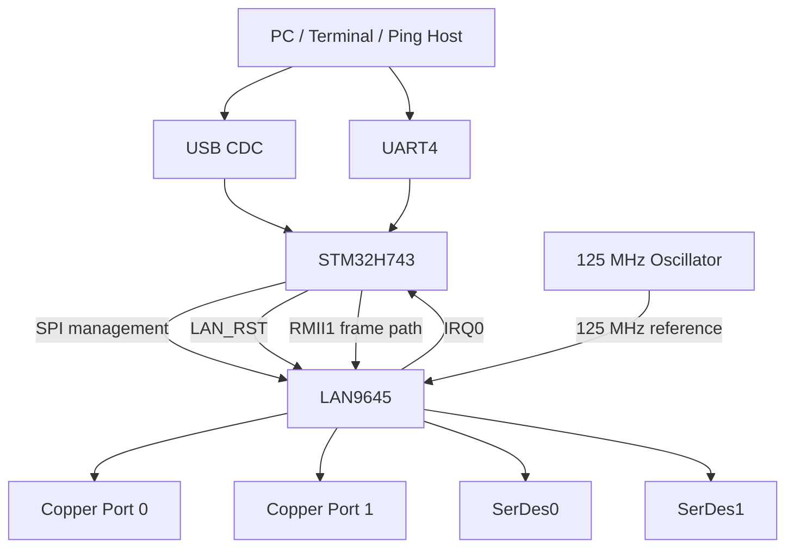
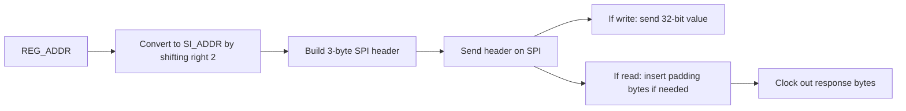
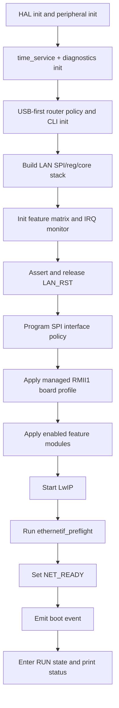
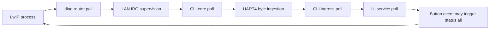
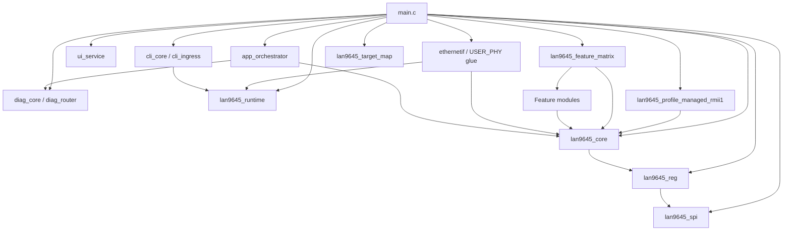
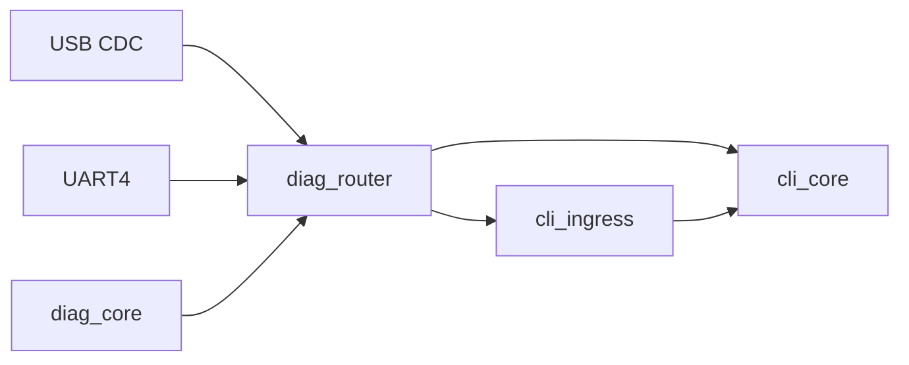
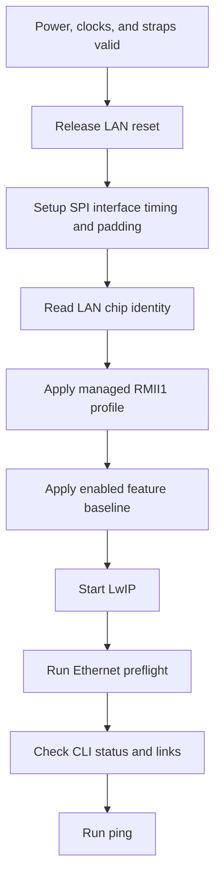

# Ethernet Switch Project Handbook

This repository contains a managed Ethernet switch platform built around a `LAN9645` switch and an `STM32H743` management MCU. The board is designed around two active copper ports, two active SerDes paths, a CPU-facing RMII connection, SPI-based management, and a USB-first CLI and diagnostics workflow.

This `README.md` is intentionally written as the main project handbook. The goal of this file is that a user should be able to understand the hardware, the firmware structure, the boot sequence, the runtime behavior, the LAN9645 feature surface, and the current CLI without needing to open the design-side markdown files first.

## Current Status

| Area | Status | Meaning |
|---|---|---|
| Hardware architecture | Defined | The board role, major interfaces, straps, clocks, and LAN9645 pin usage are fixed. |
| LAN9645 startup straps | Defined | Managed SPI mode, RMII1 CPU link, copper LED overlap handling, and SerDes clock policy are documented and fixed. |
| STM32 control and debug pin plan | Defined | SPI, RMII, LAN reset, IRQ, USB CDC, UART4, LEDs, and user button are assigned. |
| STM32 HAL ETH + LwIP baseline | Implemented in code | The project has a generated-plus-custom Ethernet path ready for bring-up. |
| USER_PHY path | Implemented in code | The LAN9645 internal copper PHY state is exposed to Cube through the custom `USER_PHY` bridge. |
| LAN9645 low-level SPI/register/core stack | Implemented in code baseline | The firmware has a layered SPI, register, target-map, and core API. |
| LAN9645 feature modules | Implemented in code baseline | The repo contains feature-domain modules and CLI hooks for a wide control surface. |
| CLI and diagnostics framework | Implemented in code baseline | USB CDC is the default serial owner and the CLI already exposes many switch domains. |
| Real board power-on validation | Not yet performed | The board is not currently available for hardware proof. |
| Ping validation on real hardware | Not yet performed | The code path exists, but the physical test still needs to be run later. |
| Final target/register truth vs silicon | Still required | The firmware is structured for full control, but the final proof must come from real-board register readback. |

## Quick Navigation

- [1. Project Overview](#1-project-overview)
- [1.1 Project Goal](#11-project-goal)
- [1.2 Locked Project Profile](#12-locked-project-profile)
- [1.3 What Success Looks Like](#13-what-success-looks-like)
- [2. Board Images](#2-board-images)
- [3. System Architecture](#3-system-architecture)
- [3.1 High-Level View](#31-high-level-view)
- [3.2 Control Path vs Data Path](#32-control-path-vs-data-path)
- [3.3 Clocking Strategy](#33-clocking-strategy)
- [4. Hardware Platform](#4-hardware-platform)
- [4.1 LAN9645 Hardware Summary](#41-lan9645-hardware-summary)
- [4.2 Port Usage Model](#42-port-usage-model)
- [4.3 Exact Startup Strap Configuration](#43-exact-startup-strap-configuration)
- [4.4 Definitive Bootstrap Matrix](#44-definitive-bootstrap-matrix)
- [4.5 Functional Pin Assignment](#45-functional-pin-assignment)
- [4.6 Copper LED Pin Usage](#46-copper-led-pin-usage)
- [4.7 Reset and IRQ Design](#47-reset-and-irq-design)
- [4.8 Hardware Facts Software Cannot Repair](#48-hardware-facts-software-cannot-repair)
- [5. STM32H743 Interface Map](#5-stm32h743-interface-map)
- [5.1 Fixed STM32 Control and Debug Pins](#51-fixed-stm32-control-and-debug-pins)
- [5.2 STM32 Ethernet Signals](#52-stm32-ethernet-signals)
- [5.3 STM32 Board LEDs and Button](#53-stm32-board-leds-and-button)
- [5.4 STM32 Role in the System](#54-stm32-role-in-the-system)
- [5.5 RMII Reference Clock Ownership](#55-rmii-reference-clock-ownership)
- [6. Firmware Architecture](#6-firmware-architecture)
- [6.1 Locked Firmware Stack](#61-locked-firmware-stack)
- [6.2 CubeMX and LwIP Operating Model](#62-cubemx-and-lwip-operating-model)
- [6.3 Memory, DMA, Cache, and MPU Assumptions](#63-memory-dma-cache-and-mpu-assumptions)
- [6.4 Locked Static Network Plan](#64-locked-static-network-plan)
- [6.5 Responsibility Split](#65-responsibility-split)
- [6.6 LAN9645 Register Addressing Model](#66-lan9645-register-addressing-model)
- [6.7 SPI Management Transaction Format](#67-spi-management-transaction-format)
- [6.8 USER_PHY Bridge and Ethernet Glue](#68-user_phy-bridge-and-ethernet-glue)
- [6.9 Generated Code vs Project Code](#69-generated-code-vs-project-code)
- [7. Startup and Runtime Execution Model](#7-startup-and-runtime-execution-model)
- [7.1 Main Application States](#71-main-application-states)
- [7.2 Boot Sequence Overview](#72-boot-sequence-overview)
- [7.3 Detailed Startup Sequence](#73-detailed-startup-sequence)
- [7.4 Runtime Loop Responsibilities](#74-runtime-loop-responsibilities)
- [7.5 LAN IRQ Supervision Model](#75-lan-irq-supervision-model)
- [7.6 Why Some Code Stays in main.c](#76-why-some-code-stays-in-mainc)
- [8. Library Architecture](#8-library-architecture)
- [8.1 Top-Level Dependency View](#81-top-level-dependency-view)
- [8.2 Infrastructure Libraries](#82-infrastructure-libraries)
- [8.3 LAN9645 Base Control Libraries](#83-lan9645-base-control-libraries)
- [8.4 Ethernet and LwIP Glue Files](#84-ethernet-and-lwip-glue-files)
- [8.5 Feature Modules](#85-feature-modules)
- [8.6 Intended Library Usage Policy](#86-intended-library-usage-policy)
- [9. LAN9645 Control Surface](#9-lan9645-control-surface)
- [9.1 Fixed-by-Hardware vs Runtime-Controlled](#91-fixed-by-hardware-vs-runtime-controlled)
- [9.2 Bring-Up Critical Runtime Domains](#92-bring-up-critical-runtime-domains)
- [9.3 Feature Family Overview](#93-feature-family-overview)
- [9.4 Complete Feature Matrix](#94-complete-feature-matrix)
- [9.5 Default Firmware Baseline](#95-default-firmware-baseline)
- [9.6 Practical Meaning of Full Control](#96-practical-meaning-of-full-control)
- [10. CLI, Diagnostics, USB/UART, LEDs, and Button](#10-cli-diagnostics-usbuart-leds-and-button)
- [10.1 Serial Policy](#101-serial-policy)
- [10.2 CLI Usage Conventions](#102-cli-usage-conventions)
- [10.3 What `status all` Actually Shows](#103-what-status-all-actually-shows)
- [10.4 CLI Command Family Map](#104-cli-command-family-map)
- [10.5 Complete CLI Command Reference](#105-complete-cli-command-reference)
- [10.6 Diagnostics Event Catalog](#106-diagnostics-event-catalog)
- [10.7 LED Behavior](#107-led-behavior)
- [10.8 User Button Behavior](#108-user-button-behavior)
- [10.9 Serial Routing Model](#109-serial-routing-model)
- [10.10 First Commands to Type on a Fresh Boot](#1010-first-commands-to-type-on-a-fresh-boot)
- [11. Bring-Up and Ping Test Procedure](#11-bring-up-and-ping-test-procedure)
- [11.1 Preconditions Before Firmware Bring-Up](#111-preconditions-before-firmware-bring-up)
- [11.2 Mandatory Bring-Up Order](#112-mandatory-bring-up-order)
- [11.3 Locked Ping Test Network Settings](#113-locked-ping-test-network-settings)
- [11.4 Minimum CLI Checklist Before Ping](#114-minimum-cli-checklist-before-ping)
- [11.5 Expected Ping Matrix](#115-expected-ping-matrix)
- [11.6 Failure Interpretation Guide](#116-failure-interpretation-guide)
- [11.7 Validation Record Placeholder](#117-validation-record-placeholder)
- [12. Validation Status and Open Points](#12-validation-status-and-open-points)
- [12.1 What Is Already True in the Repository](#121-what-is-already-true-in-the-repository)
- [12.2 What Still Needs Real Hardware Validation](#122-what-still-needs-real-hardware-validation)
- [12.3 Important Current Risks](#123-important-current-risks)
- [12.4 Readiness Summary](#124-readiness-summary)

## 1. Project Overview

### 1.1 Project Goal

The goal of this project is to build a managed Ethernet switch board where:

- `LAN9645` performs Ethernet switching, internal PHY control, queueing, filtering, and advanced switch-domain configuration.
- `STM32H743` acts as the management CPU and the CPU-side Ethernet MAC.
- `SPI` is the management path used by the STM32 to read and write LAN9645 registers.
- `RMII1` is the CPU-facing Ethernet frame path between STM32 and LAN9645.
- `USB CDC` is the default user-facing CLI and diagnostics port.
- `UART4` is the secondary serial path for fallback debugging and capture.

The project is not trying to treat the LAN9645 as a dumb external PHY. It is trying to treat it as a managed switch that the STM32 can control at register level through a clean firmware library stack.

### 1.2 Locked Project Profile

| Item | Locked choice |
|---|---|
| Switch family | `LAN9645xS / LAN96459F` |
| Package | `128-pin TQFP` |
| Copper ports physically used | `CuPHY0`, `CuPHY1` |
| Copper target for first validation | `10/100 Mbps` only |
| SerDes paths physically used | `SerDes0`, `SerDes1` |
| SerDes reference | External low-jitter `125 MHz` oscillator |
| MCU | `STM32H743` |
| CPU Ethernet path | `RMII1` |
| Switch management path | `SPI` |
| Extra control lines | `LAN_RST`, `IRQ0` |
| Default CLI owner | `USB CDC` |
| Secondary debug path | `UART4` |
| First test objective | `ping` to STM32 through the switch |

### 1.3 What Success Looks Like

For this project, first-stage success is very concrete:

1. The LAN9645 powers up in the intended managed SPI mode.
2. The STM32 can reset it and communicate with it over SPI.
3. The fixed RMII1 CPU-facing path comes up correctly.
4. The STM32 Ethernet stack starts through HAL ETH + LwIP.
5. The board responds to `ping` at the locked static IP.
6. The user can inspect status, link state, errors, and switch-domain settings through the serial CLI.

Long-term success is broader:

1. The SPI transport is fully trusted.
2. The BSP can configure and read back the switch cleanly.
3. The firmware exposes feature-domain APIs instead of scattering raw register writes through `main.c`.
4. The CLI can act as a bring-up tool, validation tool, and long-term service tool.

## 2. Board Images

These renders are included so the user can visually identify the board orientation, connector placement, and physical layout zones.


.png>)

Use the renders to orient the board into four practical areas:

| Visual zone | What it represents |
|---|---|
| Copper side | The two copper Ethernet ports tied to `CuPHY0` and `CuPHY1` |
| SerDes side | The two SerDes/SGMII/SFP-facing paths |
| MCU/debug side | The STM32H743, USB, UART, LEDs, and user button |
| Control/power side | Reset, clock, power, decoupling, and management-support circuitry |

## 3. System Architecture

### 3.1 High-Level View



### 3.2 Control Path vs Data Path

This distinction is one of the most important ideas in the whole project.

| Path | Direction | Physical interface | Purpose |
|---|---|---|---|
| Management path | STM32 <-> LAN9645 | `SPI` | Read and write switch registers, configure ports, inspect status, clear events, program features |
| Interrupt path | LAN9645 -> STM32 | `IRQ0` | Notify the STM32 that the switch has a cause worth checking |
| Reset path | STM32 -> LAN9645 | `LAN_RST` | Force deterministic switch reset and strap re-latch |
| CPU frame path | STM32 <-> LAN9645 | `RMII1` | Carry actual Ethernet frames between the STM32 MAC and the switch fabric |
| Serial debug path | User <-> STM32 | `USB CDC` and `UART4` | Run CLI commands, inspect status, collect errors |

A critical consequence of this split is:

- `SPI` configures the switch.
- `RMII` carries frames.
- `IRQ0` reports events.
- The serial ports explain what is happening.

### 3.3 Clocking Strategy

The board uses two different clock domains that must not be confused.

| Clock | Owner | Destination | Purpose |
|---|---|---|---|
| `125 MHz` | External oscillator | LAN9645 `S0_CLKP` | SerDes reference clock |
| `50 MHz RMII REF_CLK` | LAN9645 | STM32 `ETH_REF_CLK` | RMII timing reference for the CPU Ethernet link |

Important design conclusions:

1. The SerDes `125 MHz` is not generated by the STM32.
2. `SD_125M` is strapped high so the LAN9645 expects the external `125 MHz` reference.
3. `SGPIO_EN` must remain low when `SD_125M=1`.
4. For this design, the LAN9645 should be treated as the generator of the RMII `REF_CLK` seen by the STM32.
5. The STM32 should not be used as the RMII clock master for this switch link.

## 4. Hardware Platform

### 4.1 LAN9645 Hardware Summary

| Domain | Selected implementation |
|---|---|
| Managed mode | Yes |
| Management host | STM32 over SPI |
| CPU-facing Ethernet | `RMII1` |
| Active copper ports | `CuPHY0`, `CuPHY1` |
| Active SerDes ports | `SerDes0`, `SerDes1` |
| JTAG | disabled by strap |
| `SD_125M` | strapped high |
| `SGPIO_EN` | strapped low |
| Copper LED pins | enabled, including strap-overlap pins |

### 4.2 Port Usage Model

The hardware physically supports more internal switch resources than the first validation path needs. This project intentionally narrows the first scope.

| Port/domain | Project role | First bring-up priority |
|---|---|---|
| `CuPHY0` | Active copper user port | High |
| `CuPHY1` | Active copper user port | High |
| CPU-facing path | STM32 conduit / CPU port via `RMII1` | High |
| `SerDes0` | Active hardware path | Medium |
| `SerDes1` | Active hardware path | Medium |
| Other internal port resources | Not the first focus | Low |

Important practical rule:

- The first code validation is built around a stable managed switch plus a working CPU port.
- The first success case is not "every switch feature is proven".
- The first success case is "the switch is controlled, the CPU port works, and ping works".

### 4.3 Exact Startup Strap Configuration

The following table is the exact startup strap plan for the selected managed SPI configuration.

| Strap | GPIO / Pin | State at reset | Typical resistor | Meaning in this project |
|---|---|---|---|---|
| `BOOT_MODE0` | `GPIO_24 / pin 70` | LOW | `10k` to GND | managed startup profile |
| `BOOT_MODE1` | `GPIO_25 / pin 68` | LOW | `10k` to GND | managed startup profile |
| `BOOT_MODE2` | `GPIO_26 / pin 67` | LOW | `10k` to GND | managed startup profile |
| `MGMT_MODE0` | `GPIO_27 / pin 66` | HIGH | `10k` to VCC | SPI client management |
| `MGMT_MODE1` | `GPIO_28 / pin 65` | HIGH | `10k` to VCC | SPI client management |
| `JTAG_ENB` | `GPIO_34 / pin 43` | HIGH | `10k` to VCC | JTAG disabled |
| `SD_125M` | `GPIO_23 / pin 71` | HIGH | `10k` to VCC | external 125 MHz SerDes reference selected |
| `SGPIO_EN` | `GPIO_22 / pin 72` | LOW | `10k` to GND | must stay low when `SD_125M=1` |
| `LOOP_EN` | `GPIO_35 / pin 42` | LOW | `10k` to GND | unmanaged loop feature forced off |
| `EEPROM_SIZE` | `GPIO_33 / pin 60` | LOW | `22k` to GND | EEPROM strap forced low, then pin reused as IRQ0 |
| `GPIO_MODE0` | `GPIO_36 / pin 41` | LOW | `10k` to GND | unmanaged GPIO mode strap forced low |
| `GPIO_MODE1` | `GPIO_37 / pin 40` | LOW | `10k` to GND | unmanaged GPIO mode strap forced low |
| `SD_MODE0` | `GPIO_39 / pin 36` | LOW | `10k` to GND | unmanaged SerDes mode strap forced low |
| `SD_MODE1` | `GPIO_40 / pin 35` | LOW | `10k` to GND | unmanaged SerDes mode strap forced low |
| `XMII_MODE0` | `GPIO_41 / pin 34` | LOW | `10k` to GND | unmanaged XMII strap forced low |
| `XMII_MODE1` | `GPIO_38 / pin 38` | LOW | `10k` to GND | unmanaged XMII strap forced low |
| `E2E_CLOCK_EN` | `GPIO_10 / pin 87` | LOW | `47k` to GND | weak strap because pin becomes RMII |
| `FLOW_EN` | `GPIO_11 / pin 86` | LOW | `47k` to GND | weak strap because pin becomes RMII |
| `EEE_EN` | `GPIO_12 / pin 85` | LOW | `47k` to GND | weak strap because pin becomes RMII |
| `LED_MODE` | `GPIO_13 / pin 83` | LOW | `47k` to GND | weak strap because pin becomes RMII |
| `CUPHY_MODE` | `GPIO_14 / pin 82` | LOW | `47k` to GND | copper unmanaged strap forced low |
| `SFP_EN` | `GPIO_15 / pin 81` | LOW | `47k` to GND | unmanaged strap forced low |

Why the weaker `47k` pull-downs on `GPIO10..15` matter:

- those pins are reused for live interface signals after reset
- weaker straps reduce dynamic loading during runtime
- they still provide deterministic strap bias during reset latch

### 4.4 Definitive Bootstrap Matrix

This is the strap-by-strap answer to the simple question: "which strap is actually used, which one is just forced, and what level must it have?"

| Strap | GPIO | TQFP pin | Used in this mode? | Required state | Project meaning |
|---|---:|---:|---|---|---|
| `BOOT_MODE0` | 24 | 70 | Mandatory | LOW | with BOOT_MODE1/2 selects managed startup |
| `BOOT_MODE1` | 25 | 68 | Mandatory | LOW | with BOOT_MODE0/2 selects managed startup |
| `BOOT_MODE2` | 26 | 67 | Mandatory | LOW | with BOOT_MODE0/1 selects managed startup |
| `MGMT_MODE0` | 27 | 66 | Mandatory | HIGH | with MGMT_MODE1 selects SPI client management |
| `MGMT_MODE1` | 28 | 65 | Mandatory | HIGH | with MGMT_MODE0 selects SPI client management |
| `JTAG_ENB` | 34 | 43 | Mandatory | HIGH | disables JTAG so the pins are not claimed by JTAG logic |
| `SD_125M` | 23 | 71 | Mandatory | HIGH | external 125 MHz SerDes reference is expected |
| `SGPIO_EN` | 22 | 72 | Constraint | LOW | must be low while `SD_125M` is high |
| `LOOP_EN` | 35 | 42 | Forced-low strap | LOW | unmanaged feature held off |
| `E2E_CLOCK_EN` | 10 | 87 | Forced-low strap | LOW | unmanaged feature held off |
| `FLOW_EN` | 11 | 86 | Forced-low strap | LOW | unmanaged feature held off |
| `EEE_EN` | 12 | 85 | Forced-low strap | LOW | unmanaged feature held off at strap level |
| `LED_MODE` | 13 | 83 | Forced-low strap | LOW | unmanaged feature held off |
| `CUPHY_MODE` | 14 | 82 | Forced-low strap | LOW | copper behavior left to managed software |
| `SFP_EN` | 15 | 81 | Forced-low strap | LOW | unmanaged feature held off |
| `EEPROM_SIZE` | 33 | 60 | Forced-low strap | LOW | no dependence on unmanaged EEPROM boot logic |
| `GPIO_MODE0` | 36 | 41 | Forced-low strap | LOW | keep startup deterministic |
| `GPIO_MODE1` | 37 | 40 | Forced-low strap | LOW | keep startup deterministic |
| `SD_MODE0` | 39 | 36 | Forced-low strap | LOW | keep startup deterministic |
| `SD_MODE1` | 40 | 35 | Forced-low strap | LOW | keep startup deterministic, later reused as LED |
| `XMII_MODE0` | 41 | 34 | Forced-low strap | LOW | keep startup deterministic, later reused as LED |
| `XMII_MODE1` | 38 | 38 | Forced-low strap | LOW | keep startup deterministic |

### 4.5 Functional Pin Assignment

#### Copper differential pairs

| Function | TQFP pins |
|---|---|
| `CuPHY0` differential pairs | `102, 103, 105, 106, 108, 109, 110, 111` |
| `CuPHY1` differential pairs | `112, 113, 114, 115, 117, 118, 120, 121` |

#### SerDes pins

| Function | TQFP pins |
|---|---|
| `SerDes0` | `45, 46, 48, 49, 50` |
| `SerDes1` | `53, 55, 56, 57` |

#### External 125 MHz reference

| Net | From | To | Notes |
|---|---|---|---|
| `SERDES_125M_CLK` | 125 MHz oscillator output | `S0_CLKP` pin `45` | must be valid before reset release |
| `SD_125M_SEL` | External strap/jumper | `GPIO_23 / pin 71` | fixed high at boot |
| `SGPIO_EN_SEL` | External strap/jumper | `GPIO_22 / pin 72` | fixed low at boot |

#### SPI management pins

| Signal | LAN9645 GPIO | TQFP pin | Direction relative to LAN9645 |
|---|---|---:|---|
| `SI_nCS` | `GPIO_2` | 98 | chip select input |
| `SI_CLK` | `GPIO_3` | 97 | SPI clock input |
| `SI_DI` | `GPIO_0` | 100 | data input from STM32 MOSI |
| `SI_DO` | `GPIO_1` | 99 | data output to STM32 MISO |

#### CPU-facing RMII1 signal map

| STM32 ETH signal | LAN9645 RMII1 signal | LAN9645 GPIO | TQFP pin | Direction |
|---|---|---|---:|---|
| `ETH_TXD0` | `RGMII1_RXD0` | `GPIO_4` | 95 | STM32 -> LAN9645 |
| `ETH_TXD1` | `RGMII1_RXD1` | `GPIO_5` | 94 | STM32 -> LAN9645 |
| `ETH_TX_EN` | `RGMII1_RXCTL_CRS_DV` | `GPIO_9` | 89 | STM32 -> LAN9645 |
| `ETH_RXD0` | `RGMII1_TXD0` | `GPIO_12` | 85 | LAN9645 -> STM32 |
| `ETH_RXD1` | `RGMII1_TXD1` | `GPIO_13` | 83 | LAN9645 -> STM32 |
| `ETH_CRS_DV` | `RGMII1_TXCTL_TX_DV` | `GPIO_11` | 86 | LAN9645 -> STM32 |
| `ETH_REF_CLK` | `RGMII1_TXC_REFCLK` | `GPIO_10` | 87 | LAN9645 -> STM32 |

Important RMII notes:

- `GPIO_10`, `GPIO_11`, `GPIO_12`, and `GPIO_13` are strap-overlap pins, so their reset-time weak pull resistors matter.
- `ETH_REF_CLK` is expected to be driven by the LAN9645, not by the STM32.
- `RGMII1_RXD2_RXER` and `RGMII1_RXC_REFCLK` are not part of the selected STM32 RMII pin set and are not used in this design.

### 4.6 Copper LED Pin Usage

The selected copper LED outputs are:

| LED output | LAN9645 GPIO | TQFP pin | Strap overlap | Valid for this design? |
|---|---|---:|---|---|
| `PHY0_LED1` | `GPIO_43` | 31 | No | Yes |
| `PHY0_LED0` | `GPIO_42` | 33 | No | Yes |
| `PHY1_LED1` | `GPIO_41` | 34 | Yes, overlaps `XMII_MODE0` | Yes |
| `PHY1_LED0` | `GPIO_40` | 35 | Yes, overlaps `SD_MODE1` | Yes |

Why the PHY1 LED choice still makes sense:

1. Strap logic matters only at reset latch.
2. After reset, those pins can be reassigned to LED alternate function.
3. A fixed pull-down keeps the startup strap value correct.
4. The LED still works afterward because runtime function selection changes.

Recommended LED wiring model on the LAN9645 side:

| LED pin type | Recommended electrical model |
|---|---|
| LAN9645 PHY LED pins | active-low LED drive |
| LED anode | to supply through resistor |
| LED cathode | to LAN9645 LED pin |

This is different from the STM32 board LEDs, which are active high.

### 4.7 Reset and IRQ Design

| Function | LAN9645 pin | Direction | Notes |
|---|---:|---|---|
| `nRESET` | 101 | STM32 -> LAN9645 | active low reset input |
| `IRQ0` | 60 | LAN9645 -> STM32 | produced from `GPIO_33` alternate function |

Reset sequence requirements:

1. `SERDES_125M_CLK` must already be valid.
2. Strap resistors and jumpers must already be stable.
3. The STM32 should not disturb strap-overlap pins during reset latch.
4. `nRESET` is released.
5. Only after the post-reset settling interval should SPI transactions begin.

### 4.8 Hardware Facts Software Cannot Repair

These points are intentionally explicit because they are a common source of confusion.

| Hardware fact | Can software fix it later? | Why |
|---|---|---|
| Wrong `BOOT_MODE[2:0]` | No | the mode is latched during reset release |
| Wrong `MGMT_MODE[1:0]` | No | management path choice is latched at reset |
| `SD_125M` wrong at reset | No | the SerDes reference expectation is already chosen |
| `SGPIO_EN` high while `SD_125M=1` | No | the hardware mode is already inconsistent |
| Missing 125 MHz oscillator | No | software cannot invent the SerDes reference clock |
| Wrong RMII wiring | No | firmware cannot repair a netlist mistake |
| Wrong SPI wiring | No | firmware cannot recover from physically crossed MOSI/MISO/NSS/SCK |
| Missing IRQ wire | Partially | the switch can still be polled, but the intended interrupt model is broken |

## 5. STM32H743 Interface Map

### 5.1 Fixed STM32 Control and Debug Pins

| STM32 signal | MCU pin | Connected function |
|---|---|---|
| `SPI_NSS` | `PA4` | LAN9645 `SI_nCS` |
| `SPI_SCK` | `PA5` | LAN9645 `SI_CLK` |
| `SPI_MISO` | `PA6` | LAN9645 `SI_DO` |
| `SPI_MOSI` | `PD7` | LAN9645 `SI_DI` |
| `LAN_RST` | `PD5` | LAN9645 `nRESET` |
| `IRQ0` | `PD6` | LAN9645 `IRQ0` |
| `USB_DM` | `PA11` | USB FS data minus |
| `USB_DP` | `PA12` | USB FS data plus |
| `UART4_RX` | `PI9` | secondary debug input |
| `UART4_TX` | `PA0` | secondary debug output |

### 5.2 STM32 Ethernet Signals

| STM32 ETH signal | MCU ownership | Linked LAN9645 pin function |
|---|---|---|
| `ETH_TXD0` | STM32 MAC output | LAN9645 `GPIO_4` |
| `ETH_TXD1` | STM32 MAC output | LAN9645 `GPIO_5` |
| `ETH_TX_EN` | STM32 MAC output | LAN9645 `GPIO_9` |
| `ETH_RXD0` | STM32 MAC input | LAN9645 `GPIO_12` |
| `ETH_RXD1` | STM32 MAC input | LAN9645 `GPIO_13` |
| `ETH_CRS_DV` | STM32 MAC input | LAN9645 `GPIO_11` |
| `ETH_REF_CLK` | STM32 MAC input | LAN9645 `GPIO_10` |

### 5.3 STM32 Board LEDs and Button

| Board signal | MCU pin | Polarity | Meaning |
|---|---|---|---|
| `HEART` | `PG6` | active high | firmware-alive indicator |
| `STATUS` | `PG7` | active high | network and switch-ready indicator |
| `ERR` | `PG8` | active high | error indicator |
| `USER button` | `PI10` | active low | local status trigger |

### 5.4 STM32 Role in the System

The STM32 has four jobs at the same time.

| STM32 role | What it actually means |
|---|---|
| Management master | It drives the SPI management interface and owns switch configuration. |
| CPU MAC | It exchanges actual Ethernet frames with the switch over RMII1. |
| Diagnostics host | It turns failures and state transitions into readable serial output. |
| User control point | It hosts the CLI over USB CDC and UART4. |

### 5.5 RMII Reference Clock Ownership

This point is important enough to state directly.

For this board, the LAN9645 should be treated as the source of the RMII `REF_CLK` seen by the STM32. The STM32 should not be used to generate the RMII reference for the switch.

Why this makes sense here:

1. The selected net direction is `LAN9645 -> STM32` on `ETH_REF_CLK`.
2. The STM32 pin list you locked does not imply an STM32-generated REF clock path.
3. The switch CPU-facing port profile is being configured from the LAN side.
4. Keeping the LAN9645 as the RMII clock source makes the CPU port behave like a switch-owned conduit interface.

## 6. Firmware Architecture

### 6.1 Locked Firmware Stack

| Layer | Selected technology |
|---|---|
| MCU HAL | `STM32Cube HAL` |
| Network stack | `LwIP` |
| Operating model | `NO_SYS=1` polling model |
| Ethernet low-level driver | Cube-generated `ethernetif.c` with project customizations |
| PHY abstraction | Cube `USER_PHY` option with project adapter |
| Switch management | Custom LAN9645 SPI/register/core stack |
| User control plane | project CLI over `USB CDC` and `UART4` |
| Runtime diagnostics | project `diag_core` + `diag_router` |

### 6.2 CubeMX and LwIP Operating Model

The firmware direction for this project is deliberately simple:

- `HAL ETH` provides the MCU Ethernet driver.
- `LwIP` provides the IP stack.
- `NO_SYS=1` is used instead of FreeRTOS.
- `USER_PHY` is used instead of a canned LAN8742 driver.
- `USB CDC` is the default serial CLI path.
- `UART4` remains available as a secondary path.

Why this direction was chosen:

| Decision | Reason |
|---|---|
| `NO_SYS=1` | easier first bring-up, smaller moving-parts count |
| `USER_PHY` | the LAN9645 is not a LAN8742 and must be represented by a custom bridge |
| Static IP | removes DHCP-related variables from the first ping validation |
| USB-first CLI | easiest daily debug path for the user |

### 6.3 Memory, DMA, Cache, and MPU Assumptions

The STM32H7 Ethernet path only behaves reliably if cache and DMA placement are handled correctly.

| Area | Project expectation |
|---|---|
| DCache | enabled |
| ICache | enabled |
| ETH DMA descriptors | placed in the dedicated non-cacheable memory section |
| RX buffer pool | placed in the dedicated RX pool section |
| MPU | configured so ETH DMA memory is coherent and does not get corrupted by cache behavior |
| ETH low-level mode | zero-copy oriented as generated in `ethernetif.c` |

Practical meaning:

- The project is not using a naive "just enable Ethernet" setup.
- The generated ETH descriptors, RX pool, and MPU configuration are part of the bring-up contract.
- If these memory rules are broken, ping may fail even when the LAN9645 side is correct.

### 6.4 Locked Static Network Plan

The first validation phase uses a fixed static network plan.

| Device | IP | Netmask | Gateway |
|---|---|---|---|
| STM32 board | `192.168.10.50` | `255.255.255.0` | `0.0.0.0` |
| PC test host | `192.168.10.100` | `255.255.255.0` | `0.0.0.0` |

This design intentionally does not start with DHCP. Static addressing keeps the first test deterministic.

### 6.5 Responsibility Split

The project is easier to understand when each layer has a clear job.

| Layer | Owns what |
|---|---|
| `main.c` | board-level boot order, peripheral init, service bring-up, global control flow |
| `app_orchestrator` | firmware state machine and LAN IRQ supervision policy |
| `diag_core` | in-memory event store and counters |
| `diag_router` | delivery of text and events to USB CDC and/or UART4 |
| `ui_service` | HEART/STATUS/ERR LEDs and button polling |
| `cli_core` | command parsing, command execution, text replies |
| `cli_ingress` | serial-byte ingestion into CLI |
| `lan9645_spi` | raw SPI transport and timing/padding support |
| `lan9645_reg` | register read/write transaction layer |
| `lan9645_target_map` | base target/address mapping for the switch |
| `lan9645_core` | common reset, SPI setup, port mode, IRQ analysis helpers |
| `lan9645_profile_managed_rmii1` | fixed board profile for this exact hardware design |
| `lan9645_feature_matrix` | inventory of feature modules, enable state, and apply sequencing |
| feature modules such as `lan9645_vlan`, `lan9645_qos`, `lan9645_vcap` | domain-specific switch configuration |
| `ethernetif.c` | HAL ETH + LwIP low-level interface |
| `lan9645_user_phy_adapter` | makes LAN9645 internal PHY state look like a Cube `USER_PHY` backend |

### 6.6 LAN9645 Register Addressing Model

The addressing model is one of the most important technical details in the whole project.

The documentation and Linux reference material commonly describe register locations in 32-bit word-addressed terms, while the SPI management transport uses a 23-bit path field derived from that address.

For this project, the rule used in the README and firmware baseline is:

```text
SI_ADDR = (REG_ADDR & 0x01FFFFFF) >> 2
```

Meaning:

| Term | Meaning |
|---|---|
| `REG_ADDR` | the 32-bit-aligned register address you think of when reading register maps |
| `>> 2` | converts byte addressing into word addressing |
| `SI_ADDR` | the address field actually sent in the 3-byte SPI management header |

Practical warning:

- The software stack is built around this model.
- It is the correct direction for continuing the BSP implementation.
- Final silicon-level validation still depends on readback against the actual board.

### 6.7 SPI Management Transaction Format

The management SPI protocol uses a compact header rather than a normal memory-mapped bus protocol.

| Field | Meaning |
|---|---|
| 1 control bit | read/write selection |
| 23 address bits | the switch register path |
| 4 data bytes | present for writes, and returned for reads |

Operational model:



Read behavior details:

- read timing may require one or more padding bytes before valid return data appears
- padding depends on active SPI clock rate
- the firmware keeps padding as part of the SPI/core setup state

Write behavior details:

- the header selects write mode
- the 32-bit register value is sent immediately after the header
- readback should still be used for validation whenever practical

### 6.8 USER_PHY Bridge and Ethernet Glue

The STM32 HAL ETH and LwIP stack want to interact with a PHY-style object. The LAN9645 is not being used as a normal external PHY device on MDIO here, so the project uses a custom bridge.

That bridge is the `lan9645_user_phy_adapter`.

Its job is:

1. expose Clause-22-style PHY register behavior expected by Cube
2. translate those reads and writes into LAN9645-controlled internal PHY state
3. let HAL ETH and LwIP decide link-up, speed, and duplex using the switch-managed copper side

Important current implementation detail:

- the Ethernet glue currently binds the active `USER_PHY` port to `LAN9645_USER_PHY_PORT1`
- that means copper port 1 is currently the active link-status source used by the ETH middleware path

The adapter currently models the expected Clause-22 basics:

| Register | Meaning |
|---|---|
| `BCR` | basic control |
| `BSR` | basic status |
| `PHYI1R` | PHY ID 1 |
| `PHYI2R` | PHY ID 2 |
| `ANAR` | auto-negotiation advertisement |
| `ANLPAR` | auto-negotiation link partner ability |

The project policy is currently `10/100` advertisement only. That means the default auto-negotiation path is intentionally limited to the 10/100 capability set relevant to the board's first-phase CPU and switch design.

### 6.9 Generated Code vs Project Code

This distinction is important for anyone maintaining the repo.

| Type | Example | Meaning |
|---|---|---|
| Generated code | `MX_SPI1_Init()`, `MX_LWIP_Init()`, `ethernetif.c` base structure | produced by CubeMX or ST middleware generation |
| Project custom code | `lan9645_core`, `lan9645_profile_managed_rmii1`, CLI, diagnostics, user PHY adapter | custom logic written specifically for this switch project |
| Hybrid file | `ethernetif.c` | generated base file with important project-specific user code sections |

This is why some logic remains outside the pure LAN9645 BSP. The BSP should stay switch-focused, while the application layer still owns board-level boot order, serial ownership, and overall runtime orchestration.

## 7. Startup and Runtime Execution Model

### 7.1 Main Application States

The orchestrator state machine uses the following states.

| State | Meaning |
|---|---|
| `BOOT` | general firmware boot and service startup phase |
| `LAN_RESET` | external LAN reset is being applied and released |
| `LAN_SPI_TEST` | the SPI-side interface is being brought online |
| `LAN_PROFILE_APPLY` | the fixed RMII1 managed profile is being applied |
| `NET_READY` | the Ethernet stack is initialized and ready |
| `RUN` | the board is in normal runtime operation |
| `FAULT` | a fatal or latched failure has moved the application into fault state |

### 7.2 Boot Sequence Overview



### 7.3 Detailed Startup Sequence

The following table is intentionally explicit. It is effectively a user-readable explanation of the current boot logic in `main.c`.

| Step | Function or action | Why it exists | What failure means |
|---|---|---|---|
| 1 | `HAL_Init()` and system clock configuration | basic MCU startup | MCU never reaches project logic |
| 2 | `MX_GPIO_Init()` | configures GPIO ownership and directions | reset, LEDs, button, SPI pins, and IRQ line cannot work correctly |
| 3 | `MX_SPI1_Init()` | prepares the management SPI peripheral | STM32 cannot control the switch |
| 4 | `MX_UART4_Init()` | enables secondary debug path | fallback serial path unavailable |
| 5 | `MX_RTC_Init()` | timestamp support | time-based diagnostics quality reduced |
| 6 | `MX_CRC_Init()` and `MX_RNG_Init()` | utility services | secondary support services missing |
| 7 | `MX_USB_DEVICE_Init()` | brings up USB CDC transport | primary CLI/debug path unavailable |
| 8 | compute effective SPI clock with `lan9645_spi_effective_clock_hz()` | needed for SPI padding/setup rules | SPI interface setup may use fallback clock assumptions |
| 9 | `time_service_init()` | timing base for diagnostics and services | timestamps and periodic services are unreliable |
| 10 | `diag_core_init()` | event storage must exist before bring-up continues | failures cannot be recorded coherently |
| 11 | `diag_router_init()` | output path must exist before LAN bring-up | there is no organized diagnostics output |
| 12 | `diag_router_set_owner(APP_OWNER_USB)` | makes USB CDC the default CLI/debug owner | replies may not go to the expected port |
| 13 | `diag_router_set_uart_ready(1)` | keeps UART4 available as fallback | no secondary serial path |
| 14 | `app_orchestrator_init()` | state machine must exist before boot sequencing | no reliable state tracking |
| 15 | `app_orchestrator_set_state(APP_STATE_BOOT)` | marks the system as in boot phase | status reporting is less clear |
| 16 | `ui_service_init()` | board LEDs/button service comes online | no clean user feedback |
| 17 | `cli_core_init()` | command engine becomes available | no CLI execution |
| 18 | `cli_ingress_init()` | serial bytes can be fed into the CLI | user input cannot reach CLI parser |
| 19 | clear UI LEDs | starts from known visible state | misleading LED state |
| 20 | `lan9645_spi_init()` | binds SPI1 + NSS GPIO to the switch transport | no low-level switch transport |
| 21 | `lan9645_reg_init()` | creates the register-access layer | no structured register read/write path |
| 22 | `lan9645_target_map_apply_board_defaults()` | installs the base target/address mapping | register helpers may point at wrong target assumptions |
| 23 | `lan9645_core_init()` | creates the high-level switch core helper | higher-level switch actions cannot run |
| 24 | `lan9645_runtime_set_core()` | exposes the core to CLI and runtime helpers | shared helpers cannot find the switch core |
| 25 | `lan9645_feature_matrix_init()` | inventory of supported feature modules becomes available | feature control is not organized |
| 26 | `lan9645_runtime_set_feature_matrix()` | exposes the matrix to CLI/runtime | CLI cannot inspect/apply feature state |
| 27 | `app_orchestrator_lan_irq_init()` | starts IRQ runtime tracking | IRQ supervision is blind |
| 28 | `app_orchestrator_set_state(APP_STATE_LAN_RESET)` | announces switch reset phase | boot trace loses clarity |
| 29 | `lan9645_core_hw_reset()` | pulses `LAN_RST` and re-latches straps | switch may stay in unknown power-on state |
| 30 | `lan9645_core_spi_setup()` | configures interface readiness and read-padding behavior | SPI reads can be invalid or badly timed |
| 31 | `app_orchestrator_set_state(APP_STATE_LAN_SPI_TEST)` | announces that SPI-side bring-up is under way | status trace less precise |
| 32 | `app_orchestrator_set_state(APP_STATE_LAN_PROFILE_APPLY)` | announces profile stage | status trace less precise |
| 33 | `lan9645_profile_managed_rmii1_apply()` | applies the fixed board profile for managed RMII1 operation | the conduit/CPU-facing link may never work |
| 34 | report profile result through diagnostics | captures `chip_id` and feature-disable state | less traceability during bring-up |
| 35 | `lan9645_feature_matrix_apply_all()` | applies the enabled software feature baseline | feature domains stay at reset defaults |
| 36 | `MX_LWIP_Init()` | starts the LwIP network stack | no network stack |
| 37 | `ethernetif_preflight()` | confirms ETH low-level + USER_PHY prerequisites are sane before RUN | the stack may start in a half-initialized state |
| 38 | `app_orchestrator_set_state(APP_STATE_NET_READY)` | marks network-ready stage | status trace less precise |
| 39 | set `STATUS` LED and clear `ERR` LED | visible indication of successful bring-up progression | user loses quick visual clue |
| 40 | emit `DIAG_EVT_BOOT` | records successful completion of the boot path | no explicit boot marker in diagnostics |
| 41 | `app_orchestrator_set_state(APP_STATE_RUN)` | normal runtime begins | status trace less precise |
| 42 | `cli_core_exec_line("status all")` | dumps the consolidated runtime snapshot immediately after boot | user misses immediate post-boot visibility |

### 7.4 Runtime Loop Responsibilities

The runtime loop in `main.c` is also intentionally simple and explicit.

| Runtime action | Why it runs every loop |
|---|---|
| `MX_LWIP_Process()` | service LwIP packet RX/TX and stack timers in `NO_SYS=1` mode |
| `diag_router_poll()` | push pending serial output |
| `app_orchestrator_lan_irq_step()` | supervise IRQ line, read causes, report events, and acknowledge events when required |
| `cli_core_poll()` | run deferred CLI behavior |
| read bytes from `UART4` | feed fallback serial input into the CLI ingress path |
| `cli_ingress_poll()` | turn accumulated serial input into command lines |
| `ui_service_poll()` | refresh LEDs and button state |
| button event -> `status all` | gives the user a local hardware-triggered status dump |

Runtime loop view:



### 7.5 LAN IRQ Supervision Model

The IRQ handling model is not just "read one GPIO". It has a clear layered purpose.

| Part | Responsibility |
|---|---|
| EXTI / IRQ line sample | tell the runtime whether the LAN IRQ line is high or low |
| `lan9645_runtime_irq_*` | track edges, timestamps, and stuck-high conditions |
| `lan9645_core_get_irq_regs()` | snapshot switch IRQ-related registers |
| `lan9645_core_analyze_irq()` | decode raw register values into action recommendations |
| `app_orchestrator_lan_irq_step()` | report diagnostics events, escalate errors, and acknowledge ANA events |

The runtime tracks at least these practical conditions:

- whether the IRQ line is currently high
- how many edges have been seen
- when the last edge occurred
- whether the line appears stuck high beyond a timeout
- which LAN9645 cause bits are currently latched
- whether those cause bits imply warning or error severity

Current diagnostics-relevant IRQ outputs include:

| Event | Meaning |
|---|---|
| `DIAG_EVT_LAN_IRQ_CAUSE` | one or more LAN9645 IRQ causes were decoded |
| `DIAG_EVT_LAN_DROP_COUNTER_ALERT` | a drop-related cause was observed |
| `DIAG_EVT_LAN_IRQ_ACK_FAIL` | the firmware tried to acknowledge events and failed |
| `DIAG_EVT_LAN_IRQ_STUCK` | the external IRQ line appears stuck high |

### 7.6 Why Some Code Stays in `main.c`

This answers a maintenance question directly.

Not every line related to the LAN9645 belongs inside the LAN9645 BSP itself.

The BSP should remain responsible for switch behavior. `main.c` and the application services should remain responsible for board behavior.

What belongs in the BSP:

- SPI transport to the switch
- register read/write helpers
- switch reset helper
- switch profile application
- feature-domain configuration helpers
- switch IRQ register analysis

What still belongs outside the BSP:

- overall boot order of the whole board
- USB/UART ownership decisions
- CLI service bring-up
- diagnostics router bring-up
- app state machine transitions
- UI LEDs and user button policy
- the global polling loop
- when to start LwIP

That separation is good architecture, not unfinished architecture.

## 8. Library Architecture

### 8.1 Top-Level Dependency View



### 8.2 Infrastructure Libraries

| Library | Purpose |
|---|---|
| `time_service` | project timing helper used for timestamps and periodic logic |
| `diag_core` | diagnostics event storage and counters |
| `diag_router` | sends diagnostics and CLI output to USB CDC and/or UART4 |
| `ui_service` | HEART/STATUS/ERR LEDs and button handling |
| `cli_core` | parses and executes user commands |
| `cli_ingress` | collects input bytes from serial channels |
| `app_orchestrator` | high-level boot and runtime supervision |

### 8.3 LAN9645 Base Control Libraries

| Library | Purpose |
|---|---|
| `lan9645_spi` | raw SPI transactions, transport stats, padding policy |
| `lan9645_reg` | 32-bit register read/write abstraction |
| `lan9645_target_map` | target defaults and access mapping assumptions |
| `lan9645_core` | switch reset, SPI setup, port control, chip ID, IRQ analysis |
| `lan9645_runtime` | shared runtime pointers and IRQ-state tracking |
| `lan9645_profile_managed_rmii1` | one-shot configuration for this exact board profile |
| `lan9645_feature_matrix` | feature inventory, enabled state, summary, and apply sequencing |
| `lan9645_user_phy_adapter` | bridges Cube `USER_PHY` calls to LAN9645-controlled internal PHY state |

### 8.4 Ethernet and LwIP Glue Files

| File | Role |
|---|---|
| `LWIP/App/lwip.c` | generated LwIP init and process glue |
| `LWIP/Target/ethernetif.c` | HAL ETH low-level driver with project custom USER_PHY binding and diagnostics hooks |
| `LWIP/Target/ethernetif.h` | runtime state snapshot and preflight entry points |
| `LWIP/Target/eth_custom_phy_interface.*` | Cube `USER_PHY` implementation interface used by the adapter |

### 8.5 Feature Modules

The repo already contains many feature-domain modules. They are listed in full in the next section because the user asked for the LAN9645 control surface to be made explicit.

### 8.6 Intended Library Usage Policy

The intended usage model is:

1. application code calls high-level profile and feature APIs
2. feature APIs call `lan9645_core` and `lan9645_reg`
3. `lan9645_reg` calls `lan9645_spi`
4. CLI and diagnostics query the runtime state rather than duplicating low-level access logic

That keeps the project understandable and testable.

## 9. LAN9645 Control Surface

### 9.1 Fixed-by-Hardware vs Runtime-Controlled

| Domain | Controlled by hardware strap | Controlled by STM32 firmware |
|---|---|---|
| `BOOT_MODE[2:0]` | Yes | No |
| `MGMT_MODE[1:0]` | Yes | No |
| `JTAG_ENB` | Yes | No |
| `SD_125M` | Yes | No |
| `SGPIO_EN` | Yes | No |
| external 125 MHz presence | Yes | No |
| LAN reset | No | Yes |
| SPI transport behavior | No | Yes |
| switch register access | No | Yes |
| CPU-facing RMII profile | No | Yes |
| port admin state | No | Yes |
| speed and duplex policy | No | Yes |
| VLAN membership | No | Yes |
| QoS and queueing | No | Yes |
| counters and diagnostics | No | Yes |
| IRQ reporting and acknowledge flow | No | Yes |
| advanced switch features | No | Yes |

### 9.2 Bring-Up Critical Runtime Domains

The first successful ping does not require every advanced feature to be proven. It does require these runtime domains to be correct.

| Domain | Why it matters for first bring-up |
|---|---|
| SPI transport | without it the STM32 cannot manage the switch |
| chip identity readback | proves the STM32 is really talking to the LAN9645 |
| managed RMII1 profile | creates the CPU-facing Ethernet data path |
| port admin/mode control | allows the copper and CPU ports to be enabled correctly |
| USER_PHY bridge | allows HAL ETH / LwIP to understand link state |
| ETH low-level driver preflight | confirms the STM32 network side is ready |
| diagnostics and CLI | lets the user understand what failed if ping does not work |

### 9.3 Feature Family Overview

```mermaid
flowchart TD
    A[LAN9645 Control Surface]
    A --> B[Bring-up core]
    A --> C[Port and MAC control]
    A --> D[VLAN and QoS]
    A --> E[Shaping and scheduling]
    A --> F[Filtering and classification]
    A --> G[Redundancy and multicast]
    A --> H[Timing and advanced service domains]

    B --> B1[SPI]
    B --> B2[Profile apply]
    B --> B3[IRQ]
    B --> B4[Stats]

    C --> C1[MAC]
    C --> C2[PHYLINK]
    C --> C3[EEE]
    C --> C4[FP]
    C --> C5[CUT_THRU]

    D --> D1[VLAN]
    D --> D2[QOS]
    D --> D3[DCB]
    D --> D4[MQPRIO]
    D --> D5[ETS]

    E --> E1[TBF]
    E --> E2[CBS]
    E --> E3[TAPRIO]
    E --> E4[POLICE]
    E --> E5[AFI]

    F --> F1[VCAP]
    F --> F2[TC_FLOWER]
    F --> F3[TC_MATCHALL]
    F --> F4[PSFP]
    F --> F5[STREAM]

    G --> G1[MIRROR]
    G --> G2[BUM]
    G --> G3[MDB]
    G --> G4[LAG]
    G --> G5[MRP]
    G --> G6[HSR_PRP]

    H --> H1[PTP]
    H --> H2[NPI]
    H --> H3[MANUAL_INJ]
```



### 9.4 Complete Feature Matrix

The following table is the practical interpretation of the feature surface currently modeled in the repo.

| Feature token | What it means | What the user controls through firmware | Why it matters | Current repo state |
|---|---|---|---|---|
| `afi` | Automatic frame injection / timed frame handling domain | enable state and AFI-related configuration hooks | useful for deterministic injected traffic and advanced timing behavior | software baseline present, hardware validation pending |
| `bum` | Broadcast / unknown unicast / multicast flooding policy | flood masks, IP multicast masks, PGID membership | controls where unknown or special traffic is replicated | software baseline present, hardware validation pending |
| `cbs` | Credit-based shaper | per-queue credit-based shaping parameters | required for AVB/TSN-style queue shaping | software baseline present, hardware validation pending |
| `cut_thru` | Cut-through switching configuration | per-port thresholds and enable-style settings | affects latency and forwarding style | software baseline present, hardware validation pending |
| `dcb` | Data center bridging controls | trust policy, default priority, PFC-like settings | ties traffic classes and pause behavior to queue policy | software baseline present, hardware validation pending |
| `eee` | Energy Efficient Ethernet | per-port EEE enable and timer-like settings | controls low-power Ethernet behavior | software baseline present, hardware validation pending |
| `ets` | Enhanced Transmission Selection | per-port queue scheduling mode and weight | controls weighted queue service | software baseline present, hardware validation pending |
| `fp` | Frame preemption | enable, verification, fragment size | important for TSN / preemption-capable links | software baseline present, hardware validation pending |
| `hsr_prp` | High-availability Seamless Redundancy / Parallel Redundancy Protocol | CPU-related redundancy mask settings | advanced redundancy and resilience | software baseline present, hardware validation pending |
| `lag` | Link aggregation | aggregate masks and grouped behavior | combines ports into logical groups | software baseline present, hardware validation pending |
| `mac` | Basic port MAC/admin control | port up/down, speed, duplex | absolutely central for first bring-up | software baseline present, hardware validation pending |
| `manual_inj` | Manual packet injection path | injection port and header mode | useful for controlled test traffic and advanced tooling | software baseline present, hardware validation pending |
| `mdb` | Multicast database | membership config, masks, IPMC masks | controls multicast forwarding explicitly | software baseline present, hardware validation pending |
| `mirror` | Port mirroring | ingress/egress mirror masks and source selection | powerful debug feature for observing traffic | software baseline present, hardware validation pending |
| `mqprio` | Multi-queue priority scheduling | per-port scheduler mode and queue weights | aligns software priority classes with queue service | software baseline present, hardware validation pending |
| `mrp` | Media Redundancy Protocol | membership and participation settings | network redundancy domain | software baseline present, hardware validation pending |
| `npi` | Network Processor Interface / CPU conduit behavior | external CPU mode, IFH settings, rewrite settings, source PGID | controls how the CPU-facing path behaves and how headers are treated | software baseline present, hardware validation pending |
| `phylink` | Port link coordination model | per-port mode flags and CPU port link assumptions | bridges switch port behavior and host expectations | software baseline present, hardware validation pending |
| `police` | Traffic policing | per-port and indexed policer configuration | rate limiting and violation handling | software baseline present, hardware validation pending |
| `psfp` | Per-stream filtering and policing | stream filter IDs, gate state, commits | TSN-style per-stream control | software baseline present, hardware validation pending |
| `ptp` | Precision Time Protocol | global enable and per-port wait behavior | time synchronization domain | software baseline present, hardware validation pending |
| `qos` | Quality of Service classification and rewrite | trust mode, default class, DSCP/PCP maps, rewrite modes | core traffic-class management feature | software baseline present, hardware validation pending |
| `stream` | Stream identification/tracking | indexed stream entries | works with PSFP and advanced classification | software baseline present, hardware validation pending |
| `taprio` | Time-Aware Priority Scheduler | schedule lists, gate states, enable settings | key TSN time-based scheduling feature | software baseline present, hardware validation pending |
| `tbf` | Token Bucket Filter / shaper | per-port and per-queue shaping rates and bursts | classic shaping control for traffic output | software baseline present, hardware validation pending |
| `tc_flower` | Linux-like flower classifier model | enable/disable per-port classification behavior | keeps the STM32 BSP aligned with Linux reference control concepts | software baseline present, hardware validation pending |
| `tc_matchall` | Linux-like matchall classifier model | enable/disable per-port matchall behavior | broad policy matching path | software baseline present, hardware validation pending |
| `vcap` | classification / ACL engine | raw stage programming controls | deep packet classification and action programming | software baseline present, hardware validation pending |
| `vlan` | VLAN membership and tag policy | VID membership masks and untag masks | core switching behavior, critical for sane first isolation and CPU port policy | software baseline present, hardware validation pending |
| `stats` | counters and statistics | view selection and clear/read operations | required to understand failures and traffic behavior | software baseline present, hardware validation pending |

### 9.5 Default Firmware Baseline

The firmware feature matrix does not start empty. It already defines a baseline policy.

Important current defaults in the feature matrix include:

| Baseline item | Current value |
|---|---|
| Default VLAN ID | `1` |
| Default VLAN member mask | `0x103` |
| Meaning of `0x103` | ports `0`, `1`, and `8` are members |
| Default VLAN untag mask | `0x003` |
| Meaning of `0x003` | copper ports `0` and `1` are untagged |
| Feature inventory count | all feature modules listed by the matrix |
| Feature enable policy | many domains are marked enabled in software baseline |
| Register-backed policy | many domains are flagged as register-backed in software baseline |

Practical meaning of the default VLAN baseline:

- copper port 0 is in VLAN 1
- copper port 1 is in VLAN 1
- CPU port 8 is in VLAN 1
- copper egress is untagged by default
- the CPU port is not in the untag mask, which is appropriate for a CPU-facing management path

### 9.6 Practical Meaning of Full Control

For this project, "full control" does not mean "every feature has already been electrically proven on the finished board".

It means the firmware architecture is being built so that the STM32 can eventually do all of the following in a disciplined way:

1. reset the switch deterministically
2. configure the SPI management interface correctly
3. read chip identity and status registers
4. apply a known board profile for the CPU-facing path
5. change port admin state, speed, and duplex intentionally
6. manage VLANs and queue policy
7. observe and decode IRQ causes
8. expose errors and status through a human-usable CLI
9. scale into more advanced traffic control features without rewriting the architecture

That is the correct interpretation of full control for this project.

## 10. CLI, Diagnostics, USB/UART, LEDs, and Button

### 10.1 Serial Policy

The current serial policy is very intentional.

| Path | Role | Current project status |
|---|---|---|
| `USB CDC` | primary CLI and diagnostics owner | selected at boot |
| `UART4` | secondary serial path | initialized and available as fallback |
| `diag_router` | decides where text and events are sent | active in firmware |

What boot currently does:

1. initialize diagnostics router
2. set diagnostics owner to `USB`
3. mark UART4 as ready
4. bring up the CLI before switch setup so failures can be visible early

So the user should think about the serial behavior this way:

- USB is the default console.
- UART4 is the safety net.
- low-level libraries should not print ad-hoc text directly; they should report through the diagnostics path.

### 10.2 CLI Usage Conventions

These conventions make the command surface easier to understand.

| Convention | Meaning |
|---|---|
| `show` | read and print current state |
| `set` | write new configuration immediately |
| `apply` | push a stored profile or feature state into the hardware |
| `clear` | clear counters or latched status |
| `read` / `write` | raw register access |
| `port 0` | copper port 0 |
| `port 1` | copper port 1 |
| `port 8` | CPU-facing switch port used by the STM32 conduit path |
| `member_mask_hex` | bitmask of member ports |
| `untag_mask_hex` | bitmask of ports that should egress without VLAN tag |
| resource ranges like `0..127` | internal switch resource slots, not physical connector numbers |

Important scope note for the user:

- The CLI already exposes many advanced domains.
- The first bring-up focus is still the basic switch path, not proving all advanced domains at once.
- Many advanced commands are present because the firmware architecture is being pushed toward full switch mastery, even though hardware validation is still pending.

### 10.3 What `status all` Actually Shows

`status all` is the single most important command for first bring-up. It is not a generic placeholder command. It prints a consolidated system snapshot.

Current content of `status all` includes:

| Output area | Meaning |
|---|---|
| `status active_port` | the current logical active port selection in the CLI context |
| `status app_state` | current orchestrator state |
| `prev` | previous orchestrator state |
| `fault` | latched fault code if present |
| `status cli cmd_count` | how many commands have been executed |
| `cmd_err` | how many CLI command errors have occurred |
| `spi status` | SPI readiness, padding, interface state |
| `spi stats` | SPI transport statistics |
| `lan feat_disable` | raw feature-disable register snapshot |
| `feat summary` | total, enabled, register-backed, configured, and failed feature counts |
| `irq ...` | IRQ line level, edge count, stuck state, timeout, last-edge timing |
| `eth show` | Ethernet low-level runtime state |
| `net show` | network stack runtime state |
| `last event` | most recent diagnostics event |
| `link show` | link snapshot for the active port |
| `status errors` | aggregated diagnostics counters |

That is why `status all` should be the first command typed after boot.

### 10.4 CLI Command Family Map

```mermaid
flowchart TD
    A[CLI Surface]
    A --> B[System and diagnostics]
    A --> C[Low-level LAN access]
    A --> D[Port and VLAN control]
    A --> E[Feature inventory]
    A --> F[Queueing and shaping]
    A --> G[QoS and classification]
    A --> H[Redundancy and multicast]
    A --> I[Timing and advanced domains]

    B --> B1[help]
    B --> B2[state/status/diag]
    B --> B3[eth/net/serial/irq]

    C --> C1[lan id]
    C --> C2[lan check]
    C --> C3[spi status]
    C --> C4[reg read/write]

    D --> D1[link/phy/port/mac]
    D --> D2[vlan]
    D --> D3[cnt]

    E --> E1[feat list]
    E --> E2[feat summary]
    E --> E3[feat enable/apply]

    F --> F1[tbf]
    F --> F2[cbs]
    F --> F3[taprio]
    F --> F4[police]
    F --> F5[mqprio/ets]

    G --> G1[qos]
    G --> G2[vcap]
    G --> G3[tcflower]
    G --> G4[tcmatch]
    G --> G5[psfp/stream]

    H --> H1[bum]
    H --> H2[mdb]
    H --> H3[mirror]
    H --> H4[lag/mrp/hsr_prp]

    I --> I1[ptp]
    I --> I2[npi]
    I --> I3[afi]
    I --> I4[manual injection]
```



### 10.5 Complete CLI Command Reference

The following command reference is intentionally large because the user asked for a self-contained handbook.

#### 10.5.1 System, state, diagnostics, Ethernet, and serial commands

| Command | Meaning | Practical use |
|---|---|---|
| `help` | print the CLI command list | first discovery command |
| `cli contract` | print the locked CLI result-envelope schema | useful for scripting or automation |
| `state show` | print the current orchestrator state snapshot | confirms whether boot reached `RUN` |
| `status all` | print the consolidated application/LAN/IRQ/ETH/diagnostic snapshot | best first bring-up command |
| `status errors` | print diagnostics counters per event ID | see what failures have accumulated |
| `bringup check` | run a bring-up-oriented summary check | quick sanity command after boot |
| `diag clear` | clear stored diagnostics events and counters | reset error history before a new test run |
| `eth show` | show Ethernet low-level driver runtime state | confirm USER_PHY readiness, ETH start, link, speed, duplex |
| `net show` | show LwIP/network runtime state | confirm IP, netif state, and network-side readiness |
| `net check` | run a focused network readiness check | useful before ping |
| `serial show` | print diagnostics router owner and serial readiness state | confirm that USB is the active owner and UART is available |
| `irq show` | print IRQ line state and relevant LAN9645 interrupt registers | essential when debugging switch events |
| `irq clear` | clear latched IRQ runtime counters/state | start a fresh IRQ observation window |
| `irq ack` | explicitly acknowledge pending LAN9645 event state | useful if an event stays latched |

#### 10.5.2 Low-level LAN identification, preflight, and raw register commands

| Command | Meaning | Practical use |
|---|---|---|
| `lan id` | read and print the LAN9645 chip identity fields | first proof that SPI communication is real |
| `lan check` | run a focused switch-health sanity check | quick switch-level preflight |
| `lan profile apply` | re-apply the fixed managed RMII1 board profile | useful after experimentation or reset |
| `lan preflight` | run the project-defined LAN preflight path | confirms that the switch control path is sane |
| `spi status` | print SPI readiness, interface configuration, and padding state | verify management transport setup |
| `spi stats` | print SPI transport statistics | useful to detect transport retries or failures |
| `spi stats clear` | clear SPI statistics | useful before a new test sequence |
| `reg read <0xADDR>` | read one raw switch register | low-level verification and debugging |
| `reg write <0xADDR> <0xVALUE>` | write one raw switch register | controlled low-level experimentation |
| `sanity spi <0xADDR> [count]` | repeated SPI sanity read sequence from a target address | useful for signal integrity and consistency checks |

Important warning for raw register commands:

- they bypass the high-level intent of the BSP
- they are valuable for bring-up and validation
- they can also put the switch into an unexpected state if used carelessly

#### 10.5.3 Port, PHY, MAC, VLAN, counters, and feature-inventory commands

| Command | Meaning | Practical use |
|---|---|---|
| `link show [0|1]` | show link status for copper port 0 or 1 | check whether physical link came up |
| `phy show [0|1]` | show the PHY-style state for copper port 0 or 1 | inspect user-facing PHY interpretation |
| `port show [0|1|8]` | show administrative/MAC state for the given port | check current configured port mode |
| `port select <0|1>` | choose the active copper port context used by some CLI snapshots | convenient when repeating status commands |
| `port admin <0|1|8> <up|down>` | enable or disable a switch port administratively | basic operational control |
| `port mode <0|1|8> <10|100> <half|full>` | set the switch-port speed and duplex policy | core bring-up control for the 10/100 design |
| `vlan set <vid> <member_mask_hex> <untag_mask_hex>` | program one VLAN's membership and untag policy | critical for forwarding domain control |
| `vlan show <vid>` | inspect one VLAN entry | verify VLAN behavior |
| `cnt read <view>` | read a counter view | understand traffic, drops, and activity |
| `cnt clear <view>` | clear a counter view | restart measurement from zero |
| `feat list` | list all feature tokens known to the feature matrix | inventory the firmware control surface |
| `feat summary` | show counts of enabled, backed, configured, failed features | useful summary after boot |
| `feat show <name>` | show one feature's runtime state | inspect an individual domain |
| `feat enable <name> <on|off>` | toggle software enable state for one feature | stage what should be applied |
| `feat apply <name|all>` | apply one feature or the full enabled set to the hardware | turn staged feature policy into register writes |
| `mac show <0|1|8>` | show low-level MAC/admin state for a port | focused view of port MAC settings |
| `mac set <0|1|8> <up|down> <10|100> <half|full>` | set MAC/admin state in one command | compact control of basic port mode |

#### 10.5.4 AFI, injection, EEE, frame preemption, DCB, mirroring, and BUM commands

| Command | Meaning | Practical use |
|---|---|---|
| `afi show` | print AFI state | inspect advanced frame-injection-related state |
| `afi set <0|1>` | enable or disable AFI policy | control advanced timed/injected traffic support |
| `inj show <0..9>` | show manual injection configuration for an indexed injection resource | inspect frame injection path |
| `inj set <0..9> <0..3>` | set manual injection configuration | steer or qualify injected traffic |
| `eee show <0|1|8>` | show EEE state for a port | inspect low-power Ethernet settings |
| `eee set <0|1|8> <0|1> <0..127> <0..127>` | set EEE enable and timing-related fields | control EEE behavior |
| `fp show <0|1|8>` | show frame-preemption state for a port | inspect preemption enable state |
| `fp set <0|1|8> <0|1> <0|1> <0|1> <0x00..0xFF> <0..3>` | set frame-preemption policy | configure preemptable traffic behavior |
| `fp verify show <0|1|8>` | show frame-preemption verification state | inspect verification behavior |
| `fp verify set <0|1|8> <0|1> <0..255> <0..3>` | set verification behavior | configure how preemption is verified |
| `fp frag show <0|1|8>` | show frame-preemption fragment configuration | inspect fragment size policy |
| `fp frag set <0|1|8> <0..3>` | set frame-preemption fragment behavior | tune fragment size or mode |
| `dcb show <0|1|8>` | show DCB-related state for a port | inspect trust/default class/PFC behavior |
| `dcb trust <0|1|8> <0|1> <0|1>` | set DCB trust-related flags | control how traffic classes are derived |
| `dcb default <0|1|8> <0..7> <0|1>` | set default traffic class / defaults | configure default class behavior |
| `dcb pfc <0|1|8> <0|1> <0x00..0xFF> <0x00..0xFF>` | set priority-flow-control-like behavior | control pause behavior by class |
| `mirror show` | show global mirroring masks | inspect ingress/egress mirror destinations |
| `mirror set <ing_mask_hex> <egr_mask_hex>` | set global ingress/egress mirroring | route copies of traffic for debug |
| `mirror src show <0|1|8>` | show whether a given port is a mirror source | inspect per-port source flag |
| `mirror src set <0|1|8> <0|1>` | set whether a port is a mirror source | choose mirrored sources |
| `bum flood show <0..7>` | show BUM flood masks for an indexed flood group | inspect flooding policy |
| `bum flood set <0..7> <0..63> <0..63> <0..63>` | set flooding policy for an indexed flood group | control broadcast/unknown/multicast replication |
| `bum ipmc show` | show BUM IP multicast masks | inspect IP multicast flood domain |
| `bum ipmc set <0..63> <0..63> <0..63> <0..63>` | set BUM IP multicast masks | control IP multicast handling |
| `bum pgid show <0..63>` | show one PGID membership | inspect replication group membership |
| `bum pgid set <0..63> <member_mask_hex>` | set one PGID membership | control replication groups directly |

#### 10.5.5 Cut-through, shaping, scheduling, policing, stream, and PSFP commands

| Command | Meaning | Practical use |
|---|---|---|
| `cut show <0|1|8>` | show cut-through state for a port | inspect latency-oriented forwarding policy |
| `cut set <0|1|8> <0..7> <0x00..0xFF>` | set cut-through-related thresholds or flags | control low-latency forwarding behavior |
| `tbf qshow <0|1|8> <0..7>` | show queue-level token-bucket shaper state | inspect per-queue shaping |
| `tbf qset <0|1|8> <0..7> <0|1> <0..3> <0..32767> <0..63>` | set queue-level token-bucket shaping | shape one queue |
| `tbf pshow <0|1|8>` | show port-level token-bucket shaper state | inspect port shaping |
| `tbf pset <0|1|8> <0|1> <0..3> <0..32767> <0..63>` | set port-level token-bucket shaping | rate-limit a whole port |
| `cbs qshow <0|1|8> <0..7>` | show credit-based shaper state for a queue | inspect AVB/TSN shaping |
| `cbs qset <0|1|8> <0..7> <0|1> <0..3> <0..32767> <0..63>` | set credit-based shaping | configure CBS on one queue |
| `taprio show` | show global TAPRIO state | inspect time-aware scheduling status |
| `taprio set <0..255> <0..31> <0|1>` | set global TAPRIO parameters | configure schedule engine state |
| `taprio gate show <0|1|8>` | show per-port gate state | inspect gate masks |
| `taprio gate set <0|1|8> <0x00..0xFF>` | set per-port gate state | control which queues are open |
| `taprio list show <0..31>` | show one schedule list entry | inspect time-aware schedule table |
| `taprio list set <0..31> <0..7>` | set one schedule list entry | build or modify the schedule table |
| `police pshow <0|1|8>` | show port policer state | inspect per-port policing |
| `police pset <0|1|8> <0|1> <0|1> <0|1> <0x00..0xFF> <0..511>` | set port policer behavior | configure whole-port rate policing |
| `police ishow <0..9>` | show an indexed policer | inspect shared or indexed policing resources |
| `police imode <0..9> <0|1> <0|1> <0..3> <0|1> <0|1>` | set indexed policer mode flags | define how a policer behaves |
| `police iopt <0..9> <0..31> <0|1>` | set indexed policer options | tune policer sub-options |
| `police ipir <0..9> <0..4194303> <0..32767> <0..63>` | set indexed policer PIR/burst-like values | define actual policing rate behavior |
| `stream show <0..127>` | show one stream entry | inspect per-stream state |
| `stream set <0..127> <0|1> <0|1> <0|1> <0..65535>` | set one stream entry | configure stream identification or state |
| `psfp sfid show <0..127>` | show a PSFP stream filter entry | inspect stream-filter state |
| `psfp sfid set <0..127> <0|1> <0|1> <0|1> <0..65535>` | set a PSFP stream filter entry | configure per-stream filtering behavior |
| `psfp gate show <0..127>` | show a PSFP gate entry | inspect gate state |
| `psfp gate set <0..127> <0..7> <0|1> <0..15> <0|1>` | set a PSFP gate entry | configure per-stream gate behavior |
| `psfp gate commit <0..127>` | commit staged gate configuration | latch gate changes into active use |
| `mqprio show <0|1|8>` | show multi-queue priority mode for a port | inspect queue scheduler mode |
| `mqprio mode <0|1|8> <strict|dwrr>` | set queue scheduler mode | switch between strict priority and weighted mode |
| `mqprio weight <0|1|8> <0..7> <0..31>` | set one queue weight | tune weighted service |
| `ets show <0|1|8>` | show ETS state for a port | inspect enhanced transmission selection |
| `ets mode <0|1|8> <strict|dwrr>` | set ETS scheduler mode | choose scheduling behavior |
| `ets weight <0|1|8> <0..7> <0..31>` | set ETS queue weight | tune queue service ratio |

#### 10.5.6 QoS, phylink, and NPI commands

| Command | Meaning | Practical use |
|---|---|---|
| `qos show <0|1|8>` | show QoS state for a port | inspect trust, rewrite, and default-class policy |
| `qos trust <0|1|8> <none|pcp|dscp|both>` | choose what the port trusts for classification | define class-of-service source |
| `qos default <0|1|8> <0..7> <0|1>` | set default class and default drop precedence-like state | fallback classification behavior |
| `qos dscp show <0..63>` | show one DSCP mapping entry | inspect L3 QoS mapping |
| `qos dscp set <0..63> <0..7> <0|1> <0|1> <0|1>` | set one DSCP mapping entry | control L3 classification |
| `qos pcpdei show <0|1|8> <0..7> <0|1>` | show one PCP/DEI mapping entry | inspect VLAN-tag-based QoS mapping |
| `qos pcpdei set <0|1|8> <0..7> <0|1> <0..7> <0|1> <0..7> <0|1>` | set one PCP/DEI mapping entry | control L2 classification |
| `qos rew show <0|1|8>` | show rewrite mode for a port | inspect class/tag rewrite behavior |
| `qos rew set <0|1|8> <0..3> <0..3>` | set rewrite mode | change egress rewrite behavior |
| `qos tagmode show <0|1|8>` | show tag-mode behavior | inspect tag handling |
| `qos tagmode set <0|1|8> <0..3>` | set tag-mode behavior | control how tags are treated |
| `qos rewport show <0|1|8>` | show per-port rewrite-port behavior | inspect additional rewrite control |
| `qos rewport set <0|1|8> <0..7> <0|1>` | set per-port rewrite-port behavior | fine-tune QoS rewrite |
| `phylink show <0|1>` | show phylink-style status for copper port 0 or 1 | inspect how link coordination is modeled |
| `phylink set <0|1> <0|1> <0|1> <0|1> <0..7> <0|1> <0|1>` | set phylink-style state | tune port-side link policy |
| `phylink cpu show <0|1|8>` | show CPU-port link assumptions | inspect conduit/CPU link state |
| `phylink cpu set <0|1|8> <0|1> <10|100> <0|1>` | set CPU-port link assumptions | control how the CPU-facing path is modeled |
| `npi show` | show NPI/conduit state | inspect CPU-facing packet-interface behavior |
| `npi ext set <0..9> <0x00..0xFF> <0|1> <0|1>` | set external CPU/NPI resource state | control advanced conduit behavior |
| `npi ifh set <0..3> <0..3>` | set internal frame header behavior | control header interpretation on the CPU path |
| `npi rew set <0..3>` | set NPI rewrite mode | control CPU-facing frame rewrite behavior |
| `npi srcpgid set <0x000..0x3FF>` | set source PGID for the NPI path | control replication source behavior |

#### 10.5.7 Redundancy, multicast, timing, classification, and advanced domain commands

| Command | Meaning | Practical use |
|---|---|---|
| `hsr_prp show` | show HSR/PRP state | inspect redundancy domain configuration |
| `hsr_prp set <pgid_cpu_mask_hex>` | set HSR/PRP CPU-related mask | control redundancy path behavior |
| `lag show` | show link aggregation state | inspect aggregate membership |
| `lag set <aggr_mask_hex>` | set link aggregation mask | control aggregation grouping |
| `mdb cfg show <0..88>` | show one multicast DB config entry | inspect multicast database behavior |
| `mdb cfg set <0..88> <0|1> <0..7> <0|1>` | set one multicast DB config entry | configure multicast handling |
| `mdb mask show <0..88>` | show one multicast DB member mask | inspect multicast members |
| `mdb mask set <0..88> <member_mask_hex>` | set one multicast DB member mask | program multicast egress ports |
| `mdb ipmc show` | show IP multicast masks | inspect IP multicast forwarding policy |
| `mdb ipmc set <mcipv4_mask_hex> <mcipv6_mask_hex>` | set IP multicast masks | control IPv4 and IPv6 multicast handling |
| `mrp show` | show media redundancy protocol state | inspect redundancy ring participation |
| `mrp set <member_mask_hex>` | set MRP membership mask | configure redundancy membership |
| `ptp show` | show PTP state | inspect time-sync domain state |
| `ptp global <0|1>` | enable or disable global PTP behavior | control global timing domain participation |
| `ptp wait <0|1|8> <0|1>` | set PTP wait behavior for a port | fine-tune port timing behavior |
| `vcap show <0|1|8>` | show VCAP state for a port | inspect classification/ACL engine state |
| `vcap set <0|1|8> <s1_raw_hex> <s2_raw_hex>` | set raw VCAP state | low-level classification programming |
| `tcflower show <0|1|8>` | show tc-flower style classifier enable state | inspect Linux-like classifier mapping |
| `tcflower set <0|1|8> <0|1>` | enable or disable tc-flower style behavior | control classifier domain presence |
| `tcmatch show <0|1|8>` | show tc-matchall style classifier enable state | inspect matchall mapping |
| `tcmatch set <0|1|8> <0|1>` | enable or disable tc-matchall style behavior | control classifier domain presence |

### 10.6 Diagnostics Event Catalog

The diagnostics core stores stable event IDs rather than random text. That gives the project a consistent error language.

| Event ID | Meaning |
|---|---|
| `DIAG_EVT_BOOT` | firmware completed boot path and published a boot marker |
| `DIAG_EVT_LAN_SPI_IFSTAT` | LAN SPI interface state snapshot was recorded |
| `DIAG_EVT_LAN_SPI_TIMEOUT` | SPI-side or closely related LAN bring-up operation failed or timed out |
| `DIAG_EVT_LAN_PORT_CFG_FAIL` | a LAN port configuration step failed |
| `DIAG_EVT_LAN_VLAN_CFG_FAIL` | a VLAN configuration step failed |
| `DIAG_EVT_LAN_CNT_OP_FAIL` | a counter read/clear operation failed |
| `DIAG_EVT_LAN_FEAT_CFG_FAIL` | one feature-module configuration apply failed |
| `DIAG_EVT_LAN_STRAP_EXPECTATION` | observed switch state did not match expected strap-derived assumptions |
| `DIAG_EVT_LAN_RMII_LINK_TIMEOUT` | expected RMII/CPU-side link condition did not appear in time |
| `DIAG_EVT_LAN_SERDES0_LINK_TIMEOUT` | expected SerDes0 link condition did not appear in time |
| `DIAG_EVT_LAN_SERDES1_LINK_TIMEOUT` | expected SerDes1 link condition did not appear in time |
| `DIAG_EVT_LAN_IRQ_STUCK` | external IRQ line appears stuck high |
| `DIAG_EVT_LAN_IRQ_CAUSE` | LAN9645 interrupt cause was decoded and reported |
| `DIAG_EVT_LAN_IRQ_ACK_FAIL` | firmware failed to acknowledge LAN interrupt/event state |
| `DIAG_EVT_LAN_DROP_COUNTER_ALERT` | drop-related event condition was observed |

Severity levels used by diagnostics:

| Severity | Meaning |
|---|---|
| `INFO` | informative transition or state |
| `WARN` | problem worth noticing but not necessarily fatal |
| `ERR` | active error condition |
| `FATAL` | unrecoverable or design-stopping condition |

### 10.7 LED Behavior

STM32 board LEDs are active high.

| LED | Pin | Current intended meaning |
|---|---|---|
| `HEART` | `PG6` | firmware heartbeat / alive indicator |
| `STATUS` | `PG7` | successful network/switch ready indication |
| `ERR` | `PG8` | active error indication |

Current practical behavior during boot:

- LEDs are cleared early in boot
- `STATUS` is asserted after the network path reaches ready state
- `ERR` is asserted when serious bring-up problems are detected
- `RUN`/heartbeat behavior is managed through the UI service

### 10.8 User Button Behavior

| Input | Pin | Polarity | Current implemented behavior |
|---|---|---|---|
| USER button | `PI10` | active low | a detected button event triggers `status all` |

Important accuracy note:

- the current code does not implement a separate long-press recovery behavior yet
- the presently documented, code-accurate behavior is simply: button event -> print full status snapshot

### 10.9 Serial Routing Model



The important idea is:

- diagnostics events and CLI replies go through the router
- the router decides where output goes
- USB is the boot-time default owner
- UART4 stays useful as a secondary path

### 10.10 First Commands to Type on a Fresh Boot

The most useful first-session command order is:

1. `status all`
2. `lan id`
3. `spi status`
4. `lan check`
5. `eth show`
6. `net show`
7. `link show 0`
8. `link show 1`
9. `status errors`

Why this order works:

| Command | What question it answers |
|---|---|
| `status all` | is the whole system broadly healthy? |
| `lan id` | am I really talking to the switch? |
| `spi status` | is the management transport configured and ready? |
| `lan check` | does the switch look sane at a high level? |
| `eth show` | is the STM32 Ethernet low-level side ready? |
| `net show` | does the IP stack look initialized? |
| `link show 0` / `1` | do the copper links look alive? |
| `status errors` | what failed so far, if anything? |

## 11. Bring-Up and Ping Test Procedure

### 11.1 Preconditions Before Firmware Bring-Up

Before software can reasonably succeed, the hardware must satisfy all of these conditions.

1. all power rails are valid
2. the external `125 MHz` oscillator is running
3. the managed SPI strap set is correct
4. `SGPIO_EN=0` while `SD_125M=1`
5. `LAN_RST` wiring is correct
6. SPI wiring is correct, including `MISO`
7. RMII wiring is correct
8. `IRQ0` is physically connected
9. the STM32 ETH DMA memory placement is correct
10. the static IP configuration is compiled/generated as intended

### 11.2 Mandatory Bring-Up Order



### 11.3 Locked Ping Test Network Settings

| Device | IP | Netmask | Gateway |
|---|---|---|---|
| STM32 board | `192.168.10.50` | `255.255.255.0` | `0.0.0.0` |
| PC test host | `192.168.10.100` | `255.255.255.0` | `0.0.0.0` |

### 11.4 Minimum CLI Checklist Before Ping

Before trying `ping`, the following answers should be visible from the CLI.

| Question | Command that answers it |
|---|---|
| Did the board reach `RUN`? | `state show` or `status all` |
| Is SPI alive? | `lan id` and `spi status` |
| Is the switch profile applied? | `lan profile apply` or `lan check`, then `status all` |
| Is the Ethernet low-level side ready? | `eth show` |
| Does the IP stack look alive? | `net show` |
| Are there obvious accumulated failures? | `status errors` |
| Are the copper ports reporting link? | `link show 0` and `link show 1` |

### 11.5 Expected Ping Matrix

| Test | Physical path | Expected result |
|---|---|---|
| A | PC connected through copper port 0 | PC can ping `192.168.10.50` |
| B | PC connected through copper port 1 | PC can ping `192.168.10.50` |
| C | link partner through SerDes0 path | eventual target is ping to `192.168.10.50` after SerDes side validation |
| D | link partner through SerDes1 path | eventual target is ping to `192.168.10.50` after SerDes side validation |

Accuracy note:

- copper 0 and copper 1 are the immediate first targets
- SerDes paths are part of the board intent, but real proof still depends on hardware time later

### 11.6 Failure Interpretation Guide

| Symptom | Most likely area to inspect first |
|---|---|
| `lan id` fails | SPI wiring, reset state, straps, SPI clock/padding |
| `spi status` not ready | SPI setup or interface readiness sequencing |
| `status all` shows `FAULT` | inspect `status errors`, `last event`, and boot sequence step that failed |
| `eth show` says PHY not ready | USER_PHY adapter binding, active port, or switch-side PHY state |
| `net show` looks empty or broken | LwIP initialization or Ethernet low-level path |
| no link on both copper ports | port admin/mode, cable, magnetics, copper-side hardware |
| IRQ stuck high | `irq show`, inspect LAN event causes and acknowledge path |
| ping fails but link exists | VLAN baseline, CPU port profile, LwIP, or ARP/IP-level issue |

### 11.7 Validation Record Placeholder

At the time of writing this README, hardware validation has not yet been performed. When the board is available, the test record can be filled like this.

| Item | Result | Notes |
|---|---|---|
| Power-on reset behavior | Not performed yet |  |
| `lan id` readback | Not performed yet |  |
| `spi status` ready | Not performed yet |  |
| copper port 0 link | Not performed yet |  |
| copper port 1 link | Not performed yet |  |
| `eth show` sane | Not performed yet |  |
| `net show` sane | Not performed yet |  |
| ping through copper port 0 | Not performed yet |  |
| ping through copper port 1 | Not performed yet |  |
| IRQ behavior | Not performed yet |  |
| SerDes0 validation | Not performed yet |  |
| SerDes1 validation | Not performed yet |  |

## 12. Validation Status and Open Points

### 12.1 What Is Already True in the Repository

The following statements are already true in the repository state, even before the board is back on the bench.

1. the project has a consistent hardware story
2. the LAN9645 strap and pin policy is defined
3. the STM32 pin use is defined
4. the firmware stack is organized into clean layers
5. the LAN9645 SPI/register/core/profile path exists
6. the feature matrix exists and exposes a broad control surface
7. the CLI already exposes a very large command set
8. the diagnostics framework exists
9. the Ethernet low-level glue and `USER_PHY` bridge exist
10. the project is far beyond the stage of being a vague idea or a partial note set

### 12.2 What Still Needs Real Hardware Validation

The following items still require real board time.

1. physical SPI signal integrity and final padding truth on the real board
2. physical chip-ID readback from the actual LAN9645
3. final confirmation that the address/target assumptions match the silicon build in use
4. copper link validation on both copper ports
5. CPU-facing RMII link behavior on the real board
6. final LwIP ping validation
7. final IRQ behavior on real events
8. advanced feature proof for the long feature list exposed in software

### 12.3 Important Current Risks

| Risk | Why it matters |
|---|---|
| final register truth still depends on silicon readback | software architecture can be good while one address assumption is still wrong |
| advanced feature surface is wider than first bring-up needs | the command surface is powerful, but not every command is bench-proven yet |
| USER_PHY active port is currently fixed in software | if the intended validation path changes, the bridge may need retargeting |
| hardware strap correctness remains fundamental | software cannot repair wrong strap mode after reset |

### 12.4 Readiness Summary

The project is ready for the next real hardware phase in the following sense:

- the board architecture is clearly defined
- the firmware layering is clearly defined
- the boot sequence is clearly defined
- the serial and CLI control path is clearly defined
- the LAN9645 feature surface is clearly cataloged
- the first ping test path is clearly staged

What remains is not conceptual clarity. What remains is physical validation.

## Closing Notes

This README is intentionally long because the project now needs one place where the user can understand both the hardware and the firmware without constantly jumping through design notes.

The most practical way to use this repository is:

1. use this README as the main handbook
2. use `status all`, `lan id`, `spi status`, `eth show`, and `net show` as the first bring-up commands
3. treat advanced CLI domains as available control surfaces, while remembering that hardware proof still comes later
4. record real-board results back into the validation table once the board is available again
