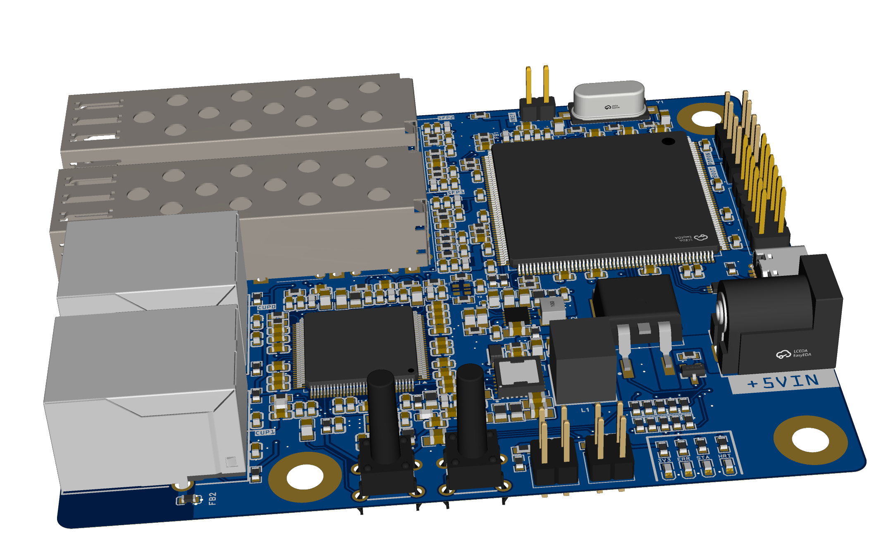
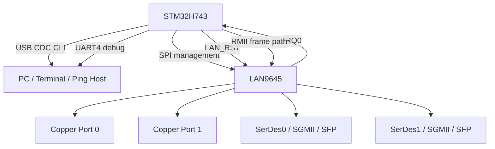
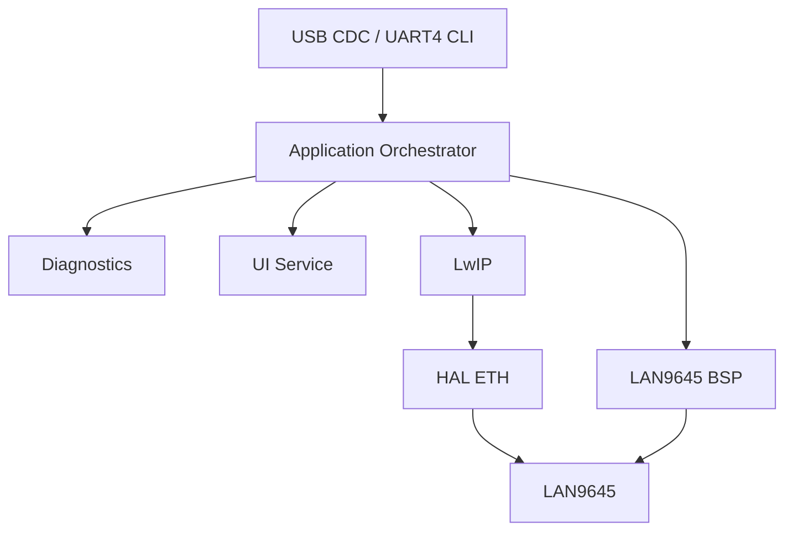
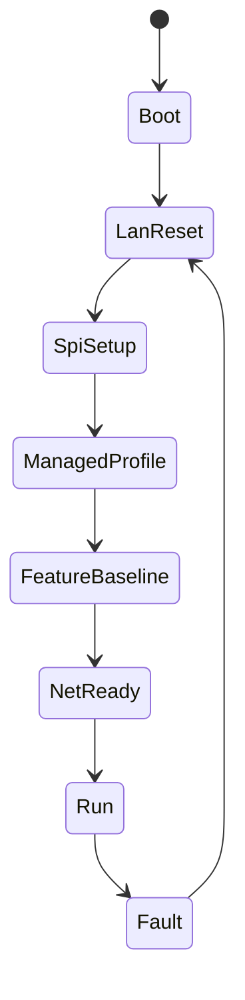
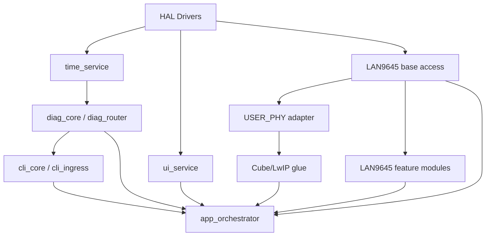
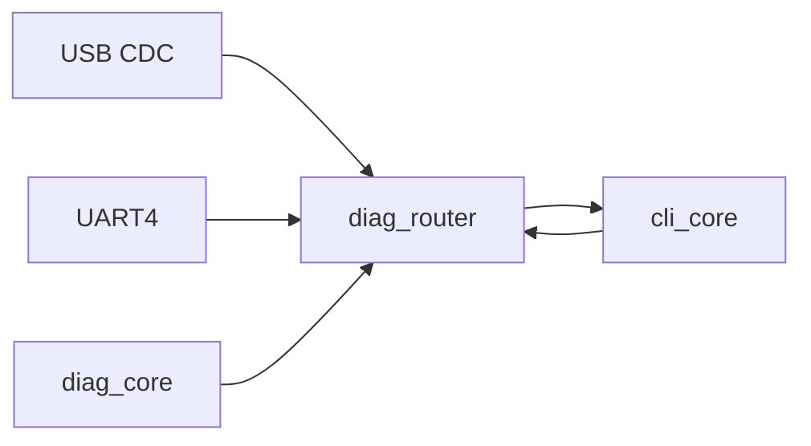
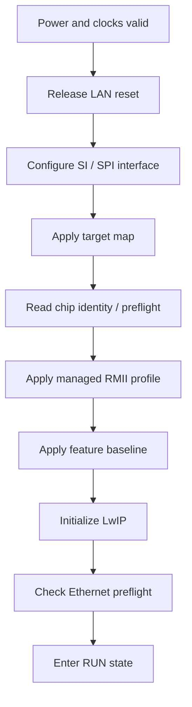

# Ethernet Switch Project Handbook

This repository contains a managed Ethernet switch platform built around a `LAN9645` switch and an `STM32H743` management MCU. The board is designed to expose two copper ports, two SerDes/SGMII paths, a CPU-facing RMII interface, SPI-based switch management, and a USB/UART-driven debug and CLI workflow.

This `README.md` is the main project handbook. It is written to stand on its own, without requiring the reader to open the design markdown files first.

## Current Status

| Area | Status |
|---|---|
| Hardware architecture | Defined |
| LAN9645 strap and pin plan | Defined |
| STM32 control/data/debug interface plan | Defined |
| Custom firmware architecture | Implemented in code baseline |
| HAL ETH + LwIP integration baseline | Implemented in code baseline |
| USER_PHY adapter path | Implemented in code baseline |
| CLI/diagnostics/runtime framework | Implemented in code baseline |
| Advanced LAN9645 feature module skeletons | Implemented in code baseline |
| Real board bring-up and ping validation | Not yet performed on hardware |
| Final target-base/register validation on LAN9645 silicon | Still required |

## Quick Navigation

- [1. Project Overview](#1-project-overview)
- [2. Board Images](#2-board-images)
- [3. System Architecture](#3-system-architecture)
- [4. Hardware Platform](#4-hardware-platform)
- [5. STM32H743 Interface Map](#5-stm32h743-interface-map)
- [6. Firmware Architecture](#6-firmware-architecture)
- [7. Runtime Execution Model](#7-runtime-execution-model)
- [8. Library Architecture](#8-library-architecture)
- [9. LAN9645 Control Surface](#9-lan9645-control-surface)
- [10. CLI, Diagnostics, LEDs, and Button](#10-cli-diagnostics-leds-and-button)
- [11. Bring-Up and Ping Test Procedure](#11-bring-up-and-ping-test-procedure)
- [12. Validation Status and Open Points](#12-validation-status-and-open-points)

## 1. Project Overview

### 1.1 Project Goal

The goal of this project is to build a managed switch board where:

- `LAN9645` performs Ethernet switching and port-domain control
- `STM32H743` acts as the management CPU and the CPU-side Ethernet MAC
- `SPI` is used for managed register access to the switch
- `RMII` is used for the CPU-facing Ethernet frame path between STM32 and LAN9645
- `USB CDC` is the main CLI/debug serial interface
- `UART4` is the secondary debug/serial interface

### 1.2 Locked Hardware Profile

| Item | Locked choice |
|---|---|
| Switch device | `LAN9645xS / LAN96459F` |
| Package | `128-pin TQFP` |
| Copper ports used | `CuPHY0`, `CuPHY1` |
| Copper policy for phase 1 | `10/100 Mbps` only |
| SerDes paths used | `SerDes0`, `SerDes1` |
| SerDes reference | external `125 MHz` oscillator |
| MCU | `STM32H743` |
| CPU Ethernet path | `RMII1` |
| Management path | `SPI` |
| Extra control lines | `LAN_RST`, `IRQ0` |

### 1.3 Design Intent

The board is intended to support two major classes of operation:

- basic bring-up and ping validation through the STM32 network stack
- long-term managed-switch control through a reusable LAN9645 firmware library

The first practical milestone is simple and strict:

1. bring the switch up in managed mode
2. configure the CPU-facing RMII path
3. make the STM32 respond to `ping`
4. inspect switch and PHY state through a serial CLI

## 2. Board Images

These two renders are included as the visual reference for the board layout and connector placement.



.png>)

Use the renders to orient:

- copper side
- MCU/debug side
- SerDes/SGMII side
- power and control side

## 3. System Architecture

### 3.1 High-Level View



### 3.2 Control Path vs Data Path

There are two independent but related paths in this project:

- control path:
  `STM32 -> SPI -> LAN9645 registers`
- Ethernet frame path:
  `STM32 ETH MAC <-> RMII <-> LAN9645 CPU-facing port`

That separation is important. The STM32 does not manage the switch by sending Ethernet control frames. It manages the switch through SPI while simultaneously using RMII as a normal Ethernet MAC interface for the CPU-side network stack.

### 3.3 Clocking Strategy

Two clock domains matter most:

- SerDes reference clock:
  external `125 MHz` oscillator into `LAN9645 S0_CLKP`
- RMII reference clock:
  LAN9645 provides the `50 MHz` RMII reference toward the STM32 in the selected internal-clock mode

This means:

- the `125 MHz` clock is for the LAN9645 SerDes side
- the RMII `ETH_REF_CLK` seen by the STM32 is driven from the LAN side, not from STM32 MCO

## 4. Hardware Platform

### 4.1 LAN9645 Hardware Summary

| Domain | Selected implementation |
|---|---|
| Managed mode | Yes |
| Management host | STM32 over SPI |
| CPU-facing Ethernet | `RMII1` |
| Active copper ports | `CuPHY0`, `CuPHY1` |
| Active SerDes ports | `SerDes0`, `SerDes1` |
| JTAG | disabled by strap |
| `SD_125M` | strapped high |
| `SGPIO_EN` | strapped low |

### 4.2 Copper and SerDes Use

| Port group | Usage |
|---|---|
| `CuPHY0` | active |
| `CuPHY1` | active |
| `SerDes0` | active |
| `SerDes1` | active |
| `DEV8` CPU-facing path | active for STM32 RMII |
| `DEV2`, `DEV3`, `DEV4`, `DEV7` | keep disabled during first bring-up |

For phase 1, copper is intentionally limited to `10/100 Mbps` advertisement and control. This keeps the first firmware path aligned with the STM32 RMII CPU link and with the current `USER_PHY` adapter policy.

### 4.3 LAN9645 Strap Configuration

The following table captures the important startup straps for the selected managed SPI configuration.

| Strap | GPIO / Pin | State at reset | Meaning in this project |
|---|---|---|---|
| `BOOT_MODE0` | `GPIO_24 / pin 70` | LOW | managed startup profile |
| `BOOT_MODE1` | `GPIO_25 / pin 68` | LOW | managed startup profile |
| `BOOT_MODE2` | `GPIO_26 / pin 67` | LOW | managed startup profile |
| `MGMT_MODE0` | `GPIO_27 / pin 66` | HIGH | SPI client management |
| `MGMT_MODE1` | `GPIO_28 / pin 65` | HIGH | SPI client management |
| `JTAG_ENB` | `GPIO_34 / pin 43` | HIGH | JTAG disabled |
| `SD_125M` | `GPIO_23 / pin 71` | HIGH | external 125 MHz SerDes reference selected |
| `SGPIO_EN` | `GPIO_22 / pin 72` | LOW | required low when `SD_125M=1` |

Additional straps are deliberately tied low for deterministic startup, including `LOOP_EN`, `GPIO_MODE0`, `GPIO_MODE1`, `SD_MODE0`, `SD_MODE1`, `XMII_MODE0`, `XMII_MODE1`, `EEPROM_SIZE`, `CUPHY_MODE`, `SFP_EN`, and unmanaged-feature-related pins that overlap GPIO/RMII/LED functions.

### 4.4 Strap Policy Notes

- `SD_125M` and `SGPIO_EN` are not STM32-controlled at runtime
- they are fixed by external resistor/jumper hardware and sampled at reset release
- firmware must treat them as startup preconditions, not as runtime settings
- if they are wrong at reset, software cannot repair the board configuration afterward

### 4.5 LAN9645 Functional Pin Assignment

#### Copper differential pairs

| Function | TQFP pins |
|---|---|
| CuPHY0 differential pairs | `102, 103, 105, 106, 108, 109, 110, 111` |
| CuPHY1 differential pairs | `112, 113, 114, 115, 117, 118, 120, 121` |

#### SerDes pins

| Function | TQFP pins |
|---|---|
| SerDes0 | `45, 46, 48, 49, 50` |
| SerDes1 | `53, 55, 56, 57` |

#### SPI management pins

| Signal | LAN9645 GPIO | TQFP pin |
|---|---|---|
| `SI_nCS` | `GPIO_2` | `98` |
| `SI_CLK` | `GPIO_3` | `97` |
| `SI_DO` | `GPIO_1` | `99` |
| `SI_DI` | `GPIO_0` | `100` |

#### CPU-facing RMII1 signal map

| STM32 ETH signal | LAN9645 RMII1 signal | LAN9645 GPIO | TQFP pin |
|---|---|---|---|
| `ETH_TXD0` | `RGMII1_RXD0` | `GPIO_4` | `95` |
| `ETH_TXD1` | `RGMII1_RXD1` | `GPIO_5` | `94` |
| `ETH_TX_EN` | `RGMII1_RXCTL_CRS_DV` | `GPIO_9` | `89` |
| `ETH_RXD0` | `RGMII1_TXD0` | `GPIO_12` | `85` |
| `ETH_RXD1` | `RGMII1_TXD1` | `GPIO_13` | `83` |
| `ETH_CRS_DV` | `RGMII1_TXCTL_TX_DV` | `GPIO_11` | `86` |
| `ETH_REF_CLK` | `RGMII1_TXC_REFCLK` | `GPIO_10` | `87` |

### 4.6 Copper LED Pin Usage

The selected copper LED outputs are:

| LED output | LAN9645 GPIO | TQFP pin | Notes |
|---|---|---|---|
| `PHY0_LED1` | `GPIO_43` | `31` | valid choice |
| `PHY0_LED0` | `GPIO_42` | `33` | valid choice |
| `PHY1_LED1` | `GPIO_41` | `34` | overlaps strap `XMII_MODE0` |
| `PHY1_LED0` | `GPIO_40` | `35` | overlaps strap `SD_MODE1` |

Important detail:

- `GPIO_40` and `GPIO_41` are both strap-overlap pins
- they are strapped low at reset, then reassigned to LED alternate function after boot
- this makes the choice valid, as long as the reset-time strap state is preserved

Recommended wiring model from the design notes:

- LAN PHY LED outputs are treated as active-low outputs
- LED anode goes to supply through resistor
- LED cathode goes to the LAN9645 LED pin

That LED polarity is separate from the STM32 board LEDs, which are active high.

### 4.7 Reset and IRQ

| Function | LAN9645 pin | Direction | Notes |
|---|---|---|---|
| `nRESET` | `101` | STM32 to LAN9645 | active low |
| `IRQ0` | `GPIO_33 alt / pin 60` | LAN9645 to STM32 | EXTI input on STM32 |

Reset sequence requirements:

1. external 125 MHz must already be present
2. straps must already be stable
3. STM32-side interfaces should not disturb strap pins during latch
4. LAN reset is released
5. SPI accesses begin only after the post-reset settling interval

## 5. STM32H743 Interface Map

### 5.1 Fixed STM32 Control and Debug Pins

| Function | STM32 pin / signal | Role |
|---|---|---|
| SPI NSS | `PA4` | LAN9645 `SI_nCS` |
| SPI SCK | `PA5` | LAN9645 `SI_CLK` |
| SPI MISO | `PA6` | LAN9645 `SI_DO` |
| SPI MOSI | `PD7` | LAN9645 `SI_DI` |
| LAN reset | `PD5` | drives `nRESET` |
| LAN interrupt | `PD6` | receives `IRQ0` |
| UART4 RX | `PI9` | secondary serial input |
| UART4 TX | `PA0` | secondary serial output |
| USB FS | `PA11`, `PA12` | USB CDC CLI/debug |
| HEART LED | `PG6` | active high |
| STATUS LED | `PG7` | active high |
| ERR LED | `PG8` | active high |
| USER button | `PI10` | active low |

### 5.2 STM32 Ethernet Signals

The STM32 uses its Ethernet MAC in RMII mode with the logical signals:

- `ETH_RXD0`
- `ETH_RXD1`
- `ETH_CRS_DV`
- `ETH_TX_EN`
- `ETH_TXD0`
- `ETH_TXD1`
- `ETH_REF_CLK`

The design does not depend on an external standalone PHY on MDIO/MDC. Instead:

- frame movement is handled through RMII to the CPU-facing LAN9645 port
- PHY-like state expected by STM32Cube/LwIP is bridged through the custom `USER_PHY` adapter

### 5.3 STM32 Role in the System

The STM32 owns:

- switch bring-up sequencing
- LAN reset control
- SPI register access
- CPU Ethernet path activation
- diagnostics routing
- CLI execution
- LED and button behavior
- ping test application behavior through HAL ETH + LwIP

## 6. Firmware Architecture

### 6.1 Locked Firmware Stack

| Layer | Selected implementation |
|---|---|
| MCU driver layer | `STM32Cube HAL` |
| Ethernet MAC/DMA | `HAL ETH` |
| IP stack | `LwIP` |
| LwIP mode | `NO_SYS=1` |
| PHY platform | `USER_PHY` |
| Switch management | custom `LAN9645` SPI-managed BSP |
| CLI primary channel | `USB CDC` |
| CLI secondary channel | `UART4` |

### 6.2 Phase-1 Network Profile

| Item | Value |
|---|---|
| STM32 IP | `192.168.10.50` |
| Netmask | `255.255.255.0` |
| Gateway | `0.0.0.0` |
| PC test host IP | `192.168.10.100` |

This profile is intentionally static and isolated. It avoids DHCP and avoids dependence on a router during first ping validation.

### 6.3 Firmware Responsibility Split



### 6.4 Current Firmware Baseline

The current codebase is aligned around these rules:

- `I-Cache` enabled
- `D-Cache` enabled
- ETH descriptors and RX pool placed in `RAM_D2`
- ETH DMA memory protected with a non-cacheable MPU region
- `MX_LWIP_Process()` is part of the runtime loop
- the diagnostics system is initialized before LAN bring-up
- default diagnostics/CLI owner is USB CDC
- the LAN9645 SPI clock is derived from the STM32 SPI kernel clock and prescaler, with fallback protection

### 6.5 Register Addressing Model

The firmware uses a layered address model:

- symbolic register tuples and masks in `lan9645_regs.*`
- address conversion through the SI/SPI protocol
- target-base resolution in `lan9645_target_map.*`

Important warning:

- target-base values are still treated as provisional until validated on real hardware
- that means syntax-correct firmware does not yet guarantee production-correct switch register access

### 6.6 SPI Management Transaction Format

The LAN9645 managed SPI path follows the SI client transaction model:

- `1 bit` read/write selector
- `23 bits` shifted SI address
- `32 bits` register payload

The address conversion rule used by the firmware is:

```text
SI_ADDR = (REG_ADDR & 0x01FFFFFF) >> 2
```

Important implementation notes:

- address bytes are sent in big-endian transaction order
- read operations may require padding bytes before valid data is returned
- padding becomes more important as SPI clock increases
- SPI timing and padding still need confirmation on the physical board

## 7. Runtime Execution Model

### 7.1 Main Application States

The application orchestrator uses these high-level states:

- `BOOT`
- `LAN_RESET`
- `LAN_SPI_TEST`
- `LAN_PROFILE_APPLY`
- `NET_READY`
- `RUN`
- `FAULT`

### 7.2 Boot Flow



### 7.3 Runtime Loop Responsibilities

The main loop is responsible for:

- `MX_LWIP_Process()` for no-RTOS network servicing
- diagnostics router polling
- LAN IRQ supervision and acknowledgement
- CLI command polling
- UART4 ingress feeding
- UI service polling
- button-triggered quick status dump

### 7.4 IRQ Handling Model

The interrupt path is intentionally split:

- ISR path:
  keep EXTI minimal and only latch the IRQ edge
- main-loop path:
  read LAN9645 IRQ registers, decode causes, report diagnostics, acknowledge events, and raise error indication if required

This keeps interrupt latency small and makes logging/reporting deterministic.

## 8. Library Architecture

### 8.1 Top-Level Dependency View



### 8.2 Infrastructure Libraries

| Library | Main role |
|---|---|
| `app_orchestrator` | high-level startup, runtime state, fault state, LAN IRQ supervision |
| `time_service` | uptime/RTC time source |
| `diag_core` | event IDs, counters, timestamps, last-context tracking |
| `diag_router` | routes formatted output to USB CDC and UART4 |
| `cli_core` | command parsing and dispatch |
| `cli_ingress` | byte-oriented CLI input staging |
| `ui_service` | HEART/STATUS/ERR LEDs and user button behavior |

### 8.3 LAN9645 Base Control Libraries

| Library | Main role |
|---|---|
| `lan9645_spi` | raw SPI transport, padding, retries, telemetry |
| `lan9645_reg` | read/write/rmw accessors |
| `lan9645_regs` | symbolic register and field definitions |
| `lan9645_target_map` | target-base mapping for register blocks |
| `lan9645_core` | core reset, SPI setup, port config, link/IRQ helpers |
| `lan9645_runtime` | shared runtime state and IRQ line monitor |
| `lan9645_profile_managed_rmii1` | board-specific managed profile |
| `lan9645_feature_matrix` | feature baseline application layer |
| `lan9645_stats` | counters/statistics access |
| `lan9645_user_phy_adapter` | bridges STM32 `USER_PHY` API to managed LAN9645 state |

### 8.4 LwIP and Cube Glue Files

| File | Role |
|---|---|
| `Core/Src/main.c` | top-level init and main loop glue |
| `LWIP/App/lwip.c` | LwIP init and static-IP setup |
| `LWIP/Target/ethernetif.c` | ETH netif glue, USER_PHY integration, runtime link state |
| `LWIP/Target/eth_custom_phy_interface.c` | Cube `USER_PHY` platform layer |
| `Core/Src/stm32h7xx_hal_msp.c` | low-level ETH/SPI/UART peripheral pin and clock setup |

### 8.5 LAN9645 Feature Modules

The advanced feature libraries are present to mirror major LAN9645/Linux reference domains. They are part of the software control surface even though hardware validation is still pending.

| Library | Feature domain |
|---|---|
| `lan9645_afi` | automatic frame injection / AFI control |
| `lan9645_bum` | broadcast, unknown, multicast flood policy |
| `lan9645_cbs` | credit-based shaper |
| `lan9645_cut_thru` | cut-through forwarding policy |
| `lan9645_dcb` | data-center bridging related controls |
| `lan9645_eee` | energy efficient Ethernet controls |
| `lan9645_fp` | frame preemption |
| `lan9645_hsr_prp` | HSR / PRP redundancy support |
| `lan9645_lag` | link aggregation |
| `lan9645_mac` | MAC-side policy helpers |
| `lan9645_manual_inj` | manual frame injection support |
| `lan9645_mdb` | multicast database policy |
| `lan9645_mirror` | port mirroring |
| `lan9645_mrp` | media redundancy protocol |
| `lan9645_npi` | network processor interface / conduit policy |
| `lan9645_phylink` | phylink-style CPU/port link coordination |
| `lan9645_police` | policing |
| `lan9645_psfp` | per-stream filtering and policing |
| `lan9645_ptp` | precision time protocol support |
| `lan9645_qos` | QoS trust, rewrite, mapping |
| `lan9645_stream` | stream handling |
| `lan9645_taprio` | TAPRIO / time-aware scheduling |
| `lan9645_tbf` | token-bucket shaping |
| `lan9645_tc_flower` | classifier control path modeled after tc-flower |
| `lan9645_tc_matchall` | classifier control path modeled after tc-matchall |
| `lan9645_vcap` | VCAP / ACL-style hardware classification |
| `lan9645_vlan` | VLAN membership and tagging policy |

## 9. LAN9645 Control Surface

### 9.1 Fixed-by-Hardware vs Runtime-Controlled

| Domain | Controlled by hardware strap | Controlled by STM32 firmware |
|---|---|---|
| `BOOT_MODE[2:0]` | Yes | No |
| `MGMT_MODE[1:0]` | Yes | No |
| `JTAG_ENB` | Yes | No |
| `SD_125M` | Yes | No |
| `SGPIO_EN` | Yes | No |
| LAN reset | No | Yes |
| SPI SI configuration | No | Yes |
| RMII path mux and enable | No | Yes |
| copper PHY advertisement/policy | No | Yes |
| SerDes mode and enable | No | Yes |
| VLAN/QoS/ACL features | No | Yes |
| IRQ reporting and clear | No | Yes |
| counters and diagnostics | No | Yes |

### 9.2 Baseline Controllable Domains

These are the most important domains for first functional bring-up:

- SPI transport and SI interface timing
- global switch identification and reset handling
- CPU-facing RMII interface enable and status
- copper port admin state and link policy
- USER_PHY compatibility path for LwIP
- basic counters and diagnostics
- CLI-visible error reporting

### 9.3 Advanced Controllable Domains

The software architecture is already organized around the following long-term domains:

- VLAN
- QoS
- policing
- shaping
- AFI
- PTP
- PSFP
- VCAP
- mirror
- MDB
- LAG
- HSR/PRP
- MRP
- phylink
- frame preemption
- cut-through
- NPI

### 9.4 Practical Meaning of “Full Control”

For this project, “full control” means the STM32 can eventually:

- read and write switch registers deterministically over SPI
- apply a known startup profile
- expose feature-domain APIs rather than raw register magic in application code
- route state, faults, and counters to a serial CLI

It does not mean every domain is already bench-proven. The codebase is structured for that full control surface, but hardware execution is still required to lock final correctness.

## 10. CLI, Diagnostics, LEDs, and Button

### 10.1 Serial Policy

The intended serial/debug behavior is:

- `USB CDC` is the primary CLI/debug path
- `UART4` is the secondary serial/debug path
- diagnostics are routed through the router layer rather than printed directly by low-level libraries

Current startup behavior in code:

- diagnostics owner is set to `USB`
- UART4 remains enabled as secondary ingress/output support

### 10.2 CLI Focus

The CLI is intended to cover:

- status overview
- error/status counters
- LAN identification and preflight
- register read/write
- port state inspection
- link inspection
- feature-domain control as each feature becomes mature enough

### 10.3 Diagnostics Model

All important failures are normalized into event IDs and routed through the same diagnostics path. Examples include:

- SPI timing/transport faults
- LAN IRQ problems
- drop alerts
- LAN feature configuration failures
- link/path failures

Recommended log style:

```text
[timestamp][level][module][event_id] message
```

### 10.4 LED Behavior

STM32 board LEDs are active high.

| LED | Pin | Intended behavior |
|---|---|---|
| HEART | `PG6` | heartbeat / firmware alive |
| STATUS | `PG7` | LAN/network ready indication |
| ERR | `PG8` | error indication |

### 10.5 User Button Behavior

| Input | Pin | Polarity | Intended use |
|---|---|---|---|
| USER button | `PI10` | active low | quick status trigger and recovery-oriented actions |

Current phase-1 intent:

- short press:
  print system status
- long press:
  trigger LAN-side re-initialization flow

### 10.6 IO Routing Diagram



## 11. Bring-Up and Ping Test Procedure

### 11.1 Preconditions Before Firmware Bring-Up

Before expecting software success, the hardware must satisfy all of these:

1. power rails valid
2. external `125 MHz` SerDes reference valid
3. straps fixed to the managed SPI profile
4. `SGPIO_EN=0` while `SD_125M=1`
5. `LAN_RST` wiring valid
6. SPI wiring valid, including `MISO`
7. RMII wiring valid
8. `IRQ0` line wired and readable

### 11.2 Mandatory Bring-Up Order



### 11.3 Ping Test Setup

Use the locked phase-1 static IP plan:

| Device | IP | Netmask | Gateway |
|---|---|---|---|
| STM32 board | `192.168.10.50` | `255.255.255.0` | `0.0.0.0` |
| PC test host | `192.168.10.100` | `255.255.255.0` | `0.0.0.0` |

### 11.4 Expected Ping Matrix

| Test | Physical path | Expected result |
|---|---|---|
| A | PC to copper port 0 | ping STM32 IP |
| B | PC to copper port 1 | ping STM32 IP |
| C | link partner to SerDes0 path | ping STM32 IP |
| D | link partner to SerDes1 path | ping STM32 IP |

### 11.5 Minimum Bring-Up Checks from CLI

Before running ping, the user should be able to confirm:

- switch communication path is alive
- LAN profile applied
- CPU-facing link ready
- no immediate transport or IRQ faults
- counters are readable

Typical command families to expect:

- `status all`
- `status errors`
- `lan id`
- `lan check`
- `link show`
- `phy show`
- `spi status`
- `reg read`

## 12. Validation Status and Open Points

### 12.1 What Is Already True in the Repository

- the project is already organized as a managed-switch firmware stack
- the root boot path initializes diagnostics before LAN configuration
- the LAN9645 SPI/register/core/profile layers are integrated into `main.c`
- the STM32 uses `HAL ETH + LwIP`
- the no-RTOS `MX_LWIP_Process()` style runtime path is part of the design
- a `USER_PHY` compatibility layer exists to bridge Cube-generated expectations to LAN9645 managed state
- advanced feature modules are present in the codebase as software-side control domains

### 12.2 What Still Needs Real Board Validation

- final target-base correctness in `lan9645_target_map`
- reliable SPI padding and timing on the real board
- successful RMII bring-up on the CPU-facing port
- successful ping through copper port 0
- successful ping through copper port 1
- successful ping through SerDes0
- successful ping through SerDes1
- IRQ source read/clear behavior on real silicon
- runtime counter behavior under actual traffic

### 12.3 Important Current Risk

The most important current risk is not general code structure. It is hardware-truth validation of the LAN9645 register addressing model:

- symbolic register definitions are centralized
- SPI transport is implemented
- target-base mapping is still the part that must be proven against the real device

Until that validation is complete, the firmware should be treated as:

- software-integrated
- bring-up-oriented
- bench-validation pending

### 12.4 Readiness Summary


## Closing Notes

This repository already contains the important split needed for the project:

- hardware choices are locked enough to explain wiring, strap state, clocks, LEDs, and interface ownership
- firmware choices are locked enough to explain the stack, runtime flow, libraries, and test strategy

The next practical milestone is not more architecture planning. It is physical validation:

1. confirm LAN9645 register base mapping on the real board
2. confirm RMII and SPI stability
3. run the ping matrix
4. then tighten feature-by-feature validation on top of that baseline
